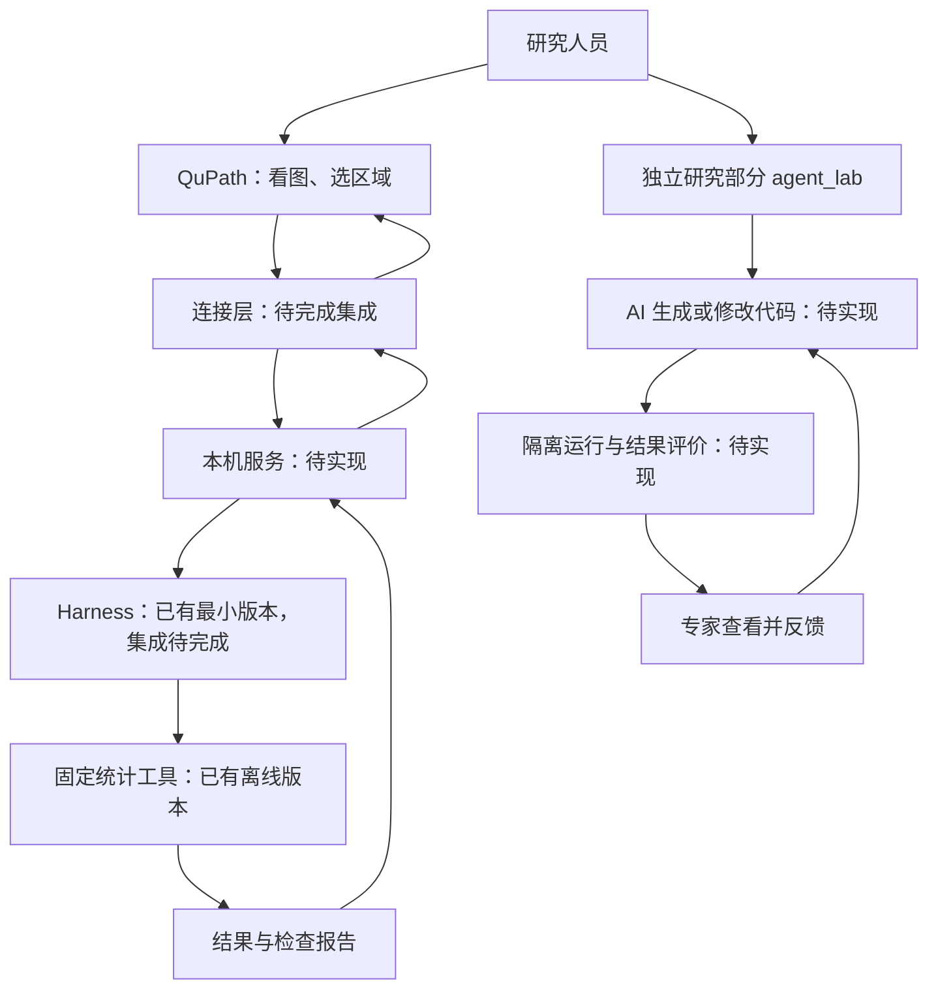

# 从零看懂我们的 Agent 架构

整理日期：2026-10-20。依据当前代码和项目设计文档编写。

这份文档不要求你懂编程。先看懂每个部分负责什么，再看它们怎样一起完成任务。架构就是这些部分的分工和连接方式。

开会前时间不多，可以先读第 1、3、10、11 节。

## 1. 先记住这三句话

2026-10-24 已写出第一版：人在 QuPath 手动运行固定脚本，读取一个选区、检测／复用细胞、测量五个 marker，再交给 Harness 输出数量、初步性状和逐细胞依据。安装版合成图已跑通，75 项 Python 测试通过；真实切片留待下一次人工验收。这还没有接模型或 PathPilot 面板，也没有执行模型生成的代码。操作见 [测试指南 §9](TESTING_GUIDE.md#9-本周-roi-计数与初步性状首版2026-10-24)。

**QuPath 是用户的主工作台，也是真正执行图像分析、查看和复核结果的地方。**

**我们想做的 Agent，主要负责根据要求写和修改分析代码。**

**Harness 负责管理任务，限制能做什么，安排检查，并保存过程记录。**

2026-10-23 已把这个分工明确写入架构：安装版位于 `F:\QuPath-0.7.0`，先在它的 Script Editor 完成单 ROI 手写计数基线，再接自然语言／Groovy 和 PathPilot 风格面板。PathPilot 是源码资源，当前安装版 GUI JAR 中没有该面板类，不能视为已经接通。Python 继续承担编排、记录、核验、参考与实验支持，不要求把真实图像分析全部搬出 QuPath。

Harness 的边界要由程序落实：只允许已注册工具和绑定的图像／ROI；执行前检查参数、效果、授权及预算；QuPath 真正执行前再复检。未知工具、想扩大到全片、未授权写入或输入已变化，都应在执行前拒绝；生成的任意 Groovy 还要有独立的运行隔离。现有 H0 只实现其中一部分，完整实施及已有代码位置见 [frame.md §1.6](frame.md#16-harness-如何实际约束-agent-的边界)。

整个项目想达到的效果，可以用一个例子理解：

> 研究人员说：“这个区域里的细胞核有些粘在一起，能不能改一下检测方法？”
>
> AI 根据具体要求修改分析代码。系统在受限制的环境中运行，检查结果，再让研究人员查看。如果仍然不合适，就带着修改意见继续调整。

这是**希望最终实现的过程**。目前还没有接上模型，也没有把这条过程从头到尾做通。

现在已经能运行的，主要是固定统计、任务管理，以及代码和反馈的保存与检查。

## 2. Agent、模型、工具，到底有什么区别

### 2.1 模型：负责理解和生成内容

大语言模型，也叫 LLM，可以理解文字要求、提出方案、生成代码。

但模型给出一段代码，并不意味着这段代码已经运行，更不意味着结果正确。运行和检查需要另外的程序来完成。

当前项目还没有连接具体模型，也不涉及我们自己训练一个病理大模型。

### 2.2 工具：负责完成一个具体操作

工具就是一段已经写好的功能。例如：

- 读取一份细胞类别名单。
- 统计其中有多少个 CD8 阳性对象。
- 检查结果文件有没有损坏。

工具本身不一定包含 AI。一个普通 Python 统计函数也可以被包装成工具。

### 2.3 Agent：围绕任务使用模型和工具的程序

在我们想实现的系统中，Agent 会利用模型理解要求、生成或修改代码，再通过规定好的步骤使用工具。

可以粗略理解为：

```text
模型提供理解和生成能力
工具提供具体操作能力
Agent 围绕任务组织这些能力
Harness 管理这项工作怎样进行
```

当前代码虽然已经有名叫 `Agent` 的定义，但它只记录身份和允许使用的工具。演示也是按固定步骤调用工具，尚未实现模型参与的反复处理过程。

**当前在对话里帮你查看文件、修改代码的助手，与项目里正在开发的 Agent，是两个不同的程序。** 我能读切片信息，不代表项目里的 Agent 已经接好了这个功能。

## 3. 整个架构由哪些部分组成

先认识下面六个部分。英文名字只是方便以后在代码和老师的讨论里对应，不需要背。

| 部分 | 通俗解释 | 目前做到哪一步 |
|---|---|---|
| QuPath | 查看切片、选择区域、运行图像分析的软件 | 软件可以使用；我们项目与它的完整连接尚未完成 |
| Java Adapter，连接层 | 把 QuPath 里的图像信息、选中区域和已有对象整理出来，并展示返回结果 | 有设计和接口探测材料，尚未完成真实集成 |
| `agent_service`，本机服务 | 在电脑上接收 QuPath 请求，把任务交给 Python 程序，再返回结果 | 目前主要是设计，服务尚未实现 |
| `harness_core`，任务管理部分 | 检查能用哪些工具，管理运行步骤，保存任务与结果记录 | 有能运行的简化版本 |
| `agent_core`，固定分析部分 | 按已经写好的明确规则做统计，并检查输入和结果 | 已有离线统计功能，当前演示用模拟数据 |
| `agent_lab`，代码研究部分 | 保存分析要求、待测试代码和反馈；以后接 AI 写代码与隔离运行 | 保存和检查功能已实现；模型调用和待测试代码运行尚未实现 |

### 3.1 已经能运行的流程

当前有两组独立的离线演示。这里“离线”指在本地文件和终端里操作，没有连接 QuPath 界面或模型服务。

```text
演示 A：固定统计

启动命令
   ↓
Harness 管理任务
   ↓
固定统计工具读取内置模拟名单
   ↓
计算并检查结果
   ↓
保存结果文件和任务记录


演示 B：代码与反馈记录

读取内置的像素例子、两版代码和修改意见
   ↓
agent_lab 保存任务、输入、代码和反馈
   ↓
检查代码结构、文件完整性和版本关系
   ↓
保存检查报告，代码仍未运行
```

这两组演示不是一前一后的完整 AI 工作流。它们分别验证已经做好的基础功能。

### 3.2 希望最终接通的架构

下面画的是设计目标，框内标注了尚未完成的连接。



上面有两条工作路线：**使用已检查过的固定工具**，以及**研究 AI 如何写和修改代码**。下一节解释为什么分开。

## 4. 为什么要分成两条路线

### 4.1 固定工具路线：完成已经明确的计算

例如，QuPath 已经检测并分类了一批细胞，研究人员想知道：CD8 阳性有多少，占多少比例？

这时主要工作是读取已有类别，按确定规则计算。使用写好的统计程序就能完成，不需要每次重新让 AI 写一个计算函数。

未来可以增加自然语言入口，把“帮我统计 CD8 比例”转换成明确任务，再调用固定工具。这个入口目前还没实现。

### 4.2 代码研究路线：尝试解决现有分析不合适的问题

例如，换了一批切片，原来的细胞核检测方法出现了漏检。我们希望研究人员描述问题后，AI 能调整参数、组合已有方法，或修改分析代码。

新代码先作为待测试材料保存，再经过检查、隔离运行、结果比较和人工复核。

这条路线是项目的主要研究方向，目前尚未完成。

**新生成的代码不会因为一次检查通过，就自动进入 QuPath 执行。** 将来如果要变成固定工具，还需要人工检查代码、固定版本、注册和测试。

## 5. 用一个统计例子，走一遍当前流程

当前演示准备了一份模拟对象名单：

| 类别 | 对象数量 |
|---|---:|
| 仅标为 CD8 | 2 |
| 仅标为 PD-L1 | 1 |
| 同时标为 CD8 和 PD-L1 | 1 |
| 阴性 | 1 |
| 没有分类 | 1 |
| 杂点或不参与分析的对象 | 1 |

合计 7 个对象。这些标签都是提前写好的。

### 第一步：明确怎么算

演示规则规定：没有分类的对象和杂点不参与比例计算。

所以分母是 `7 − 1 − 1 = 5`。

这类规则叫 `SemanticsProfile`，可以理解成“统计口径说明”：哪些算进去、哪些排除、比例的分母是什么。

目前这份规则只是模拟测试用的草案，还不能直接作为真实病理分析标准。

### 第二步：任务管理部分安排运行

Harness 检查这次能不能使用统计工具，建立任务记录，再按规定步骤调用工具。

目前它调用的是固定工具，未调用 AI 模型。

### 第三步：固定程序计算

- CD8 数量：2 个单阳性 + 1 个双阳性 = 3 个，比例为 `3 ÷ 5 = 60%`。
- PD-L1 数量：1 个单阳性 + 1 个双阳性 = 2 个，比例为 `2 ÷ 5 = 40%`。
- 双阳性数量：1 个，比例为 `1 ÷ 5 = 20%`。

演示还给定了一个面积为 2 mm² 的合成区域，用来检查面积和密度计算。

### 第四步：检查并保存

程序检查输入是否对应、数据是否完整、结果是否符合已写好的规则，然后保存结果和任务状态。

文件中的 `REPORT_READY` 表示任务结果已准备好。它不能说明上游细胞分类已经被证实正确。

**这组演示证明的是给定名单后的统计流程，没有验证从真实图像识别细胞的能力。**

## 6. 我手里的真实切片，应该接在什么位置

真实切片要先经过图像分析，才能变成上面那份“对象名单”。

```text
你的病理切片
     ↓
QuPath 读取图像、通道和像素大小
     ↓
选择分析区域
     ↓
运行检测方法，得到细胞核或细胞对象
     ↓
测量各通道强度，按确认过的规则分类
     ↓
导出对象名单、区域和相关信息
     ↓
转换成我们统计程序需要的输入格式
     ↓
固定统计与检查
```

每类信息的来源不同：

| 信息 | 怎样获得 |
|---|---|
| 图像尺寸、通道、像素大小 | 从图像文件读取 |
| 分析区域 | 由人选定，或按另外定义的方法生成；当前入门测试先手动画 |
| 细胞核位置和轮廓 | 运行检测或分割方法后得到，需要核对质量 |
| 各通道强度 | 在检测对象对应的图像区域里测量 |
| CD8 等标记的阳性类别 | 先确认染色对应关系，再使用经过复核的分类规则 |
| 统计分母和排除规则 | 由任务要求决定，需要与老师明确 |
| 数量、比例和密度 | 固定统计程序计算 |

目前已经在本地读取了你三张 `.qptiff` 的元数据和缩略图，确认有 DAPI、五个 Opal 通道和 Sample AF，像素大小约 0.5 μm。

**这次读取是通过独立的本地工具完成的，尚未接入 QuPath—Agent 的自动流程。** 当前还没有真实片子的细胞检测结果。

现有统计入口也不是通用图像入口：它接收符合约定格式的对象类别表和区域信息。当前演示规则会拒绝真实数据；还需要明确正式规则，并补上 QuPath 数据导出和转换。

关于在 QuPath 中检测、分类和导出的操作，可参考官方的[多通道分析教程](https://qupath.readthedocs.io/en/stable/docs/tutorials/multiplex_analysis.html)和[测量结果导出教程](https://qupath.readthedocs.io/en/stable/docs/tutorials/exporting_measurements.html)。

## 7. 将来 AI 写代码时，各部分怎样配合

以“改善一个小区域的细胞核检测”为例。以下是工作方式示意，任务和评价方法仍需确认。

1. **人说明任务。** 明确输入区域、使用哪个通道、要输出什么，以及哪些方法可以用。
2. **准备模型输入。** 只整理这次允许使用的任务材料。独立参考答案保留在评价一侧，不一起发给写代码的模型。
3. **AI 写第一版代码。** 先保存成一个待测试版本，记录它对应的任务和输入。
4. **检查代码。** 检查格式、接口和允许使用的操作。通过这些检查，只表示可以继续后面的验证。
5. **在隔离环境运行。** 给定获准输入，限制运行时间、内存和访问范围，保存实际输出或失败原因。
6. **比较结果。** 和独立标注或参考方法比较，再请专家查看。
7. **根据意见修改。** 保存明确反馈、第二版代码和新的结果，比较修改前后是否改善。

例如，“几个细胞核粘在一起了”是问题描述。还需要明确是哪一处、希望怎样分开、允许改哪些参数，才能形成可检查的修改要求。

当前 `agent_lab` 已经可以保存任务、输入、代码、反馈和版本关系，也能导入外部代码文本、检查文件完整性、准备首次模型输入。

**后面的模型生成、隔离运行和实际效果比较还没有实现。** 现有两版代码演示和反馈都是人工材料，不是 AI 自动完成的修订。

## 8. “可控”具体体现在哪里

可控需要落实到程序规则和记录，不能只在提示词里告诉 AI“请小心”。

| 要控制什么 | 怎样控制 | 当前情况 |
|---|---|---|
| 做哪个任务 | 输入、目标、规则要明确，不符合约定就拒绝 | 已有模拟任务的检查 |
| 能用哪些工具 | 只允许调用预先登记、当前任务获准使用的工具 | 最小版本已有 |
| 运行顺序 | 由程序规定任务步骤，不能由模型随意跳过 | 固定演示已有；模型参与的流程待做 |
| 测试的是哪一版 | 保存代码、输入和反馈的对应关系，不覆盖旧版本 | 离线记录已有 |
| 是否实际运行 | 明确记录未运行、运行失败和运行成功 | 当前待测试代码都标为未运行 |
| 代码可以访问什么 | 在验证过的隔离环境里限制文件和资源访问 | 尚未完成验证，当前不运行待测试代码 |
| 结果是否可靠 | 程序检查、独立参考比较和专家复核分别进行 | 已有基础程序检查，正式效果评价待做 |
| 是否修改 QuPath 项目 | 将来把查看结果与批准写入分开处理 | 写回和恢复尚未完成 |

需要分清四件事：

```text
记录完整 → 说明材料没有缺失或对应错
结构检查通过 → 说明代码符合当前检查要求
运行成功 → 说明这次程序确实执行完了
分析结果正确 → 还需要参考结果和专业复核
```

前一项通过，不能自动推导出后一项也通过。

## 9. 单 Agent 和多 Agent，怎么理解

单 Agent 可以理解为一个 AI 工作角色负责理解任务和写代码，再根据检查与反馈修改。

多 Agent 则把工作分给多个角色。例如，一个整理任务，一个写代码，另一个帮助检查思路。**这是可能的分工示意，目前没有实现这些角色。**

多个 Agent 不一定要用不同模型，也不一定同时运行；同一个模型配上不同任务说明，也能承担不同角色。这里的关键是工作怎样分配，以及是否有实际收益。

无论有几个 Agent，程序检查和人工复核都需要保留，不能用“另一个 AI 说没问题”代替验证。

我们当前只有一个按固定步骤调用工具的 Agent 演示。后续准备先把单 Agent 的生成、运行和修改过程做通，再按题目要求增加多 Agent，并在相同任务和可比预算下比较。

## 10. 现在究竟做到哪了

| 内容 | 当前状态 | 能说明什么 |
|---|---|---|
| 固定统计程序 | 已有离线实现 | 能对给定类别名单按规则计算和检查 |
| 最小 Harness | 已实现 | 能管理固定任务、权限、状态和保存记录 |
| 代码和反馈记录 | 已实现 | 能对应任务、输入、代码版本和修改意见 |
| 外部代码导入与文件检查 | 已实现 | 能检查代码文本及其保存记录，不能证明代码安全或结果正确 |
| 准备模型输入 | 已实现首次输入整理 | 能生成任务 JSON 文件，尚未发送给模型 |
| AI 模型调用与自主处理 | 未实现 | 当前没有真实的模型生成记录 |
| 新代码隔离运行 | 未完成 | 待测试代码始终未运行 |
| 专家反馈后的实际效果比较 | 未完成 | 当前不能报告修订带来的提升 |
| QuPath 完整连接 | 未完成 | 不能在软件内完成整个流程 |
| 多 Agent | 未实现 | 角色分工和最低要求需确认 |
| QuPath 写回与故障恢复 | 主要处于设计阶段 | 不能承诺自动修改、保存或恢复项目 |

已有记录显示，Windows 下两个 Python 环境分别通过了同一套 71 项程序测试，并做过安装后检查。这是软件功能的证据，不是病例数量或病理准确率。具体记录见[开发交接](docs/gpt-five-hour-handoff.md)。

### 第一阶段为什么有用

它先解决了“任务能否按规则运行、结果能否核对、过程能否查清”的基础问题。

但固定统计本身不足以回答整个研究问题。后面需要真正让模型写代码、运行、收到反馈再修改，并测量结果和人工成本。

## 11. 和老师沟通时，可以这样讲

### 一分钟介绍

> 老师，我现在把系统分成几个部分：QuPath 用来看图、选区域和展示分析结果；Python 负责分析和检查；Harness 管理任务步骤、权限和记录；另外单独保留一部分，用来研究 AI 写代码和根据反馈修改代码。
>
> 目前已经完成固定统计、最小任务管理，以及代码和反馈记录。现有演示还是模拟数据，没有接模型，也没有执行 AI 生成的代码，真实 QuPath 连接还没完成。
>
> 下一步我想选一个小任务，把模型生成、隔离运行、结果检查和反馈修改做通。真实切片已经有了，希望和您确认先做什么、用什么参考判断对错，以及多 Agent 最低需要做到什么程度。

### 老师可能追问什么

| 老师问 | 可以怎样回答 |
|---|---|
| “AI 在哪里？” | “目前还没接模型，先完成了任务管理、固定统计和代码记录。模型生成与修改是下一步要补上的核心部分。” |
| “Harness 和 Agent 有什么区别？” | “Agent 负责完成任务，Harness 负责规定能用什么工具、怎样运行、怎么检查和保存记录。Harness 本身不是模型。” |
| “为什么还要固定统计？” | “有些计算规则已经明确，交给固定程序更容易检查。AI 主要研究怎样生成或修改分析代码，二者分工不同。” |
| “现在能用真实片子了吗？” | “已经读取了片子的通道、尺寸和预览。还需要做实际检测、明确分类规则，再接上数据导出和输入转换。” |
| “这和用中文操作 QuPath 有什么区别？” | “中文操作可以作为入口，但主要想研究的是根据分析要求写代码、运行检查，并根据专家意见调整方法。” |
| “为什么不直接运行新代码？” | “先把代码保存并检查，再在验证过的隔离环境里运行，这部分还没有完成。” |
| “为什么需要多 Agent？” | “需要结合题目确认最低分工要求，再和单 Agent 比较效果与成本，不能只凭角色多就判断更好。” |
| “你的研究贡献是什么？” | “准备研究明确要求、程序检查和专家反馈，是否能让 AI 写出的分析代码更可靠、减少人工修改。目前还在做基础，结论需要实验。” |

### 这次最需要确认的事情

1. **先做哪个小任务？** 比如细胞核计数或区域面积，不一次包下所有分析。
2. **怎样判断对错？** 有什么人工标注或独立参考，主要看哪个指标，谁来复核。
3. **数据和染色说明是否齐全？** Opal 通道对应哪些标记，允许怎样使用这些材料。
4. **反馈希望解决什么问题？** 请老师给一个具体失败例子和可接受的修改范围。
5. **下次交付什么？** 单个任务的研究演示、多 Agent 分工和 QuPath 展示，先后顺序怎样安排。

## 12. 遇到术语时，查这张表

| 术语 | 通俗解释 |
|---|---|
| 架构 | 系统有哪些部分，各自做什么，怎样连接 |
| LLM | 大语言模型，提供理解文字和生成内容的能力 |
| CV | 计算机视觉，用程序处理和分析图像 |
| ROI | 本次选定的图像区域 |
| 分割 | 找出对象的位置和边界，例如每个细胞核的轮廓 |
| 分类 | 给对象一个类别，例如某个标记阳性 |
| Adapter | 连接两边程序、转换数据的部分 |
| API | 程序之间约定好的调用方式；探测到接口可用，不代表完整功能已接好 |
| TaskSpec / ResearchSpec | 一次任务的说明，写清输入、输出和要求 |
| SemanticsProfile | 分析与统计口径，比如排除谁、分母是什么 |
| Harness Profile | 工程配置，比如这一运行方式能用哪些工具；与统计口径不是同一件事 |
| Candidate | 一份准备检查和测试的代码，还不是已经验证好的工具 |
| Preflight | 运行之前的检查；当前研究侧主要检查代码结构和记录关系 |
| Sandbox / 隔离环境 | 限制实验代码访问范围和资源的运行环境 |
| Artifact | 保存下来的结果、报告或其他任务文件 |
| Audit | 过程记录，方便查到一次任务做了什么 |
| Hash / 摘要 | 根据文件内容计算的一串标识，用来核对内容有没有变化，不代表内容正确 |
| JSON / CSV | 保存数据的文本格式，一个适合结构化记录，一个适合表格 |
| 插件 | 在程序中登记的一组功能；项目里的插件注册不等于已经拥有完整插件市场 |
| L0 / L1 / L2 / L3 | 设计文档对不同检查环节的编号，大致涉及任务输入、源码、运行结果及人工审查；不能因为编号存在就当作已经全部实现 |

## 13. 想对应到代码时，再看这里

不用现在读源码。这张表只帮助你在讨论中找到对应位置。

| 想了解什么 | 对应文件 |
|---|---|
| 当前固定统计怎样启动 | [agent_core 入口](qupath-agent/agent_core/__main__.py) |
| 数量、比例和密度怎样计算 | [统计实现](qupath-agent/agent_core/analysis.py) |
| 当前演示怎样登记 Agent 和工具 | [Harness 演示入口](qupath-agent/harness_core/__main__.py) |
| 任务怎样运行、记录和保存 | [Harness 运行实现](qupath-agent/harness_core/runtime.py) |
| 两版代码与反馈怎样生成演示记录 | [agent_lab 入口](qupath-agent/agent_lab/__main__.py) |
| 怎样检查研究记录和整理模型输入 | [研究检查实现](qupath-agent/agent_lab/preflight.py) |

本入门文档对应的技术资料：[系统架构设计](frame.md)、[Harness 架构设计](cancer-harness-architecture.md)、[研究方向说明](docs/adr/0005-controlled-coding-research.md)、[开发路线](docs/implementation-roadmap.md)。

实际运行方法见[测试指南](TESTING_GUIDE.md)；详细会议准备见[阶段成果与导师沟通指南](阶段成果与导师沟通指南.md)。

## 14. 看板和动画以后怎样更新

直接打开[项目进度看板.html](项目进度看板.html)，可以看到我们现在走到哪里，以及下一步需要什么。页面里有三个可以播放或逐步查看的场景：固定统计、代码记录与检查、真实切片读取。

这些动画是把已有功能讲清楚，不会真的调用模型、运行分析或修改切片。例如，统计动画会演示怎样从 7 个模拟对象算出 CD8 为 60%；代码检查动画会明确停在“代码还没运行”的地方。

**以后每次完成影响能力或进度的工作，负责开发的我或其他开发者都要顺手更新这份 HTML，不需要你每次提醒。** 更新内容包括当前阶段、已经完成什么、还缺什么、实际证据和动画停止的位置。

这是开发时同步维护的约定。浏览器页面本身不会自动扫描文件，也不会因为你按了“播放”就把项目标成完成。具体维护规则已经写进[系统架构第 17 节](frame.md#17-本地进度看板与能力动画维护)。

看板里的“文档阅读室”入口会打开独立的[项目文档页面](项目文档.html)：当前目录里的 Markdown 正文都放在里面，按用途分组。你可以先搜索关键词、选择文档，再展开章节目录，直接阅读表格和代码。文档之间的引用也可以在阅读区内跳转。

阅读页有“下载当前 MD”和“打包下载全部 MD”按钮。选中文档后，前一个按钮下载这份 Markdown，后一个按钮下载包含全部 Markdown 的 ZIP。即使只保存文档页这一份 HTML，也可以离线阅读和下载。

以后改了这些 Markdown，开发者会运行 `python scripts/update_dashboard_docs.py` 同步正文、下载内容和主页入口，再检查快照是否与源文件一致。原始 MD 仍然保留，网页只是方便阅读的副本；旧会议和学习材料里的历史说法，也会保留并注明需要结合当前进度理解。
