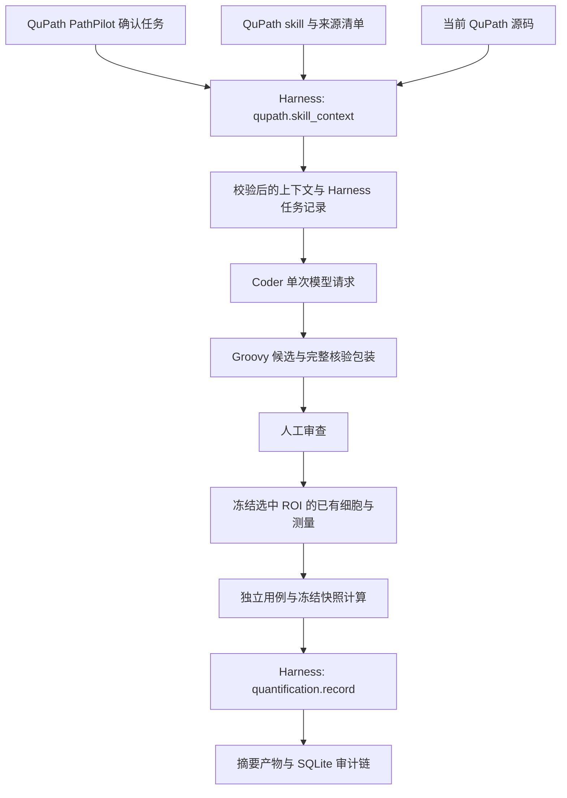

> 2026-10-30：真实样例片的四种组合已完成正常 GUI、真实模型和 Harness 记录。Otsu 来源保存在本地规格；实际快照复算与审计不授予模型图像、任意工具或执行权限。详见[真实流程验收](多通道组合统计验收.md)。

> 2026-10-27 当前验证范围：三张真实 ROI 的源码版 PathPilot 生成、冻结统计、独立核验和保存重读已通过。本文保留早期说明，最新已验证范围与未完成项见[三张切片工程验收](三张切片工程验收.md)。

# Harness 管理 QuPath skill 与量化记录

核对日期：2026-10-27。当前宿主为 QuPath 0.8 源码版 PathPilot。

## 本轮架构

QuPath skill 已作为 `qupath.skills` 插件接入现有 Harness 的 Registry、Profile、Runtime 和 Store。源码定位、摘要核对和上下文准备从 coder 移到 `pathpilot-coder/harness_skills.py`；coder 的 `source_skill.py` 只保留资源位置和运行版本适配。使用已有插件机制，没有增加常驻服务或另一套 Agent 循环。



## 两项固定工具

| 工具 | 输入与行为 | 边界 |
|---|---|---|
| `qupath.skill_context` | 在 Harness 授权后的工具执行阶段校验 skill 并检索源码，记录任务状态与上下文产物摘要 | 只读取指定资源、写本地产物；不授予模型 shell、文件浏览或任意工具权限 |
| `quantification.record` | 绑定候选、包装、规格、快照、图像身份、ROI 与执行回执；核对后保存结果摘要及审计 | 不运行 Groovy，不重新计算模型结果，不把回执中的成功声明当作科学验证 |

两项工具都使用现有只读 Profile，`allow_remote_llm=false`。模型请求由 coder 在拿到 Harness 的上下文后单独发出；当前 Harness 尚未统一调度整个模型循环或 QuPath 写操作。模型请求只收到任务字段、skill 和受限源码片段，独立用例及答案继续留在本地。

## skill 具体如何管理

- 作者工作区仍是 `code-intelligence/qupath-coding-agent-skill/`，运行副本仍位于各 coder 的 `skills/qupath-coding-agent-skill/`。Harness 管理加载和记录，不为改目录再次复制一套 skill。
- `source-provenance.json` 固定允许的资源与摘要。加载 SKILL、引用、索引、指纹和检索脚本前检查对应摘要；检索后只读取限定数量和大小的当前源码片段，拒绝越界路径。
- 上下文记录 skill 摘要、索引基线、实际源码版本、当前提交／已跟踪文件修改状态和片段是否过时。提交身份无法读取时明确记录未核验，不伪造匹配。
- 每次成功生成都保存 `source-task.json` 和对应上下文产物；`manifest.json` 记录该 Harness 任务 ID／状态。缺失或被修改的 skill 会在创建候选目录和发起模型请求前停止，并保留失败任务记录。
- `sync_workspace.py` 维护 0.8 skill 与共享 helper；本轮检查 35 个受控文件，不再生成 0.7 副本。

本机 `code/qupath-agent/harness_core/` 的新增文件写入仍被系统拒绝，因此新增的 QuPath skill 插件维护在可写的生产 `pathpilot-coder/`，通过原 Harness 注册机制挂载；没有修改受保护文件的权限，也没有另写一套 Harness 核心。

## 冻结与执行记录

人工同意执行后，在 FX 线程用已有 `getCellsForROI` API 取得该面积 ROI 内的 CellObject。保留细胞 ID、明确测量键、数值／null、ROI 几何与 z/t，以及规格摘要和图像身份；不修改对象、分类或项目。图像身份是 server 路径的 SHA-256，不是整张切片的像素指纹。

快照最多 100000 个细胞／16 MiB，测量缺失或非有限时保存 null；超限或没有已有细胞会拒绝运行。Groovy 的输入列表与测量 Map 不可修改。快照在执行前写盘；执行使用冻结值，之后修改现场测量不改变该次输入。候选仍具有 QuPath 进程权限，这些输入保护不是任意 Groovy 的 OS 沙箱。

成功回执与快照、候选、包装、规格必须一致，且参考用例数量、ROI、细胞数和输出字段吻合，才进入 `quantification.record`。同一回执重复导入保持同一任务，不重复产生审计事件。审计失败时保留已经完成的执行回执，界面明确显示“代码已执行，审计尚未完成”，可只重试审计：

```powershell
& 'code/qupath-agent/.venv/Scripts/python.exe' -X utf8 'qupath-main 2/qupath-main/pathpilot-coder/audit_execution.py' --receipt '本次 candidate/execution-UUID.json'
```

旧执行回执不具备新快照字段时不会被冒充成新链路的证据；需要重新生成并审查执行。

## 本地产物

| 路径（相对一次 `run-*`） | 内容 |
|---|---|
| `candidate/source-task.json` | skill 装载的 Harness 任务与上下文产物摘要 |
| `candidate.source-harness/` | skill 阶段 SQLite、审计与上下文产物 |
| `candidate/source-context.json` | 实际发送的 skill 与源码依据 |
| `candidate/execution-UUID.snapshot.json` | 运行前冻结的细胞及测量 |
| `candidate/execution-UUID.json` | 人工审查、摘要、结果或执行失败 |
| `candidate/execution-UUID/task.json` | 结果记录的 Harness 任务 |
| `candidate/execution-UUID/harness/` | 结果阶段 SQLite、审计与摘要产物 |

原始快照与运行产物仅留本地，不加入公网网站。网站同步状态及恢复步骤见 `CODE_CLEANUP.md`。

## 验证与下一步

Python 主线 14 项、0.7 回归 9 项通过。覆盖 skill 篡改导致零模型请求、上下文产物／SQLite 审计、只读能力、回执绑定、重复导入、错误目标、额外代码参数、快照或候选变化拒绝。

本机 HTTP fixture 驱动源码版真实 ChatPanel 与 AgentEngine 的合成 GUI 验收，验证已有细胞选择、边界、不同平面排除、缺测 null、冻结回放、输入不可改及 Harness 结果记录。最终结果以本轮 `pathpilot-coder/local-data/harness-skill-snapshot-smoke-20261027-01/acceptance.json` 为准；没有调用真实模型或打开真实切片。

实际 GUI 产出的回执再次导入两次，返回相同的 `REPORT_READY` 任务。安装版 0.7 的共享 Groovy 兼容检查也通过：合成 ROI 计数 3、错误候选和缺少 ROI 均拒绝，证据为 `qupath-coder-integration/local-data/harness-skill-compat-cli-20261027-01/acceptance.json`。额外的 0.7 GUI 尝试在初始化时超时，保留失败记录，不报告为界面验收通过。

下一步可将已审查的检测／测量作为快照上游接入，继续使用同一份快照与记录契约。真实科学规则、真实切片质量、模型预算／反馈调度和任意候选隔离仍未由本轮实现或验收。

## 源码版重复 PathPilot 面板处理

2026-10-27 用户确认正在使用源码版，并授权移除重复面板及重启。源码的 `QuPathGUI` 本身创建 PathPilot，先前安装的 `病理片/extensions/pathpilot-harness-0.1.0.jar` 又注册一个同名标签；启动日志确认两者同时存在。

原用户桌面的 QuPath（PID 4336）经 WM_CLOSE 正常退出，未出现保存提示。旧 JAR 已移至 `qupath-coder-integration/local-data/disabled-extensions/20261027-150705/`，移前与备份 SHA-256 一致，扩展目录中原文件已不存在。保留源码内置面板及其他扩展，没有删除分析源码或病理数据。

本次未完成用户桌面的重启：桌面连接器返回网络／内部错误，Windows 桌面输入返回 Access denied；通过 Shell 启动的空实例只出现在隔离桌面，已清理。不能将该隔离实例启动记录当作用户已看到新窗口的证据。用户需在自己的资源管理器双击 FYP 根 `启动QuPath源码.lnk` 完成重新打开；重启后的实际面板数量尚未从用户桌面核验。


## 三张真实切片的后续核验（2026-10-27）

真实 PathPilot 模型生成与审查运行已在三张实际图像 ROI 上通过，细胞集合、计数、五通道均值与独立 Python 参考一致，来源及结果 Harness 审计、重复导入和保存重读通过。空输入异常参考与数值参考现显式二选一；主线 15 项、0.7 回归 10 项、基础 75 项通过，68 个受控文件一致。当前源码合成 GUI 回归和新版包装的 0.7 CLI 检查也通过。

修复源码启动的 JavaFX 样式模块导出，并让 GUI 检查保留应用默认 JVM 参数，复测未再出现该样式错误。构建会重写已打开 GUI 的 JAR，必须先保存退出再构建；旧进程类加载失败不代表源码缺少 API。旧固定报告链路已在短目录对三张真实数据通过；Windows 深目录缺陷的补丁经 76 项检查通过，但维护源写入被拒绝。用户桌面恢复与该补丁落地仍待收尾，不能称整个目标完成。检测及阈值未经专家验证。详情见三张切片工程验收记录；本地原始数据与截图不发布。


## 2026-10-28：源码版统一与旧扩展退役

- 停止维护 0.7 扩展及其快捷方式；现行主线为 QuPath 0.8 源码版。旧集成目录中源码启动所需的 Gradle 配置、缓存及历史证据仍保留。
- Harness 授权后运行 `qupath.skill_context` 加载技能；未授权或资源异常时阻止后续模型请求。此机制不是操作系统沙箱。
- 审查包装仅接受 PathPilot 冻结快照，不自动检测细胞；真实切片的科学准确性与专家反馈仍待验证。
- 0.8 coder 15 项、共享研究代码 75 项通过；Groovy 独立验证了无快照拒绝和 3 个冻结细胞计数。未重新验收 QuPath GUI。
