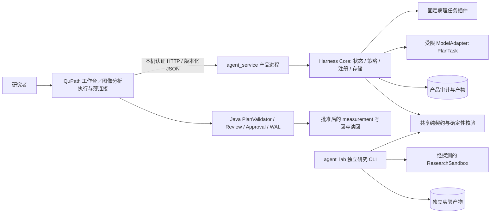
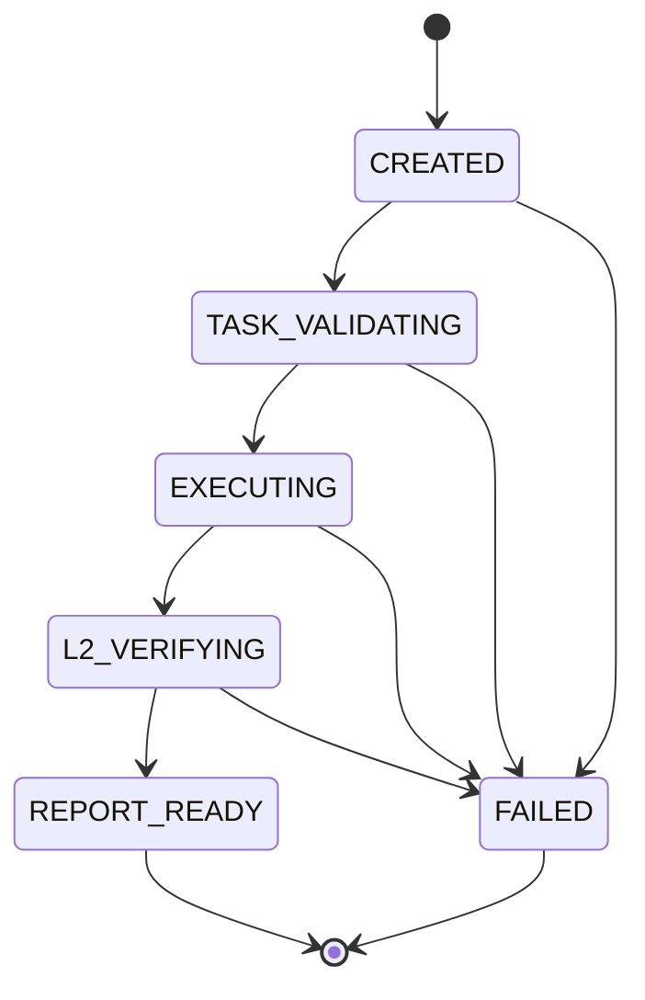

# Cancer Harness 架构设计

状态：设计草案 + H0 最小验证骨架；2026-10-18。面向癌症病理研究与分析辅助，不具备已验证的临床诊断能力。

2026-10-23 主线更新：**QuPath 是工作入口和图像分析执行端，Harness 是不可绕过的任务、权限、核验及记录支撑层。** 当前安装基线为 `F:\QuPath-0.7.0`（核心／GUI JAR 为 0.7.0，内置 runtime 声明 Java 25.0.2）；`qupath-main 2` 的 PathPilot 面板与必要固定工具作为优先接入资源，尚未装入该安装版。先复用 Script Editor 完成单 ROI 基线，再适配 `ChatPanel → 单一 Harness 任务入口 → QuPath 执行／复检`，不先重编译本体。完整分工、路径、权限矩阵和实施门槛见 [frame.md §1.5](frame.md#15-当前主线以-qupath-为中心的接入与本机环境) 与 [§1.6](frame.md#16-harness-如何实际约束-agent-的边界)。

原 Python 固定统计继续用作回归与参考；下文的 product/read_only H0 事实和产品窄写回协议保持原范围。新增 QuPath 检测／写测量、模型预算及生成 Groovy 研究执行须按各自效果设计，不因主线调整自动获得权限。本轮只更新设计及安装证据，尚未接通运行链。

## 1. 决策与证据边界

**推荐路线 B：在现有 Java + Python 架构上自主实现小型 Harness，借鉴 DeepSeek 的接口与生命周期思想，不 Fork、嵌入或运行其 Cordis/Node 内核。** 路线 C（以 dsh/其 Python SDK 作 sidecar）保留为未来独立研究选项，当前没有需要第三套运行时才能满足的用例。理由及替代路线见 [ADR-CH-001](docs/adr/0001-runtime-route.md)。

| 证据 | 本次实际取得/验证的内容 | 限制 |
|---|---|---|
| [frame.md](frame.md) | v0.3-r3 的产品/研究分离、窄写回、指纹、L0/L2/L3、审批与恢复设计 | 大部分 QuPath/API/事务行为尚待 Phase 0 实测 |
| 本地 `qupath-agent/` | 已有离线执行器、Schema、profile、输入核验、golden、Java 指纹探针及 26 项测试 | 原来的 CI/GUI/容器验收不能从离线通过推断 |
| `agent架构研究.md` | 2026-10-19 已只读取得 `../每周笔记/` 下笔记 | 原 L1/L2 与实验原始材料仍未找到；见 [来源核对](docs/source-reconciliation.md) |
| DeepSeek 官方仓库 | 固定提交 `687f282e8625c6b8d11ff58211a90524be2e4317`，版本 `0.2.1-rc.2`；静态检查源码、配置与依赖披露 | 未安装/启动上游，未独立安全审计；仅对该提交下结论 |

证据与逐项差异见 [gap analysis](docs/deepseek-harness-gap-analysis.md)，26 份原始 Git 对象的摘要和永久链接见 [source index](docs/research/deepseek-harness-source-index.json)。本次自己编写骨架，没有复制上游实现。许可证结论限于所检查的清单，不能替代将来具体分发产物的许可核对。

本文件补充运行时设计，不废止 `frame.md` 的病理协议。冲突处理顺序：已确认的数据/科学规则 → 经批准的安全不变量 → 版本化契约与 ADR → 本草案；发现冲突必须修订文档，不静默依赖配置覆盖。

2026-10-18 转录对齐：研究主线是受控生成、执行、核验和反馈修正传统 CV 分析代码；固定 PathClass 统计与 H0 只是工程基线。Phase 1 已增加独立研究预检；下一步研究 Phase 2R 不依赖产品写回或产品 Planner。依据、闭环及成果边界见 frame.md §2.2.1 和 [ADR-CH-005](docs/adr/0005-controlled-coding-research.md)。不将未执行的候选源码预检表述为已实现 coding agent。

## 2. 必须保持的不变量

1. 产品只能执行已注册的确定性任务；模型只生成 TaskSpec 业务参数。没有 shell、任意 Groovy/Python、`run_code`、动态 import 或插件安装工具。
2. 控制流由代码中的转换表控制；事件监听者、模型和 Profile 均不能替换安全核验、生成授权或跳过状态。
3. 写回仅限一个 annotation 的白名单 measurement；审批绑定具体计划原始字节 hash、上下文、review、before 与存储精度。
4. 产品与研究进程、配置、工具集合、数据目录隔离。共享代码不提供任意执行能力；研究执行失败即拒绝，不能用 L1 或工具权限替代 OS 隔离。
5. 科学语义由 SemanticsProfile 与确认记录决定，Harness Profile 只决定工程组合。二者名称、版本、hash、权限分开。
6. 模型可见信息来自显式白名单投影；完整图像/ROI/detection/WAL/token 不进入 Planner。所有外传都受 D3、任务数据等级和进程策略约束。
7. 会话恢复不等于 QuPath 写回恢复。未知副作用先对账，不重放原写入；SUCCEEDED 只表示当时内存读回符合预期，不代表保存了项目。
8. 插件是受信任的应用代码。同进程服务作用域、工具白名单与 Python 类型系统都不是对恶意插件的沙箱。

## 3. 拓扑与依赖

Java 不监听通用工具端口；Python 不反向调用 QuPath 或取得 JVM 任意方法权限。Java 只发起窄协议请求、轮询/订阅状态并在本机执行审核后的操作。研究进程不连接产品服务，不挂载产品 token、WAL、图像目录或产品数据库。

代码依赖规则：

| 层 | 可以依赖 | 禁止依赖/行为 |
|---|---|---|
| `agent_core` | 纯契约、SemanticsProfile、输入预检、确定性执行器、L2 | `agent_lab`、QuPath 远程控制、生成代码运行时 |
| `harness_core` | 上述核心、标准库持久化、启动时受信任注册表 | 包管理器、源码发现/下载、`eval/exec/subprocess`、研究执行器 |
| `agent_service`（未来） | Harness Core、产品固定插件、PlanBuilder、ResultVerifier | 研究插件、Coder、ResearchSandbox |
| `agent_lab`（已有离线预检，执行待 Phase 2R） | 纯契约/核验、候选/反馈版本链；未来研究模型与隔离执行 | `agent_service`、PlanBuilder、QuPath Adapter、产品凭据；当前禁止候选执行 |
| Java Adapter（待集成） | 嵌入的契约与任务目录、QuPath API、本机 HTTP | 通用脚本执行、模型下发类/方法/路径 |

新增 Harness 是现有编排/RunStore 的实现位置，不在未来再叠一层并行权威状态机。H0 使用独立演示数据库，尚未接入产品服务；接入时由一个 RunStore 拥有产品 run 状态。

## 4. Harness Core 的职责

| 组件 | 最小接口/责任 | 当前状态 |
|---|---|---|
| Plugin Registry | `mount/unmount`；核对 API、domain、服务依赖和重名；注册失败不留下部分条目 | H0：启动期静态注册，运行时冻结 |
| Service Registry | 以稳定且带版本的 service id 找服务；唯一 provider；先验证依赖再发布 | H0：显式字典依赖；结构接口验证/完整 DAG 为 H1 |
| Event Dispatcher | 类型化、已提交事实的通知；接收者不能决定安全策略或改写状态 | H0：一种 transition 事件、串行观察；监听失败只计数 |
| Agent Host | 注册 Agent 定义，管理运行/静止/关闭及有限预算 | H0：一个固定 Agent、一步任务；没有模型 Loop |
| Task Engine | 代码内的合法转换与 guard；动作前持久化；幂等与取消边界 | H0：只读转换子集；完整产品表仍以 frame.md 为准 |
| Model Adapter | `plan(PlannerContextView, budget)`；策略检查、用量、超时与模型标识 | 只有契约设计；H4 接入，不在 H0 加空 SDK |
| Tool Registry | 输入/输出校验、身份固定、能力交集、side-effect 分类、结果约束 | H0：一个合成 mIHC 工具，无任意代码工具 |
| Policy Kernel | 默认拒绝、不可由 Profile 替换的能力上限、数据策略和审批 binding | H0：只读硬上限；写回策略设计在 ADR-CH-002 |
| Run/Audit Store | 状态与审计同事务；重启后确定性恢复；schema/version 验证 | H0：SQLite、独占实例、hash 链及任务快照校验 |
| Artifact Store | 内容寻址、大小/类型限制、完整性与敏感等级；不能把 path 当能力 | H0：≤1 MiB JSON、写入 fsync 后 rename、读取复算摘要 |

核心权限、Task 状态转换、审批与核验是固定内核。病理执行器、模型传输与展示是扩展点。不会追求“每个机制都可被任意插件替换”。接口详见 [plugin contracts](docs/plugin-contracts.md)。

## 5. 插件生命周期、服务与组合

### 5.1 冷启动流程

读取受部署控制的纯数据 Profile → 检查完整版本与 domain → 展开选定 Bundle → 验证插件 allowlist/版本/代码来源 → 验证服务依赖与冲突 → 暂存注册 → 全部通过后发布 → 固定 effective-profile hash → 才创建 Agent/Task。

H0 的 Bundle 由 Python 启动代码显式构造；没有文件插件扫描器、home overlay、YAML `!!js`、npm/pip 安装、自动更新或运行中配置 patch。注册失败只撤销注册表资源，不声称能回滚第三方代码已经做过的文件/网络副作用。

生命周期设计为 `DECLARED → VALIDATED → ACTIVE → DRAINING → STOPPED`，失败进入 `REJECTED`。H0 只实现静态 mount、冻结和停止后 unmount，不宣称完整异步生命周期已完成。后续只有确认确有需求才增加 drain callbacks；活动 run、未解决写回和恢复记录存在时不得替换 provider。

每个 service id 精确表示接口主版本，例如 `artifacts.v1`、`models.planner.v1`。重复 provider 和缺失依赖必须失败，不能采用最后注册者胜出。Provider 返回的数据也通过契约验证；生命周期释放按消费者先、provider 后执行。

### 5.2 三种 Profile，两个不同运行域

| Harness Profile | 组合 | 权限与执行边界 | 科学语义 |
|---|---|---|---|
| `readonly.analysis` | 核心、输入/产物、固定任务目录；可不含任何病理任务 | product、read_only；只运行已注册纯分析 | 不预置疾病判断 |
| `mihc.readonly` | readonly 基础 + `pathology.mihc` | product、read_only；H0 仅内置 `mps-basic` 合成用例 | 绑定明确 id/version/hash 的 draft SemanticsProfile |
| `research.codegen` | 独立研究启动器 + 研究模型/Coder/L1/L2/EVAL/隔离执行 | research、read_only 相对于 QuPath；不代表宿主文件系统天然只读；必须隔离探测通过 | 绑定冻结实验协议；没有产品写回工具 |

未来 `mihc.reviewed-writeback` 是单独、经审查的产品组合，只启用 PlanBuilder/Java 审批协议，不把 apply 工具交给模型。H0 直接拒绝 research、propose/apply、远程模型以及超出只读能力的配置。

组合时区分“装载清单”和“授权”：合并插件不会扩大权限。有效能力取部署上限 ∩ 进程 domain ∩ Profile ∩ Agent/调用者 ∩ Tool 声明 ∩ Task mode ∩ 数据许可；任一 deny 即拒绝。Bundle 不能把自己的 grant 提升为部署上限；科学 profile 的变化必须创建新的不可变版本。

## 6. Agent Loop 与确定性 Task

Session 表示持久上下文分组，Agent 表示活跃执行者，Task/run 表示一次有明确输入、目标和终态的任务。会话聊天历史、Agent 的 running/idle 和病理 Task 状态不可混为一谈。

产品自然语言路径的有限 Loop：接收请求 → 白名单 PlannerContextView → 最多 3 次显式记账模型调用 → TaskSpecDraft → 注入 GUI target/profile → L0 → 固定执行器 → L2 → 报告或计划。模型不能选择下一状态、审批人或新的工具。表单路径直接进入 TaskSpec，不调用模型。

H0 只执行已有表单等价的确定性链：

H0 的 mIHC Tool 内部复用现有 `run_case`，因此其 EXECUTING 已包含领域 L0/统计/L2；Harness 的 L2_VERIFYING 再核对返回契约后登记产物，不把两层核验次数当成独立科学证据。将来可拆分共享纯执行器阶段，无需重写统计逻辑。

完整产品状态表沿用 frame.md §8.4，包括 AWAITING_REVIEW、APPLY_AUTHORIZED、APPLYING、RESULT_VERIFYING、APPLY_UNCERTAIN、RECOVERY_REQUIRED。研究有自己的转换表与预算，绝不复用可写回的尾部状态。H0 不接受这些尚未实现的写回状态，也不会自行恢复外部导入的未知版本数据库。

取消与超时必须区别“停止等待”和“执行已静止”。未来写回开始后不得取消或自动重试；只读后台任务也必须等待协作退出或丢弃迟到结果，不把超时视为可释放资源的证据。H0 同步串行执行，无伪造的超时/并行/取消 API。

## 7. 事件、会话、审计与恢复

事件分为三类：持久业务事实（状态/审批/结果引用）、瞬时进度（可丢失、不可授权）、受内核调用的同步校验（不是可短路的观察事件）。H0 只发布已提交的 `task.transition`，序号跨整个数据库单调递增；外部 UI 可以按 seq 去重，不能把回调成功当作提交成功。

SQLite 是最小持久化选择，使用事务、WAL 和同步屏障。状态和 AuditEvent 同事务；审计包含规范化 task 快照摘要、前一项摘要、事件版本、时间和序号。冷启动检查链与任务投影；哈希链能发现非整链修改和意外损坏，不能防御拥有整个数据库的同一用户重写全部历史。

H0 独占数据库实例，第二个写入者失败；这不是完整产品 OS 单实例锁与多用户隔离。H1 仍须验证进程锁、线程模型、磁盘满、断电、DB schema 迁移和敏感文件 ACL。产物先落盘后提交引用，崩溃可能留下孤立产物；不能留下被当作成功读取的错误摘要。目录 fsync、孤立产物 GC 和保留期是进入集成前的明确待办。

| 重启前事实 | 恢复规则 | 自动执行？ |
|---|---|---|
| H0 计算/核验未结束 | 追加 FAILED / SERVICE_RESTARTED，原 task 保留 | 否；用户建立新 task 重跑 |
| H0 REPORT_READY | 校验已有产物后原 ID 幂等返回 | 不重新调用工具 |
| 未来模型请求在途 | 记 interrupted/unknown、保守计预算，按新请求策略处理 | 不假设提供方没有计费 |
| 未来 APPLY_AUTHORIZED | STALE；旧授权不能跨重启复用 | 否 |
| 未来 APPLYING | APPLY_UNCERTAIN，保留目标锁，等 Java writer 静止与读回 | 绝不重放写入 |
| 未来 RESULT_VERIFYING | 使用已持久化 ExecutionResult 重跑纯 verifier | 只重算判定 |

Session replay 仅重建事实/视图，禁止重放 Tool、模型网络请求或 Java 写入。模型真正可见的投影与调用摘要必须可追溯，但敏感请求正文留在受控产物并受保留期约束，不能为了“全部日志可重构”默认永久保存 PHI。记录已清理正文的 tombstone 与删除原因，明确可复现范围缩小。

## 8. QuPath Adapter

当前目标为 0.7.0 兼容薄连接：优先适配 PathPilot 面板接缝，固定分析 API 在 QuPath 内执行；Python 不通过通用网关直接操控活动 JVM。模型提议必须经过 Harness 任务边界和效果授权，Java 端实际执行前再核对图像／ROI／输入；生成 Groovy 进入独立受控研究环境。旧产品 ActionPlan 仅覆盖原定 measurement 写回，不自动扩展到细胞检测或任意脚本。安装与具体接缝见 frame.md §1.5，已有／缺失的 Harness 实施点见 §1.6。

| 职责 | Java 端边界与调用 | 待验证 |
|---|---|---|
| 图像上下文 | 捕获当前 ImageData、项目条目、metadata、校准、通道和版本 | T0-1/3，源文件替换不由 metadata hash 保证 |
| ROI/annotation | 读取唯一 annotation、完整二维几何/空洞；按 profile 规则纳入 detection | T0-4，平面/边界/层级语义；当前不自动创建肿瘤区域 |
| measurement | 快照候选 key 的 before、存在性和实际存储精度 | T0-5；非有限值拒绝覆盖 |
| 状态/进度 | 轮询或消费版本化状态快照，显示 DRAFT、warnings、错误和恢复锁 | 进度回调不是权威终态 |
| 修改预览 | 验证 plan 原始字节/hash、Schema、目标、key 集合、profile 与结果引用；展示 before/expected | T0-11；不信任服务端 passed 标志 |
| L3/授权 | 两个独立记录；人工审查语义后仅授权具体计划 | review 不证明科学正确；没有模型批准入口 |
| 写回/读回 | ack 前服务端已持久化 APPLYING；ack 后再检查上下文；逐 key 写回、WAL、读回、ResultVerifier | T0-6/7/8/10，所有 QuPath 事务/undo/保存行为均待实测 |
| 恢复 | writer 停止前不对账；WAL 丢失依 plan.before 读回；未知恢复历史为 null | frame.md §12.6，不把超时当停止，不覆盖外部编辑 |

写回原子性、自动回滚、undo 和自动保存一律不预设。WAL 恢复失败、目标消失、值混合或指纹变化时进入 RECOVERY_REQUIRED；人工声明结束与系统验证成功使用不同终态。

## 9. 病理任务扩展

每种新 task 必须同时提交输入/输出 Schema、参数白名单、SemanticsProfile、纯执行器、L0/L2、独立手算/golden、敏感等级、性能上限、可选写回映射与研究局限。仅增加工具描述或自然语言 prompt 不算注册新病理能力。

| 候选任务 | 必须新增/确认的信息 | 当前不得假定 |
|---|---|---|
| mIHC 统计 | class_map、纳入规则、分母、校准、容差、上游分类方法 | marker 名等同阳性阈值，或上游分类质量已可靠 |
| 肿瘤区域分析 | 区域来源、ROI/组织面积定义、专家参考与评价单位 | 自动肿瘤分割已存在，或 annotation 就是真实肿瘤 |
| 细胞空间关系 | 坐标单位/平面、细胞代表点、距离/邻域/边界校正、稀疏与尺度限额 | 现有 DetectionTable 两列足够，或某个默认距离有科学依据 |
| 其他研究任务 | 数据许可、推断范围、参考实现、失败/不确定表达 | 结果能用于临床诊断 |

空间任务必须版本化新输入格式，不能悄悄给 DetectionTable v1 增加坐标并向远程模型发送。像素任务引入的数据量、模型权重、来源、许可证、外传和验证成本须单独 ADR；[ADR-CH-005](docs/adr/0005-controlled-coding-research.md) 仅允许 Phase 1 的有界合成数组参考/源码预检，不批准真实病理像素或候选执行。

## 10. 本轮骨架与下一步门槛

转录对齐后的 Phase 1 另提供 `qupath-agent/agent_lab/`、research.schema.json 与合成像素 fixture，运行 `python -m agent_lab --output local-data/research-preflight-demo` 可生成规格/输入、两版候选源码、绑定反馈、结构预检与独立参考。代码候选不执行，预检通过仍为 AWAITING_ISOLATION/NOT_EXECUTED；该工具不注册到产品 Harness。实际步骤见 [测试指南 §4.5](TESTING_GUIDE.md#45-新增研究主线规格源码候选与反馈修订预检)。

新增代码位于 `qupath-agent/harness_core/`；一个受信任 mIHC 插件复用既有合成用例，提供注册/冻结、能力拒绝、确定性状态、持久审计、摘要产物、幂等与计算中断恢复。没有安装上游依赖，没有增加 Node、模型或任意代码 Agent。

新契约版本 `0.1.0` 是 Harness envelope，与原病理 `schema_version=0.3.0` 分开；结果 Artifact 中仍保存原 Results。接口定义、wire schema 生成一致性和实现范围见 [contracts](docs/plugin-contracts.md)。

进入真实 QuPath 只读集成前必须通过 H1 的 G01–G08；进入任何写回开发/启用前还须 G09–G14，详见 [roadmap](docs/implementation-roadmap.md)。目前 GUI、Java Schema 打包/互验、完整指纹、权限/持久化故障门槛尚未完成，不能因为 H0 演示通过就标记产品集成就绪。

## 11. 进度看板与能力展示

根目录的[项目进度看板.html](项目进度看板.html)是本地展示入口，提供阶段定位、证据链接和三种当前能力的流程动画。动画不接入 Harness 的运行状态，不运行工具、模型或候选，也不授予 QuPath 访问与写回权限。

Markdown 正文集中在独立的[项目文档.html](项目文档.html)，通过主页入口访问，支持搜索、章节跳转和下载。正文及单份/ZIP 下载内容随源文档同步更新，属于离线阅读材料，不参与运行时任务状态。

[代码结构预览.html](代码结构预览.html)提供独立的只读架构页面：以模块依赖图、可点选的文件目录、三条调用路线与技术栈解释现有实现。`harness_core` 调用固定统计，`agent_lab` 仅复用基础契约并独立预检；探针、测试与网站工具分别展示。源码增删改后必须更新结构快照，并按实际代码核对职责、连接和未实现边界，详见 [frame.md §17.7](frame.md#177-独立代码结构预览)。页面不执行候选、模型或 QuPath，也不公开完整函数体或运行数据。

后续每次新增、删除、修改、重命名或回退影响能力、进度、架构、网页或文档的内容，必须在同一次交付中更新看板、核对动画边界、刷新文档与下载快照，并同步公网网站；无需用户再次提醒。远程与授权可用时必须运行 `scripts/publish_dashboard.ps1`，核对本次提交的部署成功和线上内容，删除项也须从目录、下载包及网站仓库移除。强制交付条件见 [frame.md §17.6](frame.md#176-增删改后的强制同步与交付条件) 与 [版本管理指南第 7 节](GITHUB_VERSION_CONTROL.md#7-网站同步是每次变更的强制交付条件)。真实发布阻碍必须明确记录，不能将本地生成或推送成功称为本次上线完成。浏览器播放完成只代表讲解完成，不能变更任务或阶段状态。
