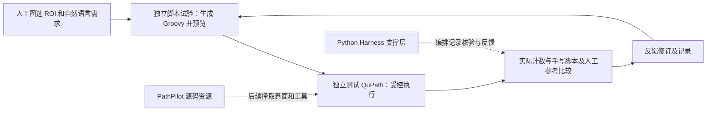
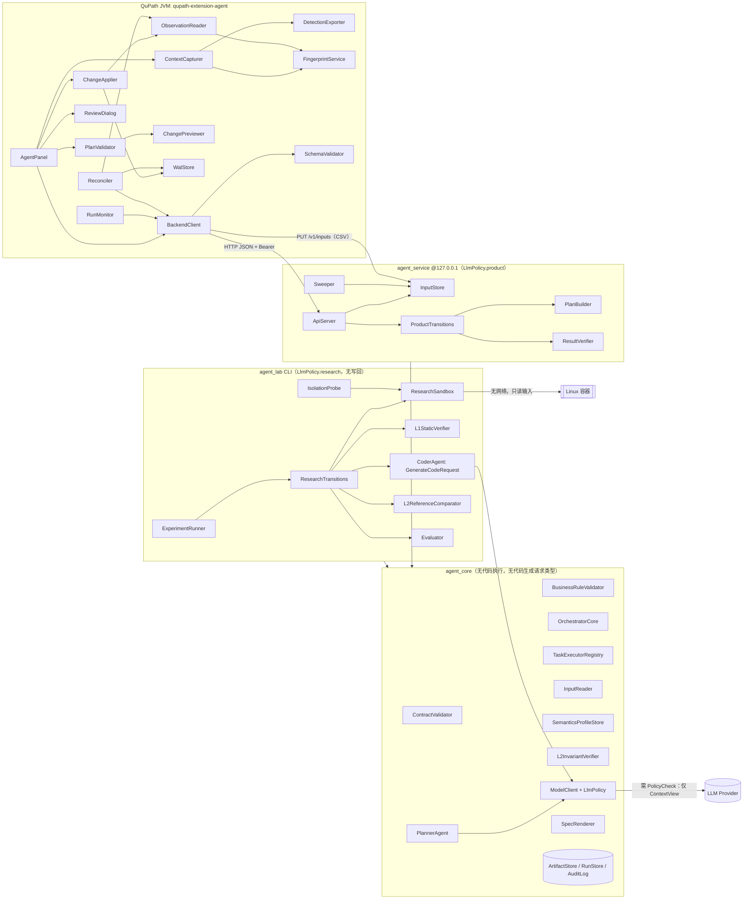
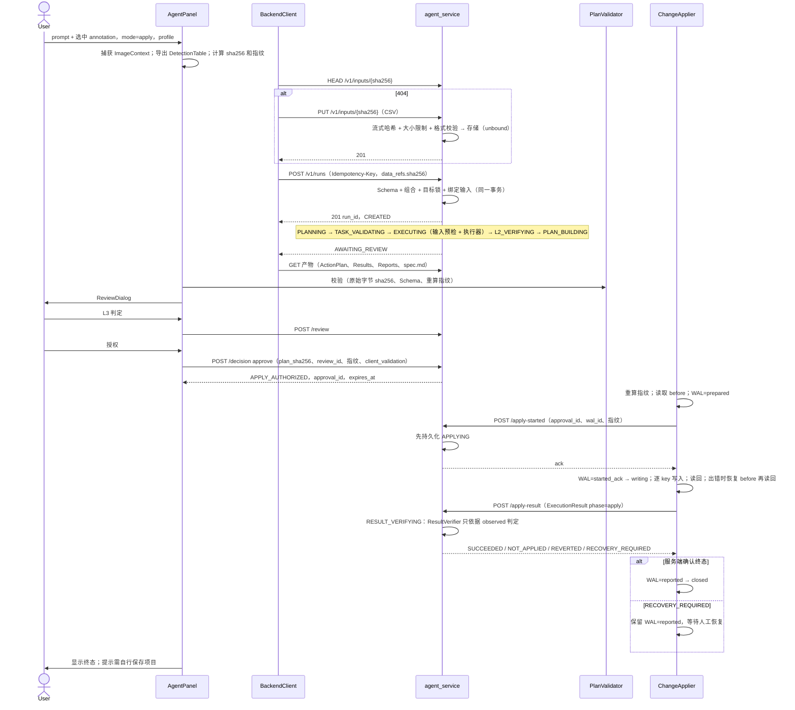
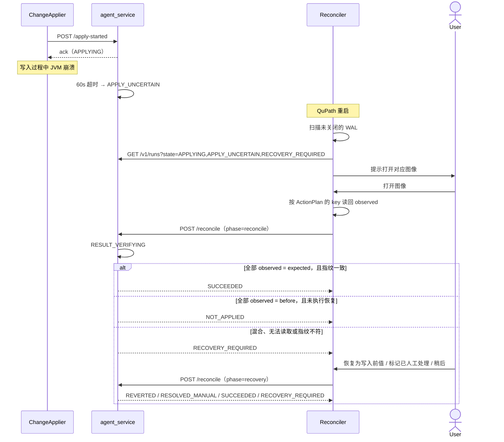
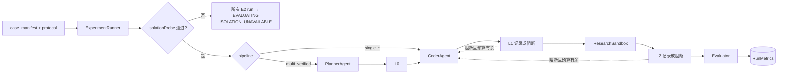
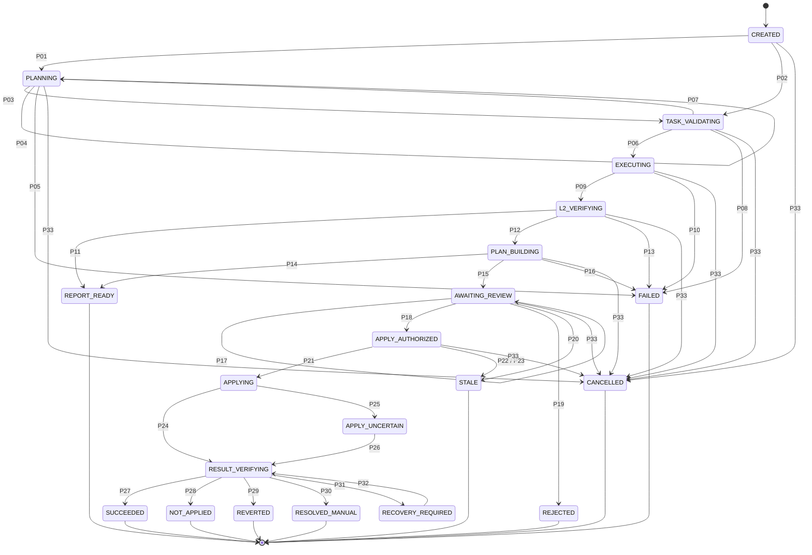
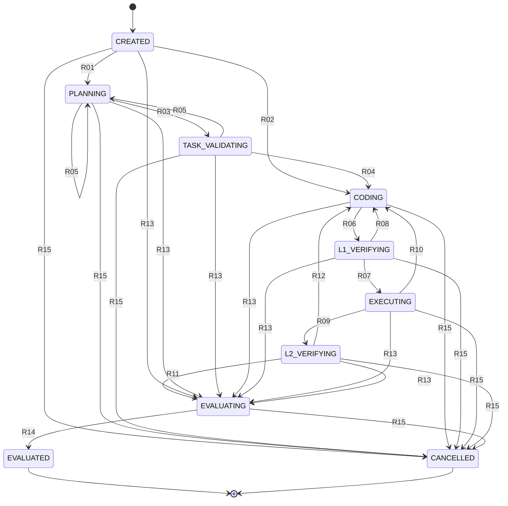

# QuPath Agentic Pathology — 系统架构设计（v0.3，修订 8）

状态：Draft。近期目标已按第二次导师谈话对齐；具体技术方案、科学规则与验收仍待验证。

**本周最小实现（2026-10-23 用户补充）：人工框选一个 ROI，统计其中细胞数量，并依据当前五个生物 marker 的表达作初步性状判断。结果必须说明“多少个、表达什么、支持什么初步解释、哪些不能判断”，详见 §1.7。该目标包含定性，不再仅以总数作为本周完成条件；目前为待实现任务。**

**当前方向（2026-10-23）：以 QuPath 为工作入口和图像分析执行环境，围绕它构建自然语言驱动、可核验、可反馈修订的定量分析助手；Python Harness 提供编排、审计、核验与实验支持。PathPilot 的面板／工具作为优先接入资源；当前已安装基线为 `F:\QuPath-0.7.0`，与 0.8.0-SNAPSHOT 源码包分开管理。接入设计及路径见 §1.5；本次未实现运行时桥接。**

**重要数据依据（2026-10-21）：用户已提供完整的 7 通道日志，固定对应表见 §1.4。DAPI 为通道 0，CD20 为 1，PDL1 为 2，CD8 为 3，CD23 为 4，PANCK 为 5，Autofluorescence 为 6。后续读取、检测、测量和脚本生成应显式引用这份对应表。**

2026-10-21 修订 5：近期优先完成“人工圈选 ROI → 自然语言 → Groovy → QuPath 内细胞计数”，不以修改或重新编译 QuPath 为前置条件。新增 §1.1–§1.3，明确 `qupath-main 2` 中 PathPilot 源码的可复用范围与独立脚本试验路线；已有 Python 固定统计和研究预检继续保留。本轮只更新设计及展示，未接模型、运行生成脚本或完成跨项目集成。

文档审核日期：2026-10-18。实现位于 `qupath-agent/`：已有 Phase 0 环境采集/探针与 Phase 1 离线契约、执行器、L2 和测试；操作与实测记录见 [分阶段测试指南](TESTING_GUIDE.md)。Phase 0 的 QuPath GUI、权限和隔离验收仍待实机确认，Phase 2 及后续产品 API/写回流程仍为设计；GitHub CI 已配置但尚未在远程运行。2026-10-18 审核时 `agent架构研究.md` 未提供；2026-10-19 已只读取得笔记，但原 L1/L2 与实验材料仍未找到，[R] 不构成已复现实验证据，详见 [来源核对](docs/source-reconciliation.md)。

导航：§1–§6 范围与架构；§7–§9A 协议与语义；§10–§13 核验、安全与恢复；§14–§16 实施、决策与风险；§17 本地进度看板与能力动画维护。仓库操作见 [GitHub 版本管理指南](GITHUB_VERSION_CONTROL.md)。

当前阶段与现有能力见根目录的[项目进度看板](项目进度看板.html)，通俗解释见[架构入门](Agent架构入门与导师沟通.md)。看板是随开发维护的展示文件，不是运行时状态或研究证据的来源。

Cancer Harness 运行时扩展设计、上游证据与路线决策见 [cancer-harness-architecture.md](cancer-harness-architecture.md)。已有只读 H0 骨架；修订 4 新增独立研究预检，修订 5 增加独立 QuPath 脚本试验设计。修订 7 将 QuPath 主入口／执行端及 PathPilot 接入点落实到模块分工；Python 离线统计和容器像素研究保留为回归与辅助实验，不再替代首个 QuPath 成果。现有产品服务仍不执行任意生成代码；优先级以 §1.5、§14 为准。

标注约定：
- [K] 架构师已有知识，未在实际环境验证，Phase 0 必须核验
- [R] 来自 `agent架构研究.md`，本文未独立核验
- [I] 工程推断或暂定默认值
- [A] 假设
- [D] 待用户/导师决策（工程类）
- [S] 待项目负责人/导师确认的科学决策（§9A.3）
- [X] 当前无法取得的信息

---

## 0. 变更记录

### v0.3 修订 8（2026-10-23 本周 ROI 计数与初步性状判断）
- 用户明确本周最小任务为人工选区内的细胞计数和初步定性；进一步说明定性是依据各 marker 对应的性状作判断，不止显示阳性／阴性。
- 新增 §1.7 的输入、最小输出、marker 解释边界与验收；将五 marker 的初步表达／性状说明前移到本周 Q0 基线，复杂空间分析及新指标仍后续推进。
- 通道名是标志物名称，染料和显示颜色用于定位信号，不直接等于细胞名称；当前面板不含 Ki-67 等增殖指标，不凭颜色、DAPI 亮度或单个 marker 强度推断高增殖。
- 本轮更新任务规格、依据及网站，不表示已完成真实细胞检测、定性或 Agent 接入。

### v0.3 修订 7（2026-10-23 QuPath 中心路线与本机安装核对）
- 根据第二次谈话 01:41–02:37、04:42–05:04、07:09–08:01，将主流程明确为“在 QuPath 中提出需求、在 QuPath 中完成图像分析、在 QuPath 中核对结果”；Harness 为支撑层。
- 将 PathPilot 的 `ChatPanel → AgentEngine.process` 列为后续薄扩展的优先适配接缝，保留现成领域工具作为固定工具资源与对照；不沿用两套独立模型调度循环。
- 登记 `F:\QuPath-0.7.0`、GUI／console 启动器与版本证据：核心和 GUI JAR 的 Implementation-Version 为 0.7.0，内置 runtime 的 release 声明 Java 25.0.2；该 GUI JAR 未发现 PathPilot 类。0.8.0-SNAPSHOT 源码不等于已安装版本。
- 保留原 Python 实现、合成数据和产品安全边界；近期先用安装版 Script Editor 完成基线，再验证生成脚本及接入，不以新建通用 Python 分析平台或重编译整个 QuPath 为前置条件。
- 补充 §1.6：将 Harness 的任务边界、工具授权、QuPath 执行前复检、独立脚本执行、预算、核验和拒绝审计映射到现有代码及待实施项。

### v0.3 修订 6（2026-10-21 用户提供通道对应日志）
- 新增 §1.4，完整记录 0–6 通道的 marker 与染料对应关系，标明来源及适用范围。
- 明确 DAPI 0 用于核通道定位，PDL1 与规范写法 PD-L1 的显式别名关系，以及 Autofluorescence 不作为生物标志物计入阳性／共表达分析。
- 将 ImageContext 的三通道示例调整为本次七通道布局；其余示例参数仍为示意，不冒充真实切片测量。
- 本次仅补齐数据语义文档与展示，不更改既有合成 SemanticsProfile、不设定阳性阈值，也不表示已完成检测或真实分析。

### v0.3 修订 5（2026-10-21 第二次谈话与现有 QuPath 源码核对）
- 根据第二次谈话 07:09–08:01，将下一次演示聚焦到人工圈选区域和细胞总数，先保持 QuPath 本体不变；阳性、边界指标和源码适配分阶段推进。
- 只读检查 `../qupath-main 2/qupath-main/`：发现 PathPilot 聊天入口、DeepSeek 工具循环及定量分析源码；确认它是候选集成资源，不是已经接入 Python Harness 的成果。
- 增加独立 QuPath/Groovy 试验路线和验收条件；保留产品固定执行器、既有 Python 研究预检与强隔离约束。现有 Python AST 预检不能用于判定 Groovy 安全或正确。
- 简历概况单独保存为本地 TXT，不将他人提供的源码能力记作本人已实现成果。网站同步已尝试，现有 HTML 写入被拒绝，本次尚未发布；阻碍与恢复命令见 §17.8。

### v0.3 修订 4（2026-10-18 转录对齐）
- 根据首次会议转录明确：受控生成、执行和修正传统 CV 分析代码是研究主线；固定 PathClass 统计是工程基线，不是完整 FYP 成果。
- Phase 1 增加独立研究规格、合成像素参考、候选源码预检和带反馈的版本链；Phase 2R 提前开展隔离代码生成闭环，不依赖 Phase 3a 写回或产品 Planner。
- 保留产品不执行生成代码、研究隔离、科学确认、指纹、核验和审批边界；合成像素阈值不等于病理阳性阈值。

### v0.3 修订 3（2026-10-18 文档审核）
- 补齐原文件在 Phase 2 处截断的 §14，以及缺失的 §15 ADR、§16 风险；新增内容依据现存正文整理，不声称恢复了原稿。
- 明确文档与实现的区别、缺失的研究来源、版本和哈希编码、写前快照与 profile 获取协议。
- 修正重试预算、幂等重放、写入与对账竞争、未知恢复历史、服务探活认证和数据保留描述。
- 修正示例中的精度、面积、draft 前缀和恢复结果矛盾；补充对应验收用例。
- 增加独立 GitHub 版本管理指南；未执行初始化、提交或推送。

### v0.3 修订 2（历史记录，原文件末尾截断）
| ID | 修改 | 涉及章节 | 替代内容 |
|---|---|---|---|
| R1 | 补全 §10.5–§16；修正所有指向 §12、ADR、Phase 的引用 | 全文 | — |
| R2 | 输入产物上传协议：`PUT/HEAD /v1/inputs/{sha256}`、InputStore、DetectionTable v1、run 绑定、大小限制、清理（ADR-016） | §6、§7、§9.13、§11.6、§12 | v0.3-r1 中只有产物读取、没有上传定义 |
| R3 | LLM 调用拆为 ModelClient + LlmPolicy + 两种请求类型 PlanTaskRequest / GenerateCodeRequest，各自有独立的 ContextView；GenerateCodeRequest 只存在于 agent_lab（ADR-017） | §6.2、§7.1、§11.4 | 单一 LlmGateway 与 LlmContextView |
| R4 | MVP 阳性判定限定为既有 PathClass + SemanticsProfile 中的显式 class_map；不再依赖 ": " 解析；detection 不上传 measurement；FP-DET-VAL 只含类别；删除 `required_fields`；数值阈值推迟到 Phase 4（ADR-018） | §1、§9.2、§9.3、§9A | marker 校验依赖"类别分量"解析 |
| R5 | 删除 `--weak-isolation-research-mode`；强隔离验证失败即拒绝执行生成代码 | §10.4、ADR-013 | 弱隔离研究模式 |
| R6 | 一致性修正：<br>- `/reconcile` 在 APPLYING 也可用。<br>- ResultVerifier 只依据 observed 判定，客户端 `status` 只作参考。<br>- NOT_APPLIED / REVERTED 以"是否执行过恢复动作"区分。<br>- `write` 增加 `unknown`。<br>- ActionPlan 携带写前快照，无 WAL 时也能对账。<br>- 新增 TARGET_LOCKED。<br>- 服务端在返回 ack 前先持久化 APPLYING。 | §7.5、§8.4、§9.5、§9.7、§12 | — |
| R7 | 新增 `dev_mode` 与 `agent:draft:` key 前缀，使 draft 语义配置能在合成数据上测试写回 | §2.1、§8.4 P06、§9.5、§14 | draft 配置完全禁止 apply，导致 Phase 3a 无法测试写回 |
| R8 | 新增 `GET /v1/semantics-profiles`；Python 可按共享编码复算纯字符串指纹（det_set、det_val）作一致性检查 | §7.5、§9.2 | "后端只做字符串比较" |
| R9 | 测试清单、验收标准 AC1–AC12、分阶段计划、ADR 全表、风险表 | §13–§16 | — |

### v0.3 修订 1
- C1 产品路径与代码生成实验路径分离；引入 `execution_profile`；后端拆为 `agent_core` / `agent_service` / `agent_lab`；产品状态机移除 CODING、L1、沙箱。
- C2 沙箱改名为 ResearchSandbox，只存在于 agent_lab；L1 不是安全层；补充三平台隔离清单。弱隔离模式已被 R5 删除。
- C3 写回范围缩小为单个 annotation 的 `set_measurements`；删除"原子应用"和"自动回滚"的承诺；ExecutionResult 支持部分应用和未知结果；新增恢复类状态。
- C4 新增 §9A 分析任务规范与 S1–S9；新增 SemanticsProfile；draft 配置限制 apply（R7 补充了 dev_mode 例外）。
- C5 两端运行时 Schema 校验。
- C6 指纹拆分并明确保证范围。
- C7 统一转换表。
- C8 ReviewRecord 与 ApprovalRecord 分离。
- C9 B2m 预算对照、错误归因、协议冻结、P1 臂。
- C10 token 生命周期与 health challenge。
- C11 数据最小化（LlmContextView 已被 R3 替代）。
- C12 Phase 0 验证任务化。
- C13 移除 TileExporter。
- C14 D6 保留。

### v0.2 / v0.1
- v0.2：对齐研究文件、复用 L1/L2、B0–B3。
- v0.1：初稿。

---

## 1. 执行摘要

主架构采用 QuPath 工作台 + 薄连接层 + Python Harness 支撑。QuPath 持有活动切片、ROI、通道、检测对象和真实图像分析执行；Agent 将需求转换为任务／Groovy 候选；Harness 管理权限、预算、记录、核验和反馈。长期产品拓扑 A' 继续作为“受信任固定工具”的连接方案，独立研究路线承接生成脚本；已有 Python 统计用于参考与回归。近期先在安装版 0.7.0 的 Script Editor 跑通 §1.5 的 Q0，不等待完整 HTTP、扩展或写回状态机。

研究主线是受控 coding agent：需求 → 版本化分析规格 → 生成/修改代码或组合标准库 → 隔离执行 → 确定性核验 → 专家复核 → 反馈修改。依据为 [首次会议转录](first%20FYP%20Meeting%20Transcript.md) 10:21–12:46、17:13–18:14、19:15–19:44；该文本为自动整理，具体科学任务和验收口径仍需导师确认。不得把“自然语言调用固定统计函数”当成已完成该研究目标，也不得把录音中的监管设想当作已核实认证结论。

核心判断：
1. 拓扑由代码决定，内容由模型决定 [R]。控制流由声明式转换表（§8.4）驱动，LLM 不决定下一步。
2. 产品路径不执行任何 LLM 生成的代码。
   - GUI 任务只能映射到 `TaskExecutorRegistry` 中预注册、经 golden 测试的确定性执行器。
   - 未注册的 task_type 直接拒绝。
   - `agent_service` 的依赖图中没有代码生成请求类型、CoderAgent 或沙箱。
3. 代码生成只存在于研究路径。
   - Python 研究的 B1–B3 由 `agent_lab` 在经 IsolationProbe 验证的 Linux 容器中执行。
   - 隔离验证失败就不执行。
   - 现有 Python 研究路径没有 PlanBuilder，也不连接 QuPath；新增 Groovy 试验另见 §1.3，不能复用产品连接来绕过执行边界。
4. 产品工程基线的阳性统计只基于 QuPath 中已有的 PathClass，通过项目负责人维护的显式 `class_map` 映射到 marker；这不是完整研究任务。本产品基线不做阈值分类，也不验证上游分类的质量。独立研究任务另行定义像素输入、算法规格和参考，不改变现有 DetectionTable。
5. LLM 在产品路径中只把自然语言翻译成 TaskSpec 的业务参数（task_type、markers、coexpression、metrics）。target 来自 GUI 选择，科学语义来自 SemanticsProfile。
6. 产品输入数据以内容寻址的方式上传：先上传、校验 SHA-256，再在创建 run 时绑定。detection 表只含 `object_id` 和 `path_class` 两列，不含像素、坐标和 measurement；研究像素输入另用版本化契约。
7. 写回不具备原子性。
   - MVP 只对一个 annotation 设置预定义的 measurement key，逐 key 记录写入前值、预期值和读回值。
   - 成功与否由服务端依据读回值判定。
   - 结果不确定时进入可对账、可人工恢复的状态。
8. 用户授权写回不等于病理结论正确。L3 审查（ReviewRecord）与授权（ApprovalRecord）分开记录。
9. 多 agent 不预设更优 [R]。B1/B2/B2m/B3 分离测量"核验反馈"与"角色拆分"的效果，结论只限于本任务与本用例集。

### 1.1 第二次导师谈话：近期目标与任务定义

依据为[第二次谈话总结](../谈话录音/第二次谈话/fyp第二次谈话_总结稿.md)及[带时间戳文字稿](../谈话录音/第二次谈话/fyp第二次谈话_文字稿.md)，原录音为同目录 `fyp第二次谈话.m4a`，时长 23 分 7 秒。本轮复用现成转写，未重新逐句听校；会议日期未明确，2026-10-21 是本次核对日期。

| 优先级 | 目标 | 依据与边界 |
|---|---|---|
| 首个演示 | 人在 QuPath 圈画并选中一个 annotation，自然语言请求“统计这个区域的细胞总数”，agent 生成或调用 Groovy，在 QuPath 内返回计数 | 07:09–08:01；保持 QuPath 本体不变，不先做自动圈画、全片分析或重新编译 |
| 可靠性 | 保存脚本、参数、实际输出和失败，检查代码是否完成任务；超能力范围时明确提示 | 05:56–07:09；可执行不等于结果正确，不承诺百分之百可信 |
| 数据准备 | 本次面板的核通道及通道—marker 映射已有用户日志，见 §1.4；继续绑定实际图像并记录强度、单位和来源 | 00:00–00:57、10:32–12:19；用户日志补充于 2026-10-21，不按显示颜色推断其他面板 |
| 下一项扩展 | 人工确认阳性阈值后，再做指定 marker 阳性计数；之后考虑近边界细胞和边界长度 | 08:01–09:03；“50”仅为口头示例，不能作为默认阈值 |
| 后续研究 | 新需求驱动代码生成、反馈修正与场景适配；必要时再研究源码修改、编译和多 Agent | 04:20–06:24、13:49–17:22；尚无多中心泛化、发表或临床有效性结论 |

**首个计数必须区分两种输入：** 已有并经复核的细胞对象时，先只读统计；没有对象时，先由人工配置并运行经确认的检测方法，或在独立试验中允许检测创建对象，再统计。零个对象不能自动解释为“图像里零个细胞”。仅检测细胞核时，结果明确命名为“细胞核数”，不能因 `isDetection()` 为真就称为细胞总数。

先固定一张获准切片、一个 ROI、一个图像平面、一套检测参数和计数规则。暂定对象代表点落在 ROI 内且不落入空洞才纳入，边界点规则先在合成样例中固定并请导师复核；不假设 hierarchy 子对象天然等价于几何纳入。纯对象计数与手写脚本应得到相同整数；图像检测质量另与人工复核对象比较，不能用“两个程序计数一致”证明分割准确。

### 1.2 `qupath-main 2` 能否融入现有架构

**结论：可以分层复用，不能直接整包合并后称为集成完成。** 实际源码根目录是 `../qupath-main 2/qupath-main/`；`__MACOSX/` 是附带目录，不作为源码入口。以下为本地静态检查结果，未构建、启动 GUI、请求模型或跑真实切片；也未确认它就是录音中名称存疑的定量软件或小窗口原型。

为便于定位，下表的 `ai/` 指 `qupath-gui-fx/src/main/java/qupath/lib/gui/ai/`。

| 源码证据 | 已看到的实现 | 在本架构中的位置／接入条件 |
|---|---|---|
| `qupath-gui-fx/.../QuPathGUI.java:332`、`ai/ChatPanel.java`、`ai/AISettingsDialog.java` | GUI 创建聊天面板；有文本输入、后台处理、设置与语音入口 | 候选 `AgentPanel`；近期脚本演示可先用现有 Script Editor，面板移植后置 |
| `ai/AgentEngine.java`、`ai/agent/DeepSeekAgent.java` | `process → DeepSeekAgent.run → 工具分派 → Tool.execute`；最多 14 轮；经 Java HttpClient 请求模型 | 可参考 Planner、ModelClient 和工具接口；集成时由 Harness 管预算、状态和日志，只保留一个实际执行入口，避免 Java/Python 各跑一套决策循环 |
| `ai/tool/Tool.java`、`ToolRegistry.java` | Java 工具接口和名称注册表；重复名称当前覆盖，返回可变工具表 | 可参考工具清单；不等于 Harness 的权限、Schema、审计或可信插件校验。不得直接映射为已授权 Python Tool |
| `ai/tool/StarDistTool.java`、`detection/StarDistRunner.java` | 选择 annotation 后调用 StarDist，创建 detection 并计数；无选区时拒绝全图检测 | 候选检测实现和人工脚本基线；有 hierarchy 副作用，不能塞进产品 `read_only` 路线 |
| `ai/tool/MarkerMeasurementTool.java`、`PhenotypeClassificationTool.java`、`MultiMarkerPhenotypeTool.java`、`AnalysisThresholdManager.java` | 通道测量、单／多 marker 统计，支持指定阈值或自动阈值和阈值上下文 | 后续病理执行器候选；先核对通道与对象类型，再将经人工确认的阈值纳入版本化科学配置，自动 Otsu 仅作建议 |
| `ai/tool/SpatialAnalysisTool.java`、`PixelClassifierTool.java`、`ComprehensiveAnalysisTool.java` | 有空间、像素分类及组合分析工具源码 | 独立扩展候选；不能根据文件名认定满足肿瘤边界长度或所有新需求，须逐任务验证 |
| `ai/analysis/AnalysisSession.java`、`AnalysisSessionManager.java`、`AnalysisReportExporter.java` | 分析会话、结果汇总与导出实现 | 可参考结果展示；转为严格、可核验的领域结果后再交 Harness 归档，成功消息不代替 L2 或科学复核 |
| `ai/voice/WhisperSpeechToText.java` | 使用外部 whisper.cpp，默认 CLI／模型路径依赖用户目录，可用配置覆盖 | 首次计数不需要语音；Windows 路径及外部程序后续单独验证 |

**兼容性和行为缺口：**

- `VERSION=0.8.0-SNAPSHOT`；本地版本目录声明 JDK 25、JavaFX 26.0.1、Groovy 5.0.6，Wrapper 声明 Gradle 9.6.1。原工程探针按 QuPath 0.6／JDK 21 设计，不能直接认定二进制或 API 兼容。先用现有可运行的 QuPath 做脚本探测，选择实际版本并冻结，再考虑移植源码。
- GUI 构建声明 `com.openai:openai-java:4.46.0` 及本地 `qupath-extension-stardist-0.6.0.jar`；JAR 和两份 StarDist `.pb` 模型文件确实存在，仍需验证传递依赖、平台原生库及与该 QuPath 快照的兼容性。存在 `build/` 或 `jpackage/` 不证明能在当前 Windows 环境运行。
- `StarDistRunner` 使用工作目录相对模型路径、固定 `pixelSize(0.5)`，找不到 DAPI／Hoechst 时回退通道 0，并用选区的直接子 detection 计数。接入前必须改为显式核通道与可配置检测分辨率，核对像素标定、深层子对象、去重及重复检测行为；不能沿用“回退通道 0”作为已确认数据语义。
- 已检查的 AI 主执行链是注册 Java 工具调用，未发现该链生成并运行 Groovy 的入口。`ChatPanel` 的 WebView `executeScript` 是界面 JavaScript，不是 QuPath Groovy 执行。现有工具成功也不满足“新增指标由 agent 编写脚本”的研究验收。
- 现有主链直接调用 `tool.execute(qupath, parameters)`；尚未形成与本项目一致的独立科学复核、写回授权、WAL、指纹和恢复验收证据。检测、测量和导出须分别声明效果，并检查 FX 线程、取消及半途失败；不能把这些工具一律称为只读。
- `AISettings` 支持保存 API key 和环境变量。接入时沿用本项目的最小模型上下文和凭据管理，不复制个人设置、key、聊天历史或切片；模型名称及接口可用性待实际配置确认，不根据默认字符串宣称已经调用成功。

源码包未提供可用 Git 提交来源。2026-10-21 核对的 SHA-256：`AgentEngine.java` 为 `624ecb70a7b4c96297554093cd7f8e7a41d55ef0d7917be3f36e672d705efc46`；`StarDistRunner.java` 为 `aadb15d4b369dbc269af5ddb5ab7e785e5c68726731e11e44d776bffd9c2568a`。包内根许可证为 GPL v3 文本；后续复制或分发前记录来源及所用依赖许可。本次不复制其 Java 实现、不修改上游源码。

### 1.3 修订后的分工、接入顺序与验收



此图是待实现路线。现有 `agent_core` 保留确定性类别统计；`harness_core` 保留固定工具、任务、权限、SQLite 审计及摘要产物；`agent_lab` 保留 Python 源码文本、合成像素参考和版本链。三者目前都不调用这个 QuPath 包，也没有 Groovy 执行器。直接复用 Python AST 检查、`analysis_py` 产物类型或两列 DetectionTable，均不能表达 Groovy、像素检测或空间规则；先设计独立版本契约，再实现必要的连接代码，不预建空模块。

新增的“QuPath 脚本试验”是独立研究入口，不属于现有产品 API 的 G1/G2 或 E2，不沿用 `read_only` 标签掩盖任意脚本能力；需要的 JVM、允许操作、输入与报告契约单独验证。`agent_service` 继续禁止执行模型代码，生成脚本也不得自动注册成受信任产品工具。

| 顺序 | 最小工作 | 通过依据 |
|---|---|---|
| Q0：人工基线 | 在当前可运行的 QuPath 中选一个 ROI；人工确认检测、测量和阈值，手写 Groovy 输出计数、marker 表达及初步性状；不改 QuPath 本体 | 保存版本、输入摘要、ROI／平面、核通道、检测参数、对象类型与纳入规则、脚本、数量、逐细胞依据和人工核对；按 §1.7 验收 |
| Q1：首个 agent 演示 | 一个 agent 接收自然语言和最小上下文，产出 Groovy；受控执行后把实际结果返回用户 | 保存模型／提示／源码摘要、实际执行环境、输出或异常及与 Q0 的比较；没有实际执行就维持“仅生成／未执行” |
| Q2：连接与反馈 | 按 §1.5 优先适配 PathPilot 面板接缝和必要固定工具；Harness 统一记录与控制，QuPath 执行图像操作 | Java/Python 双端字段验证和拒绝用例；旧 CLI 回归；同一输入上保留初版、反馈、修订版及前后误差；不同时启用两套模型循环 |
| Q3：扩展与研究 | 本周五 marker 初步定性之外的复杂共表达、空间指标及生成新指标；视需要研究源码适配与比较实验 | 分别建立数据、参考及副作用验收；不得用固定工具的成功替代新代码适配实验 |

**执行边界：** 模型生成的任意 Groovy 在活动 JVM 内具有宿主能力，预览、人工确认、关键词扫描或单独启动一个 JVM 都不构成 OS 隔离。自动候选执行前，须在通过探测的独立 OS 隔离环境中运行 QuPath/JVM，限制挂载、网络、资源与时间，且不提供产品 token、API key 或原项目写权限；原 Python 容器探测通过不能自动覆盖新的 JVM 路线。隔离尚未验证时只能保留代码文本，或由人审查为可信脚本后在获准测试副本中进行人工基线验证；后者不得称为任意生成脚本的自动闭环或安全保证。保持 QuPath 本体不变与独立运行环境可以同时满足。

**首个闭环至少检查：** 无 ROI／多个 ROI 拒绝；未检测与已检测的零计数区分；内外／空洞／边界对象和重复对象的纳入一致；非细胞 detection 不误计为细胞；执行前 ROI／输入变化拒绝复用旧结果；脚本异常／超时保存失败且不自动重跑可能已产生副作用的操作。超范围任务返回原因和当前证据等级，不用模型自然语言自评充当核验。

### 1.4 重要：当前面板的通道、标志物与染料对应表

**来源：用户于 2026-10-21 提供的 QuPath INFO 日志。通道编号从 0 开始，必须保留原顺序。** 这是当前日志对应图像／染色面板的项目输入依据；消息未指明具体切片文件名，不据此声称所有切片或所有 Opal 实验都采用同一布局。切换图像时应核对实际元数据，并将采用的对应表与图像及运行记录绑定。

| 通道索引（0-based） | 用户日志中的标签 | 染料／通道类型 | 架构中的含义及用途 |
|---|---|---|---|
| 0 | DAPI | DAPI | 核染色通道；本面板的细胞核检测应显式使用通道 0，并核对名称为 DAPI |
| 1 | CD20 | Opal 480 | CD20 标志物强度测量及后续经确认的阳性统计 |
| 2 | PDL1 | Opal 520 | 对应规范 marker 名 PD-L1；保留原始标签 PDL1，使用显式别名映射 `PDL1 → PD-L1` |
| 3 | CD8 | Opal 570 | CD8 标志物强度测量及后续经确认的阳性统计；不是通道 1 |
| 4 | CD23 | Opal 620 | CD23 标志物强度测量及后续经确认的阳性统计 |
| 5 | PANCK | Opal 690 | PANCK 标志物强度测量；该通道身份本身不等于已完成肿瘤识别或边界定义 |
| 6 | Autofluorescence | 自发荧光通道；未提供 Opal 编号 | 保留为自发荧光／背景信息，不作为生物 marker 进入阳性、共表达或细胞类型判定 |

用户提供的原始日志如下，后续不得凭显示颜色或染料编号重新猜测本面板的对应关系：

```text
INFO: 通道 0: DAPI (DAPI)
INFO: 通道 1: CD20 (Opal 480)
INFO: 通道 2: PDL1 (Opal 520)
INFO: 通道 3: CD8 (Opal 570)
INFO: 通道 4: CD23 (Opal 620)
INFO: 通道 5: PANCK (Opal 690)
INFO: 通道 6: Autofluorescence
```

后续实现约束：

- 读取和执行前核对 7 个通道及原顺序；不匹配时停止套用本表，明确提示差异，不静默沿用旧索引或回退到任意通道。
- 图像上下文保留原始通道标签和索引；任务、报告和跨模块比较可采用规范 marker 名。`PDL1 → PD-L1` 必须显式记录，不将原始元数据自动改名，也不靠模糊字符串匹配绑定别的通道。
- 五个生物 marker 为 `CD20、PD-L1、CD8、CD23、PANCK`；DAPI 是本面板的核检测输入，Autofluorescence 是自发荧光信息，二者不默认作为上述 marker 的阳性／共表达项目。开发时可先跑通 DAPI 计数，但本周完整交付还须按 §1.7 提供经确认规则的 marker 表达及初步性状说明。
- 记录 Autofluorescence 不代表已经执行背景扣除、光谱解混或信号校正；若需要处理，另行确定方法、参数与验证。
- 通道身份已由用户日志补齐；阳性阈值、细胞区室、对象纳入规则、专家参考及跨切片适用性仍分别确认。不能由本表推导统一阈值，也不能把文档登记算作真实检测成功。
- 现有 `mps-draft-1/v1.json` 是合成 PathClass 统计配置，与该真实面板的通道身份不同；不覆盖不可变的旧版本，也不因补入本表自动将其标为 confirmed。后续面板配置与运行时契约按实际接入需求新增版本。

### 1.5 当前主线：以 QuPath 为中心的接入与本机环境

#### 1.5.1 方向判断与调整理由

**需要调整架构重心，已有 Python 基础不必重写。** 导师明确说一端是自然语言、另一端驱动 QuPath（01:41–02:37），分析应直接在 QuPath 中完成（04:42–05:04），下次先保持 QuPath 本体不变，以人工选区和 Groovy 完成细胞计数（07:09–08:01）。因此当前研究主线定为“以 QuPath 为中心的自然语言定量分析与可验证脚本适配”。这是依据谈话作出的工程解释，不将未定的实现方案称为导师正式批准。

| 方面 | 调整后的定位 | 原有成果如何保留 |
|---|---|---|
| 用户工作入口 | QuPath 的切片、选区、通道及结果界面；后续接入 PathPilot 风格面板 | CLI 继续用于回归与实验，不要求用户先导出图像到独立平台 |
| 图像分析执行 | QuPath 内已有分析 API、受信任 Java 工具和经验证的 Groovy 路线 | Python 固定类别统计作为工程基线和参考，不承担所有真实病理分析 |
| Agent／Harness | 需求规格、生成／选择、预算、版本、审计、结果核验及反馈 | 复用 `agent_core`、`harness_core`、`agent_lab` 已有能力，补所需接缝 |
| 首个成果 | 一个 ROI 的细胞计数、marker 表达及初步性状说明；先手写基线，再自然语言／Groovy | 合成像素与固定名单测试保留，单独报告，不替代 QuPath 闭环 |
| 后续研究 | 复杂空间／共表达指标、临时新增指标、代码修订与需求适配 | 本周定性所需人工阈值前移；多 Agent、多中心和源码重编译仅在有明确实验问题时推进 |

不是所有通用 Harness 功能都要先实现。完整插件体系、通用 HTTP 控制台、批处理、自动圈画、完整写回恢复及多 Agent 对照不作为 Q0 的前置条件；已有产品固定执行器和独立研究执行的权限边界继续保持。

#### 1.5.2 三个位置：安装版、源码资源与现有工程

| 项目 | 位置／版本 | 本次证据与用途 |
|---|---|---|
| 当前安装目录 | `F:\QuPath-0.7.0` | 用户提供；2026-10-23 实际只读检查目录存在，作为近期接入基线 |
| GUI 启动器 | `F:\QuPath-0.7.0\QuPath-0.7.0.exe` | 文件存在；人工打开图像、圈选及 Script Editor 的入口；本轮未启动 GUI |
| console 启动器 | `F:\QuPath-0.7.0\QuPath-0.7.0 (console).exe` | 文件存在；后续需要日志或命令行时先验证具体用法，不把新进程当作当前 GUI 的上下文 |
| 运行类库／脚本扩展 | `F:\QuPath-0.7.0\app` | `qupath-core-0.7.0.jar`、`qupath-gui-fx-0.7.0.jar`、`qupath-extension-script-editor-0.7.0.jar` 存在；前两者 manifest 版本均为 0.7.0 |
| 安装版运行时 | `F:\QuPath-0.7.0\runtime` | `release` 声明 `JAVA_VERSION="25.0.2"`；app 同时含 JavaFX 25.0.2、Groovy 5.0.4 JAR；不由此证明 GUI 或 API 验收通过 |
| PathPilot 源码资源 | `../qupath-main 2/qupath-main/`，0.8.0-SNAPSHOT | 提供面板和工具接缝；安装版 GUI JAR 内未发现 `qupath/lib/gui/ai/` 类，不称其已安装或已接入 |
| 自有工程 | `qupath-agent/` | 当前 Python 固定统计、Harness、研究预检及 Phase 0 探针；与安装版的运行连接仍待实现 |

安装路径是本机环境信息，可用于命令示例或后续配置，不写入通用契约、图像指纹或远程模型提示。新机器通过显式本地配置选择安装目录；本轮仅登记路径，不创建无实际调用者的配置类。

现有 Phase 0 扩展构建脚本按 QuPath 0.6／`--release 21` 编写，不能直接认定适用于当前 0.7.0 类库。内置 runtime 中未找到 `bin/java.exe` 或 `bin/javac.exe`，不能把安装包运行时当作可编译扩展的 JDK；构建薄扩展前另行验证合适的外部 JDK／Gradle。无需为首个 Script Editor 基线先完成扩展构建，也不向安装目录直接复制 0.8 快照 JAR。

#### 1.5.3 把 PathPilot 作为优先接入资源的具体接缝

```text
人在 QuPath 打开图像并选中一个 annotation
  → 当前先用 0.7.0 Script Editor；后续适配 PathPilot ChatPanel
  → 单一任务入口（从 AgentEngine.process 接缝改接，待实现）
  → Harness：冻结上下文、需求规格、权限、预算、日志与候选版本
  → 固定任务：受信任 QuPath 工具在 QuPath 上执行
    或研究任务：生成 Groovy → 预检／人工审查 → 经验证的独立 QuPath 试验环境执行
  → 实际结果、失败与参考比较 → QuPath 内展示／复核 → 反馈修订
```

下表描述目标分工，不表示这些连接已实现。首次接入只补能支持一个 ROI 计数的必要部分：

| 现有接缝／资源 | 目标职责 | 本轮定位及约束 |
|---|---|---|
| `ChatPanel` | 需求输入、任务状态、脚本预览和结果展示 | 优先 UI 资源；需迁移到 0.7.0 兼容扩展并测试，不重写 QuPath 主窗口 |
| `AgentEngine.process` | 面板到受控任务入口的转接点 | 适配时不再独立调度一套 `DeepSeekAgent.run`；一次运行只能选一个模型／工具调度所有者 |
| QuPath 侧上下文捕获 | 捕获活动图像／选区／平面及 §1.4 通道表，固定任务目标 | 后台执行期间切换选区／图像必须检测；不让模型自行选择其他 ROI |
| `ToolRegistry` 与领域 Java 工具 | 受信任固定任务执行及手工基线 | 逐个核对参数、版本、对象类型和副作用；成功字符串不当作独立正确性证据 |
| `harness_core` | 任务状态、权限、审计及产物组织 | 复用现有实现，按连接需要补契约；不因有 SQLite 就声称完整恢复已完成 |
| `agent_lab` 的候选／反馈机制 | 记录 Groovy 候选、执行观察、修订及比较实验 | 现有实现是 Python 文本预检，Groovy 类型与核验须新版本设计；不直接套用 Python AST |
| `agent_core` 固定统计 | 离线参考、结果一致性检查和回归 | 保留原 CLI 与合成用例；不在主流程中要求导出 WSI 到 Python 重新做一套图像平台 |

PathPilot 原 Java 工具链可以先独立作为对照使用；与 Harness 集成的任务不能又由原 Java 模型循环执行一遍。固定分析和生成脚本是两类执行能力，分别声明、审查与验证；新增检测会创建对象，不能套用产品的只读标签或原窄 measurement 写回协议。

#### 1.5.4 近期推进顺序与判定标准

1. **Q0，本机 QuPath 基线：** 在安装版 0.7.0 上验证所需 API，记录实际图像、单 ROI 和七通道；人工确认检测、五 marker 的测量及阈值后运行手写 Groovy，保存对象计数、逐细胞表达、初步性状说明与人工参考，按 §1.7 验收。路径存在／JAR 版本正确仅为环境事实，不是 Q0 完成。
2. **Q1，首个自然语言脚本任务：** 对同一受控输入生成 Groovy，保存需求、脚本和实际执行输出，与 Q0 比较。先区分人工审查后手动验证、固定工具调用及自动候选执行，不能互相冒充；自动候选执行仍须 §1.3 的 OS 隔离验收。
3. **Q2，薄连接与面板：** 验证 0.7.0 扩展兼容，适配 `ChatPanel → 单一任务入口`，先传必要上下文和结果，再补轮询、取消和旧输入拒绝；不为已有一个任务先搭完整通用平台。
4. **Q3，需求适配实验：** 在本周基础定性之外选择一项固定工具未覆盖的新指标，测试生成—执行—核验—反馈修订的质量、耗时与失败；新增科学规则继续分别确认。

默认先复用 Script Editor 和已有工具；仅在脚本／扩展不能覆盖真实需求时另行评估修改与编译 QuPath 本体。官方脚本概念参考 [QuPath scripting overview](https://qupath.readthedocs.io/en/0.6/docs/scripting/overview.html)；该资料为 0.6 示例，不替代当前安装版 0.7.0 的实测。

### 1.6 Harness 如何实际约束 Agent 的边界

**Agent 提议做什么，Harness 决定是否允许并记录过程，QuPath 只执行获准操作，核验器检查实际结果。** 限制必须在程序和执行环境中生效；提示词里写“不要越界”、隐藏工具按钮或让模型自评，都不是权限控制。

#### 1.6.1 第一项单 ROI 计数的边界

| 维度 | 首个任务的允许范围 | 越界时的处理 |
|---|---|---|
| 图像与区域 | 用户当前选中的一个 annotation、一个平面；捕获后绑定图像／ROI／对象快照及摘要 | 没有或多个 ROI、换图、改选区、输入已变化时拒绝旧任务，不自动扩大到全片 |
| 通道语义 | 使用 §1.4 七通道映射；DAPI 0、PDL1 2、CD8 3，显式处理 PD-L1 别名 | 顺序／名称不匹配时提示核对，不猜通道，不让模型临时改映射 |
| 只读计数 | 对经确认的已有细胞／细胞核对象，按固定纳入规则计数 | 未检测时要求先完成检测；不把零对象当零细胞，不默认重跑检测 |
| 检测与写入 | 另立经审查的检测任务，展示方法、参数和将创建／修改的对象 | 单次计数授权不能授权创建对象、改分类、保存项目或执行任意脚本 |
| 模型与数据 | 仅发送完成需求理解所需的白名单文字／规格；外传依数据许可 | 不发送 API key、任意路径、整张切片或未获准数据；用户授权写入不等于授权外传 |
| 执行与资源 | 单任务、有限模型调用／token／修订轮数，固定资源和总时间预算 | 达到上限则停止调度并保存原因；超时不自动认定执行已停止或允许重跑 |
| 输出与正确性 | 实际计数、对象类型、输入绑定、执行状态、异常与参考比较 | 模型口头声称成功、结构通过或工具 success 字符串不能直接标记核验成功 |

#### 1.6.2 共用执行入口：先检查，后调用

接入主链固定为 `ChatPanel → TaskSpec／候选提议 → Harness 授权与状态转换 → QuPath 侧复检 → 执行 → 核验 → 记录／展示`。UI、模型工具调用、重试和组合工具的子调用必须进入同一检查路径；集成模式不能保留 `AgentEngine → tool.execute(...)` 的另一条未检查通路。

有效权限取交集：`部署硬上限 ∩ 运行域 ∩ Profile ∩ Agent 工具集 ∩ 已注册 Tool 声明 ∩ 本次任务范围 ∩ 数据许可 ∩ 具体人工授权`。任一拒绝即拒绝。权限来自受信任配置和用户真实操作，不能由模型在参数中写 `approved=true`、更换 Profile 或自行新增工具来获得。

Harness 的执行前检查须核对工具 ID／版本、严格参数、输入与目标绑定、效果类别、必要授权及剩余预算；QuPath 侧在真正读写前再次核对活动图像／ROI、输入摘要和允许操作，防止检查后上下文改变。固定工具只接受领域参数和已绑定的上下文，不接受任意 JVM 方法、宿主路径或待执行代码字符串。

这里约束的是合作的受信任工具。恶意的同进程 Java／Python 插件仍可能直接访问宿主；能力表和授权令牌不是语言级隔离，未知插件不能靠多加一个布尔开关变成受信任工具。

#### 1.6.3 三类执行能力分开实施

| 类型 | 实施方式 | 不能混淆的保证 |
|---|---|---|
| 固定只读任务 | 启动期注册经过测试的上下文读取／对象计数工具；严格校验输入及范围 | 工具固定不代表图像检测或科学规则必然正确；仍需核验 |
| 固定有副作用任务 | 单独注册／审查检测、写测量或导出任务；操作前预览并授权；保留 before／observed 和失败状态 | 检测创建对象不属于旧 measurement 窄写回；不能未经设计沿用原 apply 协议 |
| 生成 Groovy 研究任务 | 源码先保存为候选，绑定规格／输入／版本，做语法和质量检查，再进入已验证的独立 QuPath/JVM OS 隔离环境执行 | 扫描危险字符串、人工确认或新开 JVM 都不等于隔离；不把任意生成脚本塞入活动产品 JVM |

对生成脚本，隔离环境须实际限制文件挂载、写目录、网络、CPU／内存和运行时间；不授予产品 token、模型 API key 或原项目写权限。隔离或 QuPath 兼容尚未验证时保留“已生成／未执行”状态；可人工审查为可信脚本后在测试副本中做手工基线，但不能将其当作自动候选执行的安全证据。

#### 1.6.4 复用现有代码，明确还缺什么

| 已有位置 | 现在已经实现的边界 | QuPath 接入时要补的部分 |
|---|---|---|
| `harness_core/contracts.py` | strict、禁止额外字段、不可变模型；Profile／Tool／Task 的 H0 契约 | 新 QuPath 上下文、授权、预算和研究候选字段走新版本，不把示意字段塞进当前 0.1.0 |
| `Registry.mount` | 拒绝错误 domain、重复工具、超出能力及非 `pure/artifact_only` 效果；运行期冻结注册表 | 新 QuPath 工具逐个审核／注册，不让模型或面板动态装工具 |
| `Runtime.__init__`／`Runtime.run` | 当前只允许 product/read_only/无远程模型；检查 Agent 和 Profile 工具集、能力及效果；输入 strict 校验后才执行 | 绑定真实图像／单 ROI／通道和权限；把所有 QuPath 调用接到执行入口；不能直接打开当前被禁止的 research／write 开关 |
| `TRANSITIONS`／`Store.save` | 确定性状态、身份不可中途变更、任务与审计事务写入；同 task ID 不自动重执行 | 在版本化流程中补模型生成、审查、执行中断、拒绝和结果未知；不能由模型指定 next_state |
| `tool.validate_output`／`Store.put/read` | 输出校验后才发产物；摘要、大小检查；SQLite 审计和产物完整性 | 真实对象计数不变量、输入／结果绑定、手写参考与人工复核；文件完整不等于分析正确 |
| `agent_lab` | 候选／反馈版本链、Python 文本预检；候选保持 NOT_EXECUTED | Groovy 质量检查、受限 QuPath 执行、实测结果反馈及重新评价 |

H0 的拒绝有些发生在任务创建前，不能称为已具备“所有拒绝都持久审计”；接入迭代应补可追溯的拒绝记录。真实模型预算、QuPath 授权与双端复检、Groovy 执行隔离目前也未实现。已有负例测试是这些设计的基础，不能用它们代替新连接的验收。

#### 1.6.5 按小闭环落地与验收

1. **先保留并复跑现有边界测试：** `tests/test_harness.py` 中的工具／能力拒绝、Profile 提权拒绝、状态与重启、输入／输出校验。验证当前基础，不新增通用框架。
2. **接一个固定只读计数工具：** 只接用户绑定的单 ROI，上下文与工具参数明确；固定结果先与手写参考一致。用同一个 fake executor 计数证明：未知工具、错误目标、输入变化和越权操作被拒绝时，实际执行次数始终为 0。
3. **再接模型规划与总预算：** 模型只能提议任务参数，缺失／错误／多余字段被拒绝；调用前预留预算，失败和超时也记账；用 stub 先证明不能绕过边界，再接获准模型。
4. **单独增加受控代码研究：** 保存 Groovy 候选与反馈，在通过验证的 QuPath/JVM 隔离环境运行；超时须确认进程已静止，保留结果未知与副作用，不盲目自动重试。
5. **最后接面板与有副作用工具：** 预览目标、代码／参数、允许修改和预期结果，授权绑定具体输入与操作；上下文或源码变化后旧授权失效。增加“只请求计数却试图检测／改分类／保存”的拒绝用例。

首个可交付的 Harness 约束演示应同时展示一次合法计数和几次被程序阻断的越界请求，并保存实际执行次数、拒绝原因、状态及核验结果。不能只演示一条成功路径，也不以模型自述“我遵守规则”作证据。本次为实施设计与现有代码核对，尚未新增这些 QuPath 执行能力。

2026-10-23 已复跑现有 `test_harness.py` 的 22 项测试，通过工具／能力与 Profile 越权拒绝、严格字段、状态、幂等、审计、产物和重启检查。首次在 Windows 沙箱临时目录创建产物子目录时因 `mode=0700` 的系统权限失败，随后在沙箱外以同一 Python／同一测试命令重跑通过，未更改源码以绕过权限。该结果只验证现有 H0，不证明 QuPath 真实连接、模型预算或 Groovy 隔离已实现。

### 1.7 本周最小实现：人工选区内计数与初步性状判断

**任务来源：2026-10-23 用户明确“给人框选的区域的细胞进行数量统计和初步定性”，并说明希望按各指标对应的性状作初步判断。** 定性应从实测表达走到有依据的表型解释；只展示通道颜色或总数不满足目标。以下是待实现及待人工核对的规格，未产生真实分析结果。

#### 1.7.1 最短操作流程与输出

`人工框选／选中一个 ROI → 确认 DAPI 检测及细胞对象 → 测量五 marker → 人工确认阈值与解释规则 → 输出数量、表达和初步性状 → 对照原图复核`。

先在 `F:\QuPath-0.7.0` 的 Script Editor 与测试项目副本中完成可信手写基线，复用已有检测和测量能力；自然语言与 Harness 接入按 Q1／Q2 继续，不让完整面板、模型或 QuPath 重编译阻塞本周图像分析成果。手写基线完成不等于 Agent 自动闭环完成。

| 最小交付 | 必须明确的内容 |
|---|---|
| 输入和计数口径 | 一张获准图像、一个 annotation、同一 z/t 平面、§1.4 七通道、检测方法／参数；明确 CellObject 还是核对象及 ROI 边界纳入规则。只有核对象就报告“细胞核数”，不能无说明称为细胞数 |
| 细胞数量 | ROI 内对象总数及计数状态；优先使用已确认对象，不自动重复检测。未执行检测与“检测完成且确为零对象”分别显示 |
| 五 marker 表达 | CD20、PD-L1、CD8、CD23、PANCK 各自的阳性／阴性／无法判定数量、有效分母与比例；保存逐细胞测量值、所用区室、统计量、单位、阈值和规则版本。强弱分级仅在另有经确认分档时输出 |
| 初步性状说明 | 将可判定表达映射到下表的谨慎解释，附实际 marker 依据；可保留多个标签和无法判定，不强行把所有细胞分入互斥类别 |
| 人工可复核材料 | 在 QuPath 定位同一 ROI 和检测对象，提供可按对象 ID／坐标对应原图的逐细胞结果表及区域汇总。结果展示可只读；写入分类／测量、导出及保存项目分别声明和授权 |

数值阈值必须依据本图像的对照、代表性细胞和人工确认确定，记录比较运算及等于阈值的处理；不能沿用谈话中举例的“50”，不能从染料编号推出阈值。细胞区室和统计量要匹配经确认的染色模式，不能统一用核内 DAPI 或全细胞平均值代替五个 marker 的有效测量。

#### 1.7.2 当前面板支持哪些初步解释

通道标签对应标志物；Opal 编号和显示颜色帮助找到它，不直接表示一种细胞或一种功能。下表是依据公开资料拟定的解释边界，应用于具体抗体、组织及图像的规则仍须导师／人工确认。

| 实测依据 | 可以输出的初步描述 | 仍不能直接推出 |
|---|---|---|
| CD20 阳性 | CD20 表达，支持 B 细胞相关表型线索 | 单凭 CD20 确认所有 B 细胞、恶性或增殖活性；存在 CD20 表达的其他细胞 |
| CD8 阳性 | CD8 相关免疫表型，提示可能的 CD8 T 细胞相关群体 | 本面板无 CD3，不能仅靠 CD8 确认 T 细胞身份，也不能认定杀伤活性强或正在增殖 |
| PANCK 阳性 | 广谱细胞角蛋白表达，支持上皮相关表型线索 | 直接定为肿瘤细胞、判断良恶性或推导肿瘤边界 |
| PD-L1 阳性 | PD-L1 表达／免疫检查点相关表型线索 | 已发生免疫逃逸、治疗是否有效或增殖较强；也不自动计算临床 TPS／CPS |
| CD23 阳性；或与同一细胞的 CD20 共表达 | CD23 表达；满足测量与分割复核后可描述“CD20⁺CD23⁺相关表型” | CD23 单独确定某一细胞类型、已激活、增殖较强，或把相邻两细胞的信号误作共表达 |
| DAPI、Autofluorescence | 分别用于核定位、背景／质量提示 | DAPI 亮就增殖强；自发荧光就是某类生物学阳性 |

**关于用户举例的“增殖性较强”：这是希望解释的性状之一，但当前七通道没有 Ki-67／MKI67 等直接用于评估增殖的指标。** 当前应输出“增殖活性：现有面板证据不足，暂不能判断”，不能把 CD20／CD23 参与某些生物过程或信号更强，转换成该细胞正在高增殖。今后有适用的增殖染色或独立验证方法时，再确认指标、参考及阈值；不擅自向当前通道表加入 Ki-67。

资料核对（2026-10-23）：[NCBI MS4A1／CD20](https://www.ncbi.nlm.nih.gov/gene/931)、[NCBI CD8A](https://www.ncbi.nlm.nih.gov/gene/925)、[Human Protein Atlas FCER2／CD23](https://www.proteinatlas.org/ENSG00000104921-FCER2)、[NCBI CD274／PD-L1](https://www.ncbi.nlm.nih.gov/gene/29126)、[NCI cytokeratin](https://www.cancer.gov/publications/dictionaries/cancer-terms/def/cytokeratin)、[NCI CPTAC Ki-67](https://assays.cancer.gov/CPTAC-5910)。CD20 不能视为绝对细胞身份的实验例证见 [MS4A1 expression and function in T cells in the colorectal cancer tumor microenvironment](https://pmc.ncbi.nlm.nih.gov/articles/PMC7855947/)。这些资料支持解释边界，不是本项目抗体特异性、分割或阈值已通过验证的证据。

#### 1.7.3 本周验收与未完成的处理

1. **一个真实、获准的 ROI：** 人工在原图复核检测和代表性细胞，保留图像／ROI／平面、脚本、参数、规则及结果。固定同一对象集时，脚本计数应与独立手写遍历参考完全一致；真实检测质量另与人工标注比较并记录漏检／误检，误差容限由导师确认，不预设准确率。
2. **可追溯的定性：** 对五 marker 逐项核对代表性阳性、阴性和不确定对象；初步性状必须能回溯到对象及经确认规则，禁止用模型编写的说明代替测量。用“上皮相关／PD-L1 表达”等描述呈现实际依据；缺少的依据明确显示无法判断。
3. **统计自洽：** 每个 marker 的阳性＋阴性＋无法判定＝纳入总数；阳性比例明确以阳性＋阴性为有效分母，同时显示不确定数量。分母为 0 时显示不适用。不同 marker 群体可重叠，阳性数量不能相加充当细胞总数；缺测、非有限数值和未确认阈值均不得算阴性。
4. **边界样例：** 核对 ROI 内外、边界、空洞、重复对象及非细胞对象；无／多个 ROI、换图或改 ROI、通道不匹配时拒绝旧任务。检测完成的空区可给出零计数，未检测不能冒充零；阈值未确认时保留计数和原始测量，定性标“待确认”，完整 MVP 仍未验收。
5. **交付状态分别记：** 本周图像分析 MVP 要有计数与初步性状两部分的实测证据；Harness 接入另需证明越界请求 executor 调用为 0，自动生成 Groovy 另需隔离与执行证据。三者不互相替代，不因更新本文或网站推进能力动画。

本周不增加全片批处理、自动圈选、完整临床分类、复杂空间分析或多 Agent。优先把一个人工 ROI 的两项结果做清楚；检测参数、阈值及科学参考未落实时，记录具体缺项，不伪造定性结果。

## 2. 目标、范围与研究设计

目标（v1）：
- 本周演示目标：按 §1.7 完成人工单 ROI 的细胞计数、五 marker 表达及有依据的初步性状说明；先跑手写基线，再推进自然语言／Groovy，分别评价对象统计、检测质量和定性规则。
- 首要研究目标：在一个经确认的传统 CV 定量任务上，实现受控代码生成、隔离执行、核验和人工反馈修正，并测量结果质量、适配成本与单/多 Agent 差异。
- 工程基线：在 QuPath GUI 内发起 marker 阳性统计，得到经核验、可审计、经人工授权后才写回的结果。固定统计及 Harness H0 通过仅证明工程基础可用。
- QuPath 是工作入口、图像上下文持有者及图像分析执行端；Python Harness 是支撑层，研究启动器独立且不获取产品写权限。新增脚本试验仅使用受控测试环境；研究代码/结果不会因核验通过自动成为产品插件或 ActionPlan。

范围：
- 单用户、单机、单张活动图像。
- 同一时刻至多一个处于计算、审查或写回阶段的 run。
- 一个目标 annotation。
- MVP 只允许一个 QuPath 客户端实例连接同一服务数据目录；客户端持有 OS 文件锁，服务也以文件锁保证数据目录单实例。进程退出释放锁，不以锁文件存在与否判断存活。

非目标（v1）：
- 产品路径执行生成代码，或执行任意 Groovy/JVM 代码。
- 删除对象、新建 annotation、修改分类或分类器、修改 `.qpproj`、自动保存。
- 原产品通用路径的 measurement 阈值阳性判定仍按 Phase 4／ADR-018 设计；§1.7 的本周 QuPath 测试基线单独确认规则、测量效果和验收，不据此修改 H0 或开放通用写回。
- 产品基线的像素级任务、WSI 上传、批量处理、多用户、远程部署；独立研究允许有上限的合成像素/获准 ROI，不能据此传输真实 WSI。
- 临床诊断用途。
- 以 LLM 自评替代人工审查。
- 引入重型多 agent 框架 [R]。

### 2.1 执行配置与字段职责
| 字段 | 回答的问题 | 取值 |
|---|---|---|
| `source` | 谁发起 | `gui`（HTTP API）\| `experiment`（agent_lab 进程内调用） |
| `execution_profile` | 由什么执行分析 | `product_fixed`：已注册的确定性执行器 \| `research_codegen`：生成代码在 ResearchSandbox 中执行 |
| `pipeline` | agent 组织方式 | `form_fixed`（表单，无 LLM）\| `planner_fixed` \| `single_shot` \| `single_verified` \| `multi_verified` |
| `mode` | 能否改动 QuPath | `read_only` \| `propose` \| `apply` |

合法组合（其余组合由 L0 拒绝，API 返回 422 `INVALID_COMBINATION`）：
| # | source | execution_profile | pipeline | mode | 用途 |
|---|---|---|---|---|---|
| G1 | gui | product_fixed | form_fixed | read_only / propose / apply | 无 LLM 产品路径（Phase 2/3a；D3 禁用 LLM 时的路径） |
| G2 | gui | product_fixed | planner_fixed | read_only / propose / apply | 自然语言产品路径 |
| E1 | experiment | product_fixed | planner_fixed | read_only | 评估臂 P1：Planner 规划正确率 |
| E2 | experiment | research_codegen | single_shot / single_verified / multi_verified | read_only | B1 / B2(B2m) / B3 |

附加约束：
- `research_codegen` 只能由 agent_lab 构造；agent_service 的 ApiServer 只接受 G1/G2。
- `mode=apply` 的前提是 SemanticsProfile 满足以下之一：
  - `status=confirmed`；
  - 服务以 `dev_mode=true` 启动，且写回 key 使用 `agent:draft:` 前缀（R7）。
- dev_mode 默认关闭。开启后 UI 常驻横幅提示，审计中每个 run 带 `dev_mode=true` 标记，只用于合成或测试项目。
- `dev_mode` 来自服务启动配置，不能由请求覆盖；draft profile 在所有 mode 下都只允许显式标为合成测试的输入。GUI 请求须记录用户确认的 `data_class=synthetic`，研究输入取自 manifest；此声明可审计，但不是数据脱敏证明。

产品路径：
detection 表上传 → RunRequest（绑定输入）→ [Planner] → TaskSpec → L0 → 注册执行器（输入完整性预检）→ L2 → PlanBuilder → Java PlanValidator → ReviewRecord → ApprovalRecord → apply-started → 写回 → 读回 → ResultVerifier。

研究路径：
case_manifest → [Planner → L0] → Coder → L1 → ResearchSandbox → L2 → EVAL。路径中不包含 ActionPlan，也不产生写回。

### 2.2 研究设计 [I]

#### 2.2.1 最小研究闭环与阶段责任

Phase 1 提供 `agent_lab` 离线预检：独立 ResearchSpec、SyntheticImage、CodeCandidate 和 RevisionFeedback 契约，固定合成像素参考实现，候选源码摘要、父版本/反馈绑定和静态结构检查。候选源码只作为文本读取和保存；成功预检状态仍为 `AWAITING_ISOLATION`，执行状态必须为 `NOT_EXECUTED`。不接模型、不执行候选、不宣称已经实现原 L1 或完成科学核验。

Phase 2R 在 T0-12 强隔离与研究输入许可通过后，实现单 Agent 代码生成/执行/反馈修正；可与 Phase 2 只读集成独立推进，无须先完成产品写回。先做模型 stub，再接经批准的模型；无可用隔离环境时只允许 Phase 1 预检，不提供宿主进程降级执行。

研究候选必须绑定规格、输入、库/镜像/提示版本、源码摘要和父版本；反馈绑定被评论的候选摘要与观察依据，修订不覆盖旧版本。设备/中心/批次采用获准的去标识编码；本阶段合成数据不伪装成真实中心适配证据。修改规格或数据形成新上下文，旧候选核验与人工审查不能复用。参考答案保存在评估侧，不进入 Coder 请求。

已有 Python 工程任务为 `synthetic_foreground_area`：8-bit 合成二维数组，按显式 `pixel >= threshold` 计算前景像素数和比例，无物理面积或病理阳性含义。它继续用于验证像素契约和边界值，不证明细胞分割/mIHC 有效性。第二次谈话已将首个 QuPath 演示聚焦为单 ROI 细胞总数；检测方法、对象定义、参考、误差、数据许可和专家审查仍需落实，见 §1.1–§1.3。涉及 tile 时另定义 overlap、拼接去重和性能验收，不把录音中的经验值设为通用常数。

将来返回 QuPath 的研究报告必须带输入指纹、候选/规格/环境摘要、执行与核验报告、数据等级及专家复核记录；先设计独立的只读报告导入契约与 Java 校验，再接入展示。当前研究进程仍不连接产品服务；报告导入不授予源码执行或写回能力，报告也不是 ActionPlan。需要产品化时经过人工代码审查、固定版本、注册和完整回归，不能热装载模型源码。

#### 2.2.2 对照实验

| 臂 | pipeline | 最大 LLM 调用 | 反馈轮 | L1 | L2 | 被测问题 |
|---|---|---|---|---|---|---|
| B0 | — | 0 | — | — | — | 人工或手写脚本的结果与耗时 |
| B1 | single_shot | 1 | 0 | 只记录 | 只记录 | 无核验的基线 |
| B2 | single_verified，R=2 | 3 | ≤2 | 阻断 | 阻断 | 核验反馈（含附带预算） |
| B2m | single_verified，R=5 | 6 | ≤5 | 阻断 | 阻断 | 与 B3 预算对等的对照 |
| B3 | multi_verified，Rp=2，R=2 | 6 | ≤2+2 | 阻断 | 阻断 | 角色拆分（与 B2m 比较） |
| P1 | planner_fixed | 3 | ≤2 | — | 阻断 | 产品 Planner 的误解率 |

预算与对照：
- B2m 与 B3 的每 run token 上限 T_max 相同，预实验后冻结；超出记为 `BUDGET_EXHAUSTED`。
- B1 与 B2 的差异同时包含反馈和预算，论文按"核验反馈回路及其附带预算"表述。
- 表中的调用数包含传输失败和重试：禁用 SDK 隐式重试，每次实际请求都计入调用上限；产品和 P1 的初次调用加最多 2 次重试共 3 次。P04 与 P07 共用并递增同一 `plan_retry`，不可因 L0 失败无限回环。
- B3 最多 3 次 Planner 调用和 3 次 Coder 调用；B2m 最多 6 次 Coder 调用。两者只是预算上限相同，须另报实际 token、调用和成本；调用前预留输入及最大输出额度，无法确定用量的超时请求保守计费，不绕过上限。

固定输入：
- 每个用例有冻结的 `case_manifest.json`，包含：输入文件 sha256、`reference_task_spec`、`expected_results`、SemanticsProfile id/sha256、`data_class`（synthetic | public | restricted）、执行器版本。
- hash 不一致时 Runner 拒绝运行。

运行记录：
- 模型 ID 与版本、提示模板 sha256、temperature、seed（若支持）。
- 各角色调用次数、输入/输出 token、重试次数、各阶段耗时。
- isolation_report sha256、outcome、failure_stage、error_attribution。

预注册（`experiments/protocol.json`，正式实验前冻结）：
- 主要指标：端到端参考一致率。所有指标在 S7 容差内等于 `expected_results` 记为 1，否则记为 0；infra_error 不计入分母，单独报告。
- 次要指标：核验拦截率、漏检率（核验通过但 EVAL 失败）、失败率、重试次数、token、耗时、端到端成本。
- 另设人工反馈适配试验，记录首次结果误差、反馈后误差、修订次数、人工修改/复核时间、实际调用/token、端到端耗时和成本；按获准批次/设备分组报告。反馈者不能查看保留测试集参考答案；该试验独立于 B1–B3 的自动核验反馈，不能混用预算或结论。
- 重复次数：预实验每用例每臂 N0=5；按预算和目标 Wilson 区间宽度确定 N 后冻结。结果按用例配对比较。
- 同一用例的重复运行不视为独立病例：Wilson 区间只作单用例描述；总体差异按用例聚类、配对报告，区间算法在 protocol 中冻结。保留原始 infra_error，另报各臂发生率和包含它们的全尝试成功率；重跑不覆盖原记录。

错误归因：
| 代码 | 含义 | 判定 |
|---|---|---|
| E_PLAN | Planner 误解任务 | TaskSpec ≠ reference_task_spec（B3/P1） |
| E_CODE | 实现错误 | TaskSpec 正确，但输出 ≠ Reference(TaskSpec) |
| E_IMPL | 理解与实现无法区分 | B1/B2/B2m 没有中间 TaskSpec |
| E_REF | 参考实现或 expected_results 有误 | 人工复核确认后，用例作废并重跑 |
| E_VERIFIER_MISS | 核验盲区 | L1/L2 通过但 EVAL 失败 |
| E_INFRA | 基础设施问题 | LLM 不可用、ISOLATION_UNAVAILABLE |

结论边界：
- 没有 ground truth（D4）时只报告参考一致率。
- B3 > B2m 只说明在本任务、本用例集、本模型和本预算下成立。

## 3. 已确认事实、假设与待决策

### 3.1 项目内部记录 [R]
- 已有 L1 静态核验器和 L2 执行核验器，与框架解耦。位置与接口 [X]，见 D7。v0.3 只在研究路径复用（ADR-011）。
- 内部实验"8 个候选实现中检出 6 类违规"，口径 [X]，见 D8。
- 研究立场：拓扑由代码决定、产物层通信、不引入重型框架、可判定的检查交给确定性工具。

### 3.2 已知但待核查 [K]
全部转为 §4.3 验证任务：
- 扩展注册方式。
- QuPath 与 Java 版本对应关系。
- 官方模板。
- GPL-3.0。
- PathObject UUID。
- GeoJSON 坐标系。
- PathClass 字符串表示与相等性。
- MeasurementList 存储精度。
- hierarchy 事件覆盖范围。
- undo 行为。
- 保存行为。
- 线程约束。
- Py4J 权限范围。

### 3.3 待决策 [D]
| ID | 问题 | 暂定方案 | 前提 |
|---|---|---|---|
| D1 | QuPath 版本与安装位置 | 当前接入基线：0.7.0，`F:\QuPath-0.7.0`；内置 runtime 声明 Java 25.0.2 | 2026-10-23 目录／manifest 已核对；GUI/API／扩展兼容与外部构建 JDK 仍待验证。0.6／JDK21 作为历史探针假设保留 |
| D2 | 开发与实验 OS | 不预设 | 影响 §10.4 |
| D3 | 数据能否发往远程 LLM；伦理或机构许可 | 默认关闭；G1 不依赖 LLM | 数据使用协议 |
| D4 | MVP 数据集；有无专家 ground truth | 不预设 | 导师确认 |
| D5 | L3 审查者身份与资质 | 人工 | 导师确认 |
| D6 | 研究文件 §5 第 4 条及之后的内容、参考文献与核实状态 | 未读，本文不引用 | 需提供完整原文 |
| D7 | 已有 L1/L2 的位置、语言和接口 | 在 agent_lab 用适配器复用 | 能在 Python 调用 |
| D8 | "8 实现 / 6 类违规"的原始记录 | 作为 L1 回归基线 | 记录可复现 |
| D9 | 实验 LLM 与预算 | 不预设 | D3、经费 |
| D10 | 研究隔离环境 | Linux 容器（rootless Docker/Podman） | D2 |
| D11 | 写回 key 命名 | `agent:mps:<marker>:<metric>`（draft：`agent:draft:mps:…`） | 团队约定 |
| D12 | 产品输入与产物保留期 | 7 天 [I] | 数据协议 |
| D13 | 输入大小与行数上限 | 64 MiB / 200,000 行 [I] | T0-9、T0-15 |

### 3.4 科学决策 [S]
S1–S9 见 §9A.3。S1 的既有 PathClass 限制只适用于产品统计基线，不足以单独覆盖 coding agent 研究目标。正式 CV 任务、图像/通道含义、参考标注、适配场景与误差标准均需导师确认；合成阈值参考不能替代确认。

## 4. QuPath 技术约束与集成方案

2026-10-23：近期目标环境固定为 §1.5.2 的安装版 0.7.0；0.8.0-SNAPSHOT 的 PathPilot 仅为接入源码资源。以下 API、线程与扩展仍须在 0.7.0 实测。先复用 Script Editor，薄 Java 扩展在 Q2 接入，不要求先完成全部产品协议。

### 4.1 需实测的 API [K]
| 用途 | 候选 API |
|---|---|
| GUI/项目/图像 | `QuPathGUI.getInstance()`、`getProject()`、`getImageData()`、`imageDataProperty()` |
| 项目条目 | `project.getEntry(imageData)` 及其 ID |
| 元数据 | `getServer()`、`getMetadata()`、`getPixelCalibration()`、`nChannels()`、server URI/builder |
| 层级与选择 | `getHierarchy()`、`getSelectionModel()`、`getObjectsForROI(...)`（包含规则待测） |
| 对象 | `getID()`、`getROI()`、`getPathClass()` 及其字符串表示（T0-16） |
| annotation measurement | `getMeasurementList()` 的读、写、删除及存储精度 |
| ROI | 面积 API、GeoJSON 导出、空洞 |
| 写入 | `fireHierarchyChangedEvent(...)`、修改状态标记 |
| 线程 | `Platform.runLater`、QuPath 后台任务工具 |
| 监听 | `PathObjectHierarchyListener` 的覆盖范围 |
| 撤销 | 程序化修改是否进入 undo 栈 |

### 4.2 集成方案比较
| 维度 | Java 扩展 + 本机 HTTP（采用） | Py4J + QuBaLab | PAQUO | 扩展内实现 Agent |
|---|---|---|---|---|
| 实时 GUI | 强 | 中 | 无 | 强 |
| 权限边界 | 自定义窄接口 | 网关可调用任意 JVM 方法 | 进程内 JVM | LLM 依赖进入 JVM |
| QuPath 监听端口 | 无 | 有 | 无 | 无 |
| 可测试性 | 两端独立 + 共享 fixtures | 需运行中的 QuPath | headless | 弱 |
| 定位 | 产品路径 | Phase 0 探索 | 离线批处理候选 | 不推荐 |

许可证：QuPath 核心为 GPL-3.0，扩展需兼容 [K]。

### 4.3 Phase 0 验证任务
| ID | 验证项 | 方法 | 通过条件 | 失败影响 |
|---|---|---|---|---|
| T0-1 | QuPath、JDK、Gradle 版本 | About；用官方模板构建 | 记录版本；构建成功 | 调整 ADR-001 |
| T0-2 | 空扩展加载 | 安装 jar | 菜单可见、无异常 | 阻塞 Phase 2 |
| T0-3 | §4.1 读取 API | Script Editor 中用 Groovy 调用 | 逐项记录签名与行为 | 修订 ContextCapturer |
| T0-4 | detection 纳入规则 | 合成 ROI，在边界和空洞内外放已知对象 | 记录实际规则 | 影响 S3 |
| T0-5 | annotation measurement 精度 | 写 1/3 后读回位模式 | 记录 float32/float64 | 影响 S7 和读回比较 |
| T0-6 | 写入失败与恢复 | 注入异常；恢复 before 值；读回 | 记录可恢复程度 | 影响 ADR-007 |
| T0-7 | 线程约束 | FX 线程与后台线程读写对比 | 确定读写所需线程 | 影响 ChangeApplier |
| T0-8 | 事件覆盖 | 修改 class、measurement、ROI | 记录哪些变更会触发事件 | 影响 dirty 检测 |
| T0-9 | 指纹性能 | 1e3/1e4/1e5 个 detection | 记录耗时与内存 | 确定 D13 |
| T0-10 | 保存与崩溃 | 写入后关闭或 kill JVM，再重开 | 记录持久化时机；有无 autosave | 影响 `persisted` 与 §12.6 |
| T0-11 | Java Schema 库 | 打包候选库，检查 classpath 冲突、许可证、2020-12 支持 | fixtures 全部通过 | ADR-006 备选方案 |
| T0-12 | 研究隔离 | 目标 OS 上运行 IsolationProbe | 全部探测项被阻断 | 研究执行禁用 |
| T0-13 | 已有 L1/L2 | 从 Python 调用；用 D8 样例复跑 | 结果与原记录一致 | ADR-011 降级 |
| T0-14 | 文件权限 | POSIX 0600/0700；Windows 用户目录 ACL | 其他 OS 用户不可读 | 影响 §11.2/§11.6 |
| T0-15 | detection 表导出与上传 | 1e5 行 CSV 导出、哈希、上传 | 记录耗时与大小 | 确定 D13 |
| T0-16 | PathClass 字符串 | 单一类别、复合类别、null 类别的 toString、相等性和派生规则 | 记录规范 | 影响 DetectionTable 与 class_map |

## 5. 架构拓扑

- A'（固定工具产品路线）：QuPath 薄 Java 扩展 + 本机 agent_service + 独立研究入口；QuPath 持有图像并执行获准的本地操作，Python 不获得任意 JVM 反向控制权。
- B：Py4J + QuBaLab，只用于 Phase 0 探索。
- C：扩展承担 Agent 职责，拒绝。

修订 7：§1.5 的 QuPath 中心路线为当前主线；先复用安装版 Script Editor，再优先适配 PathPilot 面板接缝与必要固定工具。原 Java 内循环仅保留作独立对照，集成任务改由单一 Harness 入口管理。下表描述旧产品／Python 研究的既有边界，不表示真实图像分析必须迁移到 Python；独立 QuPath/Groovy 执行需自己的契约与验收。

属于"状态图"拓扑，配合黑板式产物存储 [R]。不采用群聊广播、由模型选人的编排或辩论模式。

| 维度 | agent_service（产品） | agent_lab（研究） |
|---|---|---|
| 入口 | HTTP 127.0.0.1 | CLI，无网络监听 |
| 转换表 | ProductTransitions（§8.4） | ResearchTransitions（§8.5） |
| 执行能力 | TaskExecutorRegistry（进程内固定函数） | ResearchSandbox（Linux 容器） |
| LLM 请求类型 | PlanTaskRequest | PlanTaskRequest、GenerateCodeRequest |
| ActionPlan | 产出 | 不存在 |
| 输入来源 | `/v1/inputs` 上传 | case_manifest 文件 |
| 数据目录 | `<data>/service/` | `<data>/lab/` |

## 6. 模块职责与依赖

### 6.1 QuPath 端：`qupath-extension-agent`（Java）

薄扩展为 Q2 目标，当前尚未实现。优先从 PathPilot 的 ChatPanel 和 `AgentEngine.process` 接缝适配，承担输入、上下文、受信任 QuPath 操作与展示；现成图像分析能力继续在 QuPath 中执行。下列完整产品模块按实际任务逐步补齐，不是 Q0 开工清单。
| 模块 | 职责 | 线程 [K] |
|---|---|---|
| `AgentExtension` | 注册菜单和面板，读取配置 | FX |
| `AgentPanel` | 优先适配 PathPilot ChatPanel；prompt／表单、状态、脚本预览与结果复核 | FX |
| `ContextCapturer` | 构建 ImageContext；FX 线程只做短时快照 | FX 快照 + 后台 |
| `DetectionExporter` | 按 profile 的 `inclusion_rule_id` 选取 detection，生成 DetectionTable v1 字节并计算 sha256 | 后台 |
| `FingerprintService` | 计算 §9.2 指纹（Java 是唯一完整实现） | 后台 |
| `SchemaValidator` | 用内嵌 JSON Schema 做运行时校验 | 后台 |
| `BackendClient` | HttpClient、token、health challenge、超时、幂等键、输入上传 | 后台 |
| `RunMonitor` | 轮询状态；监听上下文并设置 dirty | 后台 |
| `PlanValidator` | 独立业务校验（§9.6） | 后台 |
| `ChangePreviewer` | 差异表 | FX |
| `ReviewDialog` | §10.5 的审查内容；提交 ReviewRecord；授权 | FX |
| `WalStore` | 本地 WAL，原子替换写入 + fsync [K] | 后台 |
| `ChangeApplier` | §12.2 写回步骤；绝不自动重试写入 | FX 写入 |
| `ObservationReader` | 读回目标 key；计算写后指纹 | FX 读取 + 后台 |
| `Reconciler` | 启动时及按需对账（§12.6） | 后台 |
| `ClientAuditBuffer` | 后端不可达时缓冲事件 | 后台 |

依赖：QuPath 自带依赖、JDK、一个 JSON Schema 校验库（T0-11，重定位打包）。

### 6.2 后端（Python 3.11+）

本节模块属于支撑层与既有固定统计基线，不能据此把全部 QuPath 图像检测、测量或脚本执行搬到 Python。真实 QuPath 运行返回可核验的结果／失败材料；生成脚本不加入现有产品 ApiServer。
`agent_core`（共享，不含代码执行能力，不含代码生成请求类型）：
| 模块 | 职责 |
|---|---|
| `contracts` | 加载 JSON Schema；Pydantic strict 模型；fixtures |
| `ContractValidator` | L0：jsonschema → Pydantic strict |
| `BusinessRuleValidator` | L0 业务规则（§10.1） |
| `OrchestratorCore` | 转换表引擎：guard、超时、取消、审计；每个 run 加互斥锁 |
| `TaskExecutorRegistry` | `task_type → (executor, results_schema, writeback_mapping, golden_suite)`；MVP 只注册 `marker_positivity_summary` |
| `SemanticsProfileStore` | 加载版本化、带哈希的 SemanticsProfile |
| `InputReader` | 按 sha256 打开输入；复算哈希；解析 DetectionTable；复算 det_set/det_val |
| `L2InvariantVerifier` | 结果的 schema、绑定和不变量检查 |
| `llm.ModelClient` | 只负责传输：provider SDK、超时；禁用隐式重试，由编排器统一记账重试；构造时必须传入 LlmPolicy；只接受已注册的 request_kind |
| `llm.LlmPolicy` | 允许的 request_kind 集合、provider locality、远程许可、大小上限 |
| `llm.PlanTaskRequest` / `PlannerContextView` | 产品与研究共用的规划请求（§11.4） |
| `PlannerAgent` | 构造 PlanTaskRequest；解析 TaskSpecDraft |
| `SpecRenderer` | TaskSpec + SemanticsProfile → spec.md |
| `ArtifactStore` / `RunStore` / `AuditLog` | 内容寻址存储 / SQLite / 哈希链审计 |

`agent_service`（导入 agent_core，禁止导入 agent_lab）：
| 模块 | 职责 |
|---|---|
| `ApiServer` | `/v1` 路由；认证；Host/Origin 校验；health challenge；只接受 G1/G2 |
| `InputStore` | 上传接收、哈希校验、格式校验、绑定、清理（§9.13） |
| `ProductTransitions` | §8.4 |
| `PlanBuilder` | Results + writeback_mapping + 写前快照 → ActionPlan |
| `ResultVerifier` | §12.3 规则 |
| `Sweeper` | 清理过期输入和临时文件 |
| 进程策略 | 用 `LlmPolicy.product()` 构造 ModelClient，策略写在代码中，不从配置读取 |

`agent_lab`（现有 Python 研究路线；导入 agent_core，不含 PlanBuilder，不连接 QuPath；独立 Groovy 试验见 §1.3）：
| 模块 | 职责 |
|---|---|
| `ExperimentRunner` | manifest、protocol、臂 × 重复次数；断点续跑；导出 RunMetrics |
| `ResearchTransitions` | §8.5 |
| `llm.GenerateCodeRequest` / `CoderContextView` | 只存在于本包（§11.4） |
| `CoderAgent` | 构造 GenerateCodeRequest → analysis.py |
| `L1StaticVerifier` | 已有 L1 的适配器，只作质量检查 |
| `IsolationProbe` | 隔离自检（§10.4） |
| `ResearchSandbox` | 在容器中运行 analysis.py，只导出 results.json |
| `L2ReferenceComparator` | 已有 L2 的适配器 + 与 Reference(TaskSpec) 比对 |
| `Evaluator` | EVAL 与错误归因 |
| 进程策略 | `LlmPolicy.research()` |

依赖：
- 产品：fastapi、uvicorn、pydantic、jsonschema、pandas、numpy、LLM SDK。
- 研究额外依赖：容器运行时（D10）、固定 digest 的执行镜像。
- 版本在 Phase 0 锁定为精确版本。
- CI 用 import-linter [K] 强制：agent_service ↛ agent_lab；agent_lab ↛ agent_service。

### 6.3 共享：`contracts/`
- `schemas/*.schema.json`（2020-12），权威定义。
- `fixtures/valid|invalid/`，两端共用。
- `fingerprint/`：规范编码说明 + 跨语言 fixtures。
- `registry/task_registry.json`：task_type、results schema、写回 key 映射（含 draft 前缀规则）。
- `semantics/<profile_id>/v<version>.json`（不可变版本）。
- `golden/<task_type>/`：人工编写的验证用例。
- `experiments/cases/<case_id>/case_manifest.json`、`experiments/protocol.json`。

## 7. 组件图、时序图与 API

### 7.1 组件图


### 7.2 时序图：产品路径（G2，apply，主路径）


### 7.3 时序图：不确定结果与恢复


### 7.4 研究路径流程


### 7.5 API（仅 agent_service）
除 `/v1/health` 的无凭据 challenge 外，所有端点都需要 Bearer token；全部端点校验 Host/Origin（§11.2）。JSON 请求体依次经过：Schema → Pydantic strict → 业务规则；CSV 上传走 §9.13。每个 run 使用进程内互斥锁，持久化使用 SQLite 事务；SQLite 不提供行级写锁。下表中"允许状态"列在实现后由 §8.4 派生并由 CI 比对。

| 方法 | 路径 | 允许状态 | 说明 | 主要错误 |
|---|---|---|---|---|
| GET | `/v1/health?challenge=` | 任意 | 无 Authorization 头；版本 + challenge 响应（§11.2） | 400（challenge 格式错误） |
| GET | `/v1/semantics-profiles` | — | id、version、status、sha256、marker_vocabulary、inclusion_rule_id；以 sha256 从产物端点读取完整 profile，供客户端映射和 L3 展示 | — |
| HEAD | `/v1/inputs/{sha256}` | — | 输入是否已存在 | 404 |
| PUT | `/v1/inputs/{sha256}` | — | 上传 DetectionTable（§9.13）；幂等 | 411 / 413 / 415 / 422 / 507 |
| POST | `/v1/runs` | — | 只接受 G1/G2；Idempotency-Key；绑定输入 | 401 / 409 `RUN_IN_PROGRESS`·`TARGET_LOCKED` / 422 `INVALID_COMBINATION`·`INPUT_NOT_FOUND`·`INPUT_MISMATCH`·`PROFILE_NOT_FOUND` |
| GET | `/v1/runs/{id}` | 任意 | 状态、产物引用、允许动作 | 404 |
| GET | `/v1/runs?state=` | — | 供 Reconciler 查询 | — |
| GET | `/v1/artifacts/{sha256}` | — | 只提供服务端产物；不提供上传输入的下载 | 404 |
| POST | `/v1/runs/{id}/review` | AWAITING_REVIEW | ReviewRecord（P17） | 409 / 422 |
| POST | `/v1/runs/{id}/decision` | AWAITING_REVIEW | approve（P18）/ reject（P19） | 409（指纹不一致时同时转入 STALE）/ 422 |
| POST | `/v1/runs/{id}/apply-started` | APPLY_AUTHORIZED | P21；幂等（同一 wal_id 重复请求返回同一 ack） | 409 / 410 `APPROVAL_EXPIRED` |
| POST | `/v1/runs/{id}/apply-result` | APPLYING、APPLY_UNCERTAIN | phase=apply（P24/P26）；按 result_id 幂等 | 409 / 422 |
| POST | `/v1/runs/{id}/reconcile` | APPLYING、APPLY_UNCERTAIN（phase=reconcile）；RECOVERY_REQUIRED（phase=reconcile 或 recovery） | P24/P26/P32 | 409 / 422 |
| POST | `/v1/runs/{id}/stale` | AWAITING_REVIEW、APPLY_AUTHORIZED | P20/P22 | 409 |
| POST | `/v1/runs/{id}/cancel` | CREATED … APPLY_AUTHORIZED | P33 | 409（写回阶段） |

幂等规则：
- 幂等查找先于状态 guard；认证和请求校验仍必须执行。持久化 `(run_id, endpoint, request_id, request_sha256, response)`；相同 ID、相同内容返回已记录响应及当前状态，不再次转换；相同 ID、不同内容返回 409 `IDEMPOTENCY_CONFLICT`。
- `POST /runs` 按 client_request_id 去重，创建 run、输入绑定和去重记录同事务提交；重复请求返回原 run。网络超时不代表创建失败，客户端必须使用原 ID 和原内容重试。
- `/review` 使用 review_id；`/decision` 增加 client_decision_id；`/apply-started` 使用 wal_id；结果上报使用 result_id。已接受的同一写入会话即使进入后续状态，也可查询原 ack，但客户端不得据此再次写入。
- `/apply-result` 每个写入会话只接受一个首次结果；`/reconcile` 每次新的观察或人工恢复必须生成新的 result_id，网络重发保留原 ID。RECOVERY_REQUIRED 不阻止提交新的恢复结果；终态拒绝新的结果 ID，但允许已接受记录的重放。

## 8. Agent 定义与状态机

### 8.1 角色
| 角色 | 类型 | 路径 | 输出 | 禁止 |
|---|---|---|---|---|
| QuPath Interaction Gateway | 确定性客户端 | 产品 | ImageContext、DetectionTable、ReviewRecord、授权、ExecutionResult | 执行后端下发的代码 |
| PlannerAgent | LLM | 两者 | TaskSpecDraft | 填写 target、语义字段；影响控制流 |
| CoderAgent | LLM | 仅研究 | analysis.py | 任何进入产品路径的输出 |
| 注册执行器 | 确定性代码 | 产品；研究中作为 Reference | Results | — |
| Verifiers | 确定性代码 | 两者 | ValidationReport | — |
| L3 审查者 | 人工 | 产品 | ReviewRecord | 被 LLM 自评替代 |
| 授权者 | 人工 | 产品 | ApprovalRecord | — |

拆分依据 [R]：只有当子问题的正确性能被独立判定时才拆分。不设 Reviewer LLM。

### 8.2 客户端本地状态
`IDLE → CAPTURING → UPLOADING → SUBMITTING → MONITORING → REVIEWING → APPLYING_LOCAL → RECONCILING → IDLE`

上传失败时回到 IDLE，可能留下待清理的 unbound 输入。POST /runs 明确拒绝时不创建 run；响应丢失时可能已经创建，保持 SUBMITTING，用相同 client_request_id 重试找回原 run，不能换新 ID 重建。以上步骤均未写入 QuPath。

### 8.3 产品状态机


终态与副作用语义：
| 状态 | 对 QuPath hierarchy 的保证 |
|---|---|
| FAILED、REJECTED、STALE、CANCELLED、REPORT_READY | 从未进入 APPLYING。客户端只在收到 apply-started ack 后才写入，因此不会写入 |
| NOT_APPLIED | 读回确认所有目标 key 等于写入前值，且有记录证明未执行恢复动作；不保证历史上从未写入 |
| REVERTED | 执行过恢复动作，读回确认所有目标 key 等于写入前值 |
| SUCCEEDED | 读回确认所有目标 key 等于预期值，且写后指纹一致。只描述当时 QuPath 内存中的状态，不代表已保存 |
| RESOLVED_MANUAL | 用户声明已人工处理；系统未核验，按此标注 |
| APPLY_UNCERTAIN、RECOVERY_REQUIRED（非终态） | 副作用未知或部分发生；同一 target 的新 apply 被锁定 |

JVM 崩溃后，未保存的内存修改通常会丢失 [K: T0-10]。因此"崩溃后 NOT_APPLIED"的含义是：重新打开后的 hierarchy 中不存在修改，而不是"从未写过"。

### 8.4 统一转换表（产品，权威定义）
每次转换都写入通用 AuditEvent；"审计事件"列是额外的业务事件。服务端在返回任何影响客户端行为的响应之前，先持久化目标状态。

| ID | from | trigger | guard | to | 输入 | 输出 | 失败处理 | 审计事件 |
|---|---|---|---|---|---|---|---|---|
| P01 | CREATED | 自动 | pipeline=planner_fixed | PLANNING | RunRequest | — | — | RUN_CREATED、INPUT_BOUND |
| P02 | CREATED | 自动 | pipeline=form_fixed | TASK_VALIDATING | RunRequest.task_spec | task_spec 产物 | — | RUN_CREATED、INPUT_BOUND |
| P03 | PLANNING | LLM 返回且可解析 | — | TASK_VALIDATING | PlannerContextView | TaskSpec（注入 target、semantics_profile） | — | LLM_CALL、TASK_SPEC_PROPOSED |
| P04 | PLANNING | 超时或输出不可解析 | plan_retry<2 | PLANNING | — | — | 计一次重试 | LLM_CALL |
| P05 | PLANNING | 重试耗尽、POLICY_DENIED、LLM_UNAVAILABLE | — | FAILED | — | — | 对应错误码 | — |
| P06 | TASK_VALIDATING | L0 完成 | schema ∧ 已注册 ∧ 业务规则（§10.1）∧ 组合合法 ∧（mode≠apply ∨ profile=confirmed ∨ dev_mode） | EXECUTING | TaskSpec | Report(L0)、spec.md | — | TASK_SPEC_VALIDATED |
| P07 | TASK_VALIDATING | L0 失败 | planner_fixed ∧ plan_retry<2 ∧ 错误码可反馈 | PLANNING | Report(L0) | 作为反馈；plan_retry 加 1 | — | — |
| P08 | TASK_VALIDATING | L0 失败 | 其余情况 | FAILED | — | Report(L0) | TASK_INVALID / TASK_TYPE_NOT_REGISTERED / PROFILE_NOT_CONFIRMED / MARKER_NOT_AVAILABLE | — |
| P09 | EXECUTING | 执行器返回 | 输入预检通过（§9.13） | L2_VERIFYING | TaskSpec、输入、profile | Results | — | RESULTS_COMPUTED |
| P10 | EXECUTING | 预检失败、执行异常或超时 | — | FAILED | — | — | INPUT_INTEGRITY_FAILED / INPUT_CONTEXT_MISMATCH / UNMAPPED_CLASS / EXECUTOR_ERROR；不重试 | — |
| P11 | L2_VERIFYING | 通过 | mode=read_only | REPORT_READY | Results | Report(L2) | — | L2_REPORTED |
| P12 | L2_VERIFYING | 通过 | mode∈{propose, apply} | PLAN_BUILDING | 同上 | 同上 | — | L2_REPORTED |
| P13 | L2_VERIFYING | 失败 | — | FAILED | — | Report(L2) | L2_FAILED；不重试 | L2_REPORTED |
| P14 | PLAN_BUILDING | 计划已存储 | mode=propose | REPORT_READY | Results、映射 | ActionPlan（禁用 apply） | — | PLAN_PROPOSED |
| P15 | PLAN_BUILDING | 计划已存储 | mode=apply | AWAITING_REVIEW | 同上 | ActionPlan | — | PLAN_PROPOSED |
| P16 | PLAN_BUILDING | 构建失败 | — | FAILED | — | — | PLAN_BUILD_ERROR / KEY_CONFLICT / NO_CHANGES | — |
| P17 | AWAITING_REVIEW | POST /review | Schema ∧ plan_sha256 匹配 | AWAITING_REVIEW | ReviewRecord | 存储 | 422 | REVIEW_RECORDED |
| P18 | AWAITING_REVIEW | POST /decision approve | plan_sha256 匹配 ∧ review_id 指向本 run、本 plan 的最新审查 ∧ 请求指纹 = expected ∧ 最新 review 指纹 = expected ∧ verdict≠not_plausible ∧ client_validation.passed | APPLY_AUTHORIZED | 授权请求 | ApprovalRecord（expires_at） | 指纹不一致 → 409，并经 P20 转入 STALE；其他 → 409 | PLAN_VALIDATED、DECISION_APPROVED |
| P19 | AWAITING_REVIEW | POST /decision reject | — | REJECTED | — | — | — | DECISION_REJECTED |
| P20 | AWAITING_REVIEW | POST /stale，或 P18 指纹不一致 | — | STALE | 指纹 | — | — | STALE_REPORTED |
| P21 | APPLY_AUTHORIZED | POST /apply-started | approval 有效 ∧ 未过期 ∧ 指纹 = expected ∧ 提供 wal_id | APPLYING | wal_id、指纹 | ack（APPLYING 持久化后返回） | 409 / 410 | APPLY_STARTED |
| P22 | APPLY_AUTHORIZED | POST /stale | — | STALE | — | — | 无副作用 | STALE_REPORTED |
| P23 | APPLY_AUTHORIZED | 授权过期（120s [I]） | — | STALE | — | — | APPROVAL_EXPIRED | — |
| P24 | APPLYING | POST /apply-result，或 /reconcile phase=reconcile | V0（§12.3） | RESULT_VERIFYING | ExecutionResult | — | V0 失败 → 422，状态不变 | APPLY_RESULT_RECEIVED / RECONCILE_RECEIVED |
| P25 | APPLYING | 超时（60s [I]）或服务重启 | — | APPLY_UNCERTAIN | — | — | 不推断成功或失败 | APPLY_UNCERTAIN |
| P26 | APPLY_UNCERTAIN | 迟到的 /apply-result，或 /reconcile phase=reconcile | V0 | RESULT_VERIFYING | ExecutionResult | — | 同 P24 | 同 P24 |
| P27 | RESULT_VERIFYING | 自动 | V2 | SUCCEEDED | — | — | — | RESULT_VERIFIED |
| P28 | RESULT_VERIFYING | 自动 | V3a | NOT_APPLIED | — | — | — | RESULT_VERIFIED |
| P29 | RESULT_VERIFYING | 自动 | V3b | REVERTED | — | — | — | RESULT_VERIFIED |
| P30 | RESULT_VERIFYING | 自动 | V4 | RESOLVED_MANUAL | — | — | — | MANUAL_RESOLUTION |
| P31 | RESULT_VERIFYING | 自动 | V1、V5、核验异常 | RECOVERY_REQUIRED | — | — | — | RECOVERY_REQUIRED |
| P32 | RECOVERY_REQUIRED | /reconcile（phase=reconcile 或 recovery） | V0 | RESULT_VERIFYING | ExecutionResult | — | 同 P24 | RECOVERY_ACTION（phase=recovery）、RECONCILE_RECEIVED |
| P33 | CREATED … APPLY_AUTHORIZED | POST /cancel | 获得 run 锁 | CANCELLED | — | — | 终止 LLM 请求和执行器 | CANCELLED |
| P34 | （服务启动） | 启动 | — | 按 §12.5 | — | — | — | SERVICE_RESTARTED |

RESULT_VERIFYING 在持有 run 锁的同一请求中同步完成：第一笔事务提交 ExecutionResult 与 RESULT_VERIFYING，再运行纯函数 ResultVerifier，第二笔事务提交判定状态与幂等响应，最后返回 HTTP 响应。两笔事务之间崩溃时按 §12.5 重跑；不能把未提交的事务称为已持久化。

不在表中的（state, trigger）组合一律返回 409，状态不变。

### 8.5 研究状态机
以下状态图与 R01–R15 适用于 E2（B1/B2/B2m/B3）。E1 的 P1 由 ExperimentRunner 在进程内调用 agent_core 的 Planner → L0 → 注册执行器 → L2 → EVAL，复用产品规划重试预算，不调用 agent_service，不进入 CODING、沙箱或写回状态。规划失败也生成 EVAL 和 RunMetrics。



| ID | 转换 | guard / 说明 |
|---|---|---|
| R01–R05 | 规划与 L0 | 仅 B3 使用 Planner；R05 同时覆盖规划超时、不可解析和可反馈的 L0 失败，共用 Rp=2 重试计数；task_type 必须已注册；耗尽走 R13 |
| R06 | CODING→L1 | 得到代码；LLM 失败计入预算 |
| R07 | L1→EXECUTING | （L1 通过 ∨ gating=false）∧ 本批 IsolationProbe=pass |
| R08 | L1→CODING | 失败 ∧ gating ∧ 预算有余 |
| R09 | EXECUTING→L2 | 退出码 0 ∧ results.json 合法 |
| R10 | EXECUTING→CODING | 运行错误 ∧ gating ∧ 预算有余 |
| R11 | L2→EVALUATING | 通过 ∨ gating=false |
| R12 | L2→CODING | 失败 ∧ gating ∧ 预算有余 |
| R13 | →EVALUATING | 预算或重试耗尽、运行错误（B1）、ISOLATION_UNAVAILABLE（含 CREATED 时探测失败）、LLM_UNAVAILABLE、POLICY_DENIED；附带 failure_stage |
| R14 | EVALUATING→EVALUATED | EVAL 报告 + RunMetrics（outcome：pass / fail / infra_error） |
| R15 | 任意非终态→CANCELLED | 终止 LLM 请求和容器 |

研究转换表中不存在 PLAN_BUILDING 及之后的状态（CI 断言）。

## 9. 数据契约

通用规则：
- `schema_version` 为 `"0.3.0"`。MVP 只接受双方明确支持的完整版本；0.x 阶段不能只比较 major。只有标注 `x-extensible` 的对象允许未知字段，其余位置 `additionalProperties: false`。修订 3 仍是实现前草案，首次冻结后不兼容变更必须升级协议版本。
- run、task、result、context、QuPath object 等实体 ID 为小写 UUID；profile_id、task_type、op_id 等业务标识按各自 Schema 校验，不套用 UUID 规则。时间为 RFC 3339 UTC；几何为 GeoJSON，全分辨率像素坐标 [K]。
- `sensitivity` 取值：`public_meta` | `local_only` | `phi_possible`。
- 示例中的省略号和简写 ID/hash 仅说明结构，不是可直接提交的 fixtures；正式 fixtures 必须使用完整值并通过 Schema。下列数值例子彼此一致，显示舍入不用于计算或写回。
- JSON 中的 sha256 引用为 `sha256:` 加 64 位小写十六进制；URL 的 `{sha256}` 与磁盘文件名只使用后面的 64 位十六进制，避免 Windows 文件名中的冒号。先严格校验再取摘要，禁止任意路径片段。摘要计算针对实际存储的原始 UTF-8 字节。SemanticsProfile 的 sha256 只放在产物清单/引用中，不放在被哈希的正文中，避免自引用。

### 9.1 RunRequest
| 字段 | 类型 | 必填 | 规则 |
|---|---|---|---|
| schema_version | string | 是 | |
| client_request_id | uuid | 是 | 同时作为 Idempotency-Key |
| source / execution_profile / pipeline / mode | enum | 是 | §2.1 合法组合 |
| user_prompt | string | 条件 | planner_fixed 与研究 pipeline 必填；1–4000 字符；`phi_possible` |
| task_spec | TaskSpecDraft | 条件 | form_fixed 必填 |
| semantics_profile_id / semantics_profile_version / semantics_profile_sha256 | string / integer / string | 是 | 引用列表选中的不可变版本；三者必须匹配 |
| permissions.allow_remote_llm | bool | 是 | 默认 false |
| data_class | enum | 是 | synthetic / public / restricted；GUI 由用户显式选择，缺省按 restricted 处理；与研究 manifest 一致 |
| image_context | ImageContext | 是 | 含 `data_refs.detections_table`；propose/apply 还须含 writeback_snapshot |
| reference_task_spec | TaskSpec | 条件 | 只用于 experiment；不传给 LLM |
| experiment | object | 条件 | case_id、arm、repeat_index、llm_config_id、prompt_template_sha256 |
| parent_run_id | uuid | 否 | STALE 后重跑时使用 |

POST /runs 的服务端检查（任一失败则不创建 run）：
1. 组合合法。
2. profile 的 id、version、sha256 匹配，并且 data_class 符合 profile 状态限制。
3. 输入存在、kind 匹配、`row_count = detections_summary.n_included`。
4. 当前没有处于计算、审查或写回阶段的 run（`RUN_IN_PROGRESS`）。
5. mode=apply 时，target 上没有 APPLYING、APPLY_UNCERTAIN 或 RECOVERY_REQUIRED 的 run（`TARGET_LOCKED`）。

### 9.2 ImageContext 与指纹

以下为协议示例，通道布局按用户提供的 §1.4 七通道日志列示；图像尺寸、标定、对象数、时间及其余数值仍为示意，不是该日志对应切片的实测结果。实际捕获时保留元数据原始通道名称，另按显式别名表关联规范 marker。

```json
{
  "schema_version": "0.3.0",
  "context_id": "6f1d2c1e-7a0b-4c55-9d1e-2b7f9a3e8c10",
  "captured_at": "2026-10-20T09:30:12Z",
  "client": { "qupath_version": "0.7.0", "extension_version": "0.3.0", "fp_version": "1" },
  "image": {
    "width": 98304, "height": 75776, "size_z": 1, "size_t": 1,
    "pixel_type": "UINT16", "image_type": "FLUORESCENCE",
    "pixel_calibration": { "pixel_width_um": 0.4962, "pixel_height_um": 0.4962, "unit": "µm" },
    "channels": [
      { "index": 0, "name": "DAPI" },
      { "index": 1, "name": "CD20" },
      { "index": 2, "name": "PDL1" },
      { "index": 3, "name": "CD8" },
      { "index": 4, "name": "CD23" },
      { "index": 5, "name": "PANCK" },
      { "index": 6, "name": "Autofluorescence" }
    ]
  },
  "target": {
    "object_id": "a3c9e0d2-51f4-4d8b-9a1e-0c7e6b2f4d11",
    "object_type": "annotation",
    "path_class": "Tumor",
    "geometry": { "type": "Polygon", "coordinates": [[[10240,8192],[14336,8192],[14336,12288],[10240,12288],[10240,8192]]] },
    "qupath_reported_area_um2": 4130792.84219904
  },
  "detections_summary": {
    "inclusion_rule_id": "centroid_in_roi_v1",
    "n_included": 41872,
    "class_counts": { "CD8": 3120, "PD-L1": 2201, "CD8: PD-L1": 410, "Negative": 36141 }
  },
  "fingerprints": {
    "img_id": "sha256:…", "img_meta": "sha256:…", "cal": "sha256:…", "roi": "sha256:…",
    "det_set": "sha256:…", "det_val": "sha256:…", "target_meas": "sha256:…"
  },
  "data_refs": {
    "detections_table": { "sha256": "sha256:77fa…", "size_bytes": 2310455, "media_type": "text/csv", "table_version": 1, "row_count": 41872 }
  }
}
```

- `inclusion_rule_id` 必须等于所选 profile 的值，否则 P10 `INPUT_CONTEXT_MISMATCH`。
- `class_counts` 和 `data_refs` 为 `local_only`，不传给 LLM。
- 类名 "CD8: PD-L1" 只是不透明字符串，系统不解析其结构（ADR-018）。
- propose/apply 必须另带 `writeback_snapshot: {storage_precision, overwrite_existing, keys}`：keys 为所选 profile 在本机注册表中所有候选写回 key 的有序 `{key, before}` 列表，before 显式表示存在或不存在。先捕获全集，Planner 确定指标后 PlanBuilder 取子集；不可凭哈希推断 before。不存在于快照的 key 一律拒绝。
- `storage_precision` 为 T0-5 确认的 float32 或 float64；现存非有限 measurement 在 MVP 中拒绝覆盖，报 `UNSUPPORTED_MEASUREMENT_VALUE`。writeback_snapshot 仅本地上传，不进入 LLM 上下文。
- MVP 仅接受单 z、单 t 的二维面状 ROI；线、点、多层图像拒绝，报 `UNSUPPORTED_GEOMETRY` / `UNSUPPORTED_IMAGE_DIMENSIONS`。扩展到多平面前须将平面索引加入契约与 ROI 指纹。

指纹定义：
| ID | 内容 | 计算方 | 用途 | 能保证 | 不能保证 |
|---|---|---|---|---|---|
| FP-IMG-ID | 项目条目 ID（若有）+ ImageServer URI/builder 描述 | Java | 图像切换 | 指向同一图像源 | 源文件内容未被替换 |
| FP-IMG-META | 宽、高、z、t、像素类型、按序通道名、image type | Java | 元数据变更 | 元数据未变 | 像素未变 |
| FP-CAL | 像素宽高与单位 | Java | 面积与密度 | 校准值未变 | 校准值本身正确 |
| FP-ROI | target ID + 规范化 GeoJSON | Java | ROI 编辑 | 几何未变 | — |
| FP-DET-SET | inclusion_rule_id + 排序后的 object_id | Java；Python 复算 | 细胞集合 | 集合未变 | 上游检测正确 |
| FP-DET-VAL | 按 object_id 顺序的 (object_id, path_class) | Java；Python 复算 | 分类变更 | 计算输入未变 | 上游分类正确 |
| FP-TARGET-MEAS | writeback_snapshot 的候选 key 集合、存储精度及各 key 当前值或"不存在" | Java | 写入前提与冲突 | 写入前状态 | — |
| （运行时检查） | 当前活动 ImageData 与项目条目是否与捕获时一致 | Java | 切换检测 | — | 不做哈希 |

- 当前选择（selection）只用于 UI，不参与失效判定。
- MVP 输入只有 detection 的 ID 和类别，像素内容不在计算路径上。如果图像文件被替换而 detection 未重算，本系统无法察觉（风险 RK-07）。

规范化编码（`fp_version=1`，规格与跨语言 fixtures 放在 `contracts/fingerprint/`）：
- 头部：ASCII 指纹类型标签 + `fp_version`。
- 字符串：4 字节大端长度 + UTF-8 字节。ID 统一小写，按字节序排序。
- 未分类类别编码为空字符串。
- double（只出现在 FP-ROI、FP-CAL、FP-TARGET-MEAS，只由 Java 计算）：`doubleToLongBits` 的 16 位小写十六进制，NaN 统一为规范 NaN；坐标不舍入。
- 纯字符串类指纹（det_set、det_val）由 Python 按同一规格复算，作为输入一致性检查。

重算时机：
- listener 只设置 dirty 标记。T0-8 确认覆盖范围之前，不以"无事件"判定"未变化"。
- 捕获、提交 decision、apply-started 前，以及写后读回时，都强制完整重算。
- 性能由 T0-9 测量；超过 D13 上限时，客户端报 `SELECTION_TOO_LARGE`，不跳过计算。

客户端错误码：`NO_ACTIVE_IMAGE`、`NO_TARGET`、`TARGET_NOT_ANNOTATION`、`SELECTION_TOO_LARGE`、`MISSING_CALIBRATION`（按 S6 处理）、`UNSUPPORTED_IMAGE_TYPE`。

### 9.3 TaskSpec
TaskSpecDraft（LLM 输出或表单输入）只包含 `task_type`、`parameters`、`rationale`。完整 TaskSpec 由 Orchestrator 注入其余字段：
```json
{
  "schema_version": "0.3.0",
  "task_id": "0b8f4e2a-…",
  "run_id": "5d2a…",
  "task_type": "marker_positivity_summary",
  "target_object_ids": ["a3c9e0d2-51f4-4d8b-9a1e-0c7e6b2f4d11"],
  "parameters": {
    "markers": ["CD8", "PD-L1"],
    "coexpression": [["CD8", "PD-L1"]],
    "metrics": ["count", "positive_percent", "density_per_mm2", "coexpression_count", "coexpression_percent"]
  },
  "semantics_profile": { "id": "mps-draft-1", "version": 1, "sha256": "sha256:…", "status": "draft" },
  "rationale": "仅用于展示"
}
```
- `target_object_ids` 来自 ImageContext.target，MVP 只有 1 个。
- 所有 `semantics_profile` 引用必须带 id、version、sha256。
- `markers` ⊆ `marker_vocabulary`；coexpression 中每对的元素 ⊆ markers 且互不相同；metrics ⊆ 已注册的指标集合。
- marker 可用性检查见 §9A.3 S6 `marker_absent`。

### 9.4 Results（`marker_positivity_summary`）
```json
{
  "schema_version": "0.3.0",
  "results_id": "…",
  "task_spec_sha256": "sha256:…",
  "detections_sha256": "sha256:77fa…",
  "semantics_profile": { "id": "mps-draft-1", "version": 1, "sha256": "sha256:…" },
  "producer": { "kind": "registered_executor", "name": "mps_executor", "version": "0.3.0" },
  "targets": [
    {
      "target_object_id": "a3c9e0d2-…",
      "n_included": 41872,
      "n_denominator": 41872,
      "area_mm2": { "value": 4.13079284219904, "status": "ok" },
      "class_counts": { "CD8": 3120, "PD-L1": 2201, "CD8: PD-L1": 410, "Negative": 36141 },
      "metrics": [
        { "metric_id": "count", "marker": "CD8", "value": 3530, "unit": "cells", "status": "ok" },
        { "metric_id": "positive_percent", "marker": "CD8", "value": 8.430454719144057, "unit": "%", "numerator": 3530, "denominator": 41872, "status": "ok" },
        { "metric_id": "density_per_mm2", "marker": "CD8", "value": 854.5574989717455, "unit": "cells/mm^2", "numerator": 3530, "denominator": 4.13079284219904, "status": "ok" }
      ]
    }
  ],
  "warnings": []
}
```
- `producer.kind` 取值：`registered_executor` | `generated_code`（仅研究）。
- `status` 取值：`ok` | `undefined_zero_denominator` | `undefined_missing_calibration` | `undefined_invalid_area`。非 ok 时 `value=null`。
- 此处只展示 CD8 指标；真实结果必须完整覆盖 TaskSpec 请求的 marker/共表达/metric 组合，各项唯一，不能用部分输出通过 L2。

### 9.5 ActionPlan
```json
{
  "schema_version": "0.3.0",
  "plan_id": "e4a7…",
  "run_id": "5d2a…",
  "task_type": "marker_positivity_summary",
  "dev_mode": true,
  "storage_precision": "float64",
  "semantics_profile": { "id": "mps-draft-1", "version": 1, "sha256": "sha256:…", "status": "draft" },
  "expected_fingerprints": { "img_id": "…", "img_meta": "…", "cal": "…", "roi": "…", "det_set": "…", "det_val": "…", "target_meas": "…" },
  "operations": [
    {
      "op_id": "op-1",
      "op": "set_measurements",
      "target_object_id": "a3c9e0d2-…",
      "precondition": "keys_absent",
      "keys": [
        { "key": "agent:draft:mps:CD8:count", "before": { "present": false }, "expected": 3530 },
        { "key": "agent:draft:mps:CD8:positive_percent", "before": { "present": false }, "expected": 8.430454719144057 }
      ]
    }
  ],
  "source_refs": ["sha256:task…", "sha256:results…", "sha256:l2report…"]
}
```

`set_measurements` 是 MVP 唯一允许的 op，限制如下：
- 只能有一个 op。
- target 必须是 TaskSpec 的唯一 target，且为 annotation。
- key 必须属于 task_registry 映射：profile=confirmed 时用 `agent:mps:` 前缀，dev_mode + draft 时用 `agent:draft:mps:` 前缀。
- `expected` 为有限 double；status 非 ok 的指标不写入。
- `precondition` 取值：
  - `keys_absent`（默认）：before 均为 `present:false`。
  - `values_equal_snapshot`（用户勾选覆盖时）：before 取自捕获时的值。
- expected 与 before 按已验证 storage_precision 转换后相同的 key 不进入计划；计划为空时 P16 `NO_CHANGES`。有限 double 转成 float32 后若溢出则拒绝，不能写 Infinity。
- ActionPlan 必须携带 `storage_precision` 和所绑定的 profile、TaskSpec、Results 引用；精度取自 writeback_snapshot，并由 Java 对照实际 MeasurementList 校验，不能由 ExecutionResult 自行选择。

before 写入 ActionPlan 后，即使 WAL 丢失，Reconciler 仍能按计划对账。

明确禁止：删除对象、新建或修改 ROI、修改类别、运行脚本、文件 I/O、修改项目或分类器。

### 9.6 Java 端 PlanValidator
1. 对原始字节计算 sha256 并与产物引用比对；先做 Schema 校验，再反序列化。
2. 只能有一个 `set_measurements`。
3. target 存在于当前 hierarchy，为 annotation，等于 ImageContext.target。
4. key 属于内嵌 `task_registry.json` 的映射，前缀与 `dev_mode` 和 profile 状态一致；值为有限数。
5. 重算的指纹等于 `expected_fingerprints`。
6. 每个 key 的当前值等于 plan 中的 `before`。

PlanValidator 不读取后端的 ValidationReport 来做决定，也不证明统计值正确。

### 9.7 ExecutionResult
```json
{
  "schema_version": "0.3.0",
  "result_id": "…",
  "run_id": "5d2a…",
  "phase": "apply",
  "plan_sha256": "sha256:…",
  "approval_id": "…",
  "wal_id": "…",
  "client_status": "partially_applied",
  "keys": [
    { "key": "agent:draft:mps:CD8:count", "before": { "present": false }, "expected": 3530, "write": "ok", "observed": { "present": true, "value": 3530 } },
    { "key": "agent:draft:mps:CD8:positive_percent", "before": { "present": false }, "expected": 8.430454719144057, "write": "error", "observed": { "present": false } }
  ],
  "restore": { "performed": true, "outcome": "failed" },
  "post_fingerprints": { "img_id": "…", "img_meta": "…", "cal": "…", "roi": "…", "det_set": "…", "det_val": "…" },
  "storage_precision": "float64",
  "persisted": "unknown",
  "manual_resolution": null,
  "error": { "code": "WRITE_EXCEPTION", "message": "…" },
  "finished_at": "…"
}
```

字段说明：
- `phase`：
  - `apply`：首次写回后由 ChangeApplier 提交。
  - `reconcile`：只读回，不执行动作。
  - `recovery`：用户选择了恢复动作或人工标记。
- `client_status`：`applied` | `partially_applied` | `not_applied` | `rolled_back` | `rollback_failed` | `unknown`。只作参考；与服务端判定不一致时记录 CLIENT_STATUS_MISMATCH，以服务端判定为准。
- `write`：`ok` | `error` | `not_attempted` | `unknown`。reconcile 阶段无法得知是否写过时用 `unknown`。
- `observed`：`{present, value}` 或 `{unreadable: true}`。
- `restore`：`performed` 为 true / false / null，null 表示 WAL 和既有结果均不足以确认历史，不能将缺失记录视为 false；`outcome` 取 `succeeded` | `failed` | `not_applicable` | `unknown`。后续只读对账继承已知恢复历史，不重置为 false。
- `persisted`：MVP 恒为 `unknown`，因为系统不保存项目。
- `manual_resolution`：只在 phase=recovery 时出现，形如 `{ "note": "…", "confirmed_by": "local-user" }`。
- 比较规则：expected 按 ActionPlan 绑定的 `storage_precision`（T0-5）转换后比较位模式；before 与 observed 同理；ExecutionResult 的精度必须与 plan 相同。浮点相对容差仅用于分析结果核验，不替代写回读回的比较。

### 9.8 ReviewRecord（L3 科学审查）
```json
{
  "review_id": "…", "run_id": "5d2a…",
  "reviewer": { "type": "user", "id": "local-user" },
  "plan_sha256": "sha256:…", "task_spec_sha256": "sha256:…", "results_sha256": "sha256:…",
  "semantics_profile": { "id": "mps-draft-1", "version": 1, "sha256": "sha256:…", "status": "draft" },
  "context_fingerprints": { "…": "…" },
  "shown_artifacts": ["user_prompt", "spec.md", "semantics_profile", "metric_definitions", "results", "report_L0", "report_L2", "diff_preview", "context_summary"],
  "verdict": "plausible_with_concerns",
  "notes": "…",
  "created_at": "…"
}
```
`verdict` 取值：`plausible` | `plausible_with_concerns` | `not_plausible`。

### 9.9 ApprovalRecord（写回授权）
```json
{
  "approval_id": "…", "run_id": "5d2a…",
  "scope": "execute_plan_only",
  "plan_sha256": "sha256:…", "review_id": "…",
  "context_fingerprints": { "…": "…" },
  "client_validation": { "validator": "PlanValidator", "version": "0.3.0", "passed": true },
  "approved_at": "…", "expires_at": "…"
}
```

### 9.10 WAL（客户端本地）
路径：`<user_home>/.qupath-agent/wal/<run_id>.json`，权限见 §11.6。
```json
{ "wal_id": "…", "run_id": "…", "approval_id": "…", "plan_sha256": "…",
  "image_ref": { "img_id": "…", "project_entry": "…" }, "target_object_id": "…",
  "keys": [ { "key": "…", "before": { "present": false }, "expected": 3530, "write": "not_attempted" } ],
  "state": "prepared", "result_id": null, "updated_at": "…" }
```

状态推进：
- `prepared`：已读取 before，尚未收到 ack。
- `started_ack`：已收到 ack，尚未写入。
- `writing`：每写一个 key 更新一次 `write`。
- `restoring`：正在恢复 before 值。
- `written`：本地写入与恢复阶段结束。
- `reported`：ExecutionResult 完整内容及 result_id 已持久化，准备发送或已发送，可能尚未收到响应；重发保持字节和 ID 不变。新的恢复动作产生新的 result_id。
- `closed`：服务端已确认终态；按 D12 保留期后删除。

WAL 只用于检测和对账，不提供原子性（ADR-007）。

### 9.11 其他契约
- ValidationReport：
  - `level` 取值：`L0` | `L1` | `L2` | `EVAL`。
  - 字段：`gating`、`verifier.wraps`、每个 check 的 `violation_category`。
  - `assurance` 取值：`format` | `quality_rule` | `consistency` | `reference_agreement`。不存在 `safety` 或 `scientific`。
- SemanticsProfile：见 §9A.4。
- ArtifactManifest：`kind` 取值 `task_spec`、`spec_md`、`results`、`action_plan`、`validation_report`、`review_record`、`approval_record`、`execution_result`、`semantics_profile`、`isolation_report`、`case_manifest`、`run_metrics`、`eval_report`、`llm_exchange`、`analysis_py`。上传输入不在其中，见 §9.13。
- AuditEvent：
  - `actor.type` 取值 `user` | `qupath_client` | `orchestrator` | `llm` | `verifier` | `runner` | `sweeper`。
  - 新增事件：INPUT_UPLOADED、INPUT_BOUND、INPUT_PURGED、CLIENT_STATUS_MISMATCH。
  - 只存引用与哈希。
- RunMetrics（研究）：§2.2 所列全部项。

### 9.12 Schema 运行时校验（ADR-006）
| 位置 | 入站 | 出站 |
|---|---|---|
| Python ApiServer | 所有 POST/PUT 请求体：jsonschema → Pydantic strict → BusinessRuleValidator；PUT 输入走 §9.13 格式校验 | 测试中对响应做 Schema 校验 |
| Python ModelClient | LLM 输出：jsonschema → Pydantic strict | ContextView 用 `extra=forbid` 构造 |
| Python agent_lab | case_manifest、沙箱 results.json | — |
| Java SchemaValidator | ActionPlan、run 状态、Results、Reports、profile 列表 | ImageContext、ReviewRecord、decision、ExecutionResult（发送前，用于自检） |

- Pydantic strict，禁止类型强转。
- 共享 fixtures 覆盖：缺失字段、未知字段、未知枚举、错误类型、越界值（负计数、percent>100、NaN/Infinity）、major 版本不匹配、非法组合、未授权 op、非法 key 前缀。两端结果必须一致（CI）。
- Schema 校验只证明格式合法。

### 9.13 输入产物与 DetectionTable v1（ADR-016）
DetectionTable v1 格式：
- UTF-8，无 BOM，行尾 LF，按 RFC 4180 加引号。
- 表头固定为 `object_id,path_class`。
- `object_id`：小写 UUID，唯一。
- `path_class`：PathClass 的字符串表示（T0-16），空字符串表示未分类；≤256 字符；不含 NUL 或换行。
- 行按 object_id 升序。
- 只包含按 `inclusion_rule_id` 纳入的 detection（由 Java 判定，见 S3、T0-4）。
- 不包含坐标、measurement、像素、图像名或路径。
- 敏感级别 `local_only`，永不传给 LLM。

上传：`PUT /v1/inputs/{sha256}`
| 步骤 | 规则 | 失败 |
|---|---|---|
| 请求头 | `Content-Type: text/csv; charset=utf-8`；`X-Input-Kind: detections_table`；`X-Table-Version: 1`；必须带 Content-Length | 415 / 411 |
| 接收 | 流式写入 `<data>/service/inputs/.tmp/<random>`（0600），边写边算 sha256；超过 D13 字节上限立即中止 | 413，删除临时文件 |
| 哈希 | 计算结果 ≠ 路径中的 sha256 | 422 `INPUT_HASH_MISMATCH`，删除临时文件 |
| 格式 | 表头、编码、UUID 格式、唯一性、行数 ≤ 上限、排序 | 422 `INPUT_INVALID`，删除临时文件 |
| 存储 | 原子重命名为 `inputs/<sha256>.csv`（0600）；RunStore 写入 InputArtifact | 507 `INSUFFICIENT_STORAGE` |
| 幂等 | 已存在相同 sha256 时返回 200 和已有记录；客户端应先发 HEAD | — |

InputArtifact 记录：`sha256`、`kind`、`table_version`、`size_bytes`、`row_count`、`uploaded_at`、`status`（`unbound` | `bound` | `purged`）、`expires_at`。

绑定：
- POST /runs 在同一个 SQLite 事务中创建 run，并插入 `(run_id, sha256, role=detections_table)`，status 改为 bound。
- 同一输入可以绑定多个 run。

执行器预检（P09 guard，失败则 P10）：
1. 打开文件并复算 sha256（`INPUT_INTEGRITY_FAILED`）。这一步检测磁盘内容意外变化，不防御同一用户下的恶意篡改。
2. 行数等于 `n_included`；复算 det_set、det_val 指纹与 ImageContext 一致；复算 class_counts 与 `detections_summary` 一致（`INPUT_CONTEXT_MISMATCH`）。
3. 每个类别属于 class_map、ignored_classes 或未分类，否则按 S6 `unmapped_class` 处理（`UNMAPPED_CLASS`）。

清理（Sweeper，在启动时和每 10 分钟 [I] 运行）：
- 服务启动时删除 `.tmp/` 下的全部文件。
- unbound 且超过 1 小时 [I] 的输入删除。
- bound 输入在所有绑定 run 均为终态且超过 D12 保留期后删除；只要有绑定 run 处于 APPLY_UNCERTAIN 或 RECOVERY_REQUIRED，就保留。
- 删除后记录 INPUT_PURGED（只记哈希）。
- 输入不提供下载端点。

客户端失败处理：上传不写入 QuPath，但会产生本地输入文件；网络错误时可幂等重试至多 3 次，仍失败则回到 IDLE，不创建 run，遗留输入由 Sweeper 清理。

## 9A. 分析任务规范：`marker_positivity_summary`

### 9A.1 适用范围
本节仅定义固定 PathClass 统计基线；不把该基线视为完整 coding agent 研究任务，也不约束 §2.2.1 中另行确认的独立 CV 任务。
- 输入：QuPath 中已有的 cell detection 及其 PathClass（由用户在 QuPath 中预先分类）。
- 计算：对一个 annotation 计算 marker 计数、阳性率、密度和共表达统计。
- 不做：读取像素、重新分类、基于阈值判定阳性。
- 本系统不评估上游分类质量；结果的科学有效性受上游分类误差限制。

### 9A.2 公式
设 C 为按 S3 纳入的 detection 集合，cls(c) 为类别字符串（未分类为 ∅），M(k) = class_map[k] 为类别 k 对应的 marker 集合。
- pos_m(c) ⇔ cls(c) ∈ dom(class_map) ∧ m ∈ M(cls(c))。
- 分母集合 C_den = { c ∈ C : cls(c) ∉ ignored_classes，且 ∅ 是否计入由 `unclassified_policy` 决定 }。

| 指标 | metric_id | 公式 | 单位 |
|---|---|---|---|
| 分母细胞数 | — | N_den = \|C_den\| | cells |
| marker 计数 | count | N_m = \|{c ∈ C_den : pos_m(c)}\| = Σ_{k: m ∈ M(k)} n_k | cells |
| 阳性率 | positive_percent | 100 · N_m / N_den | % |
| 面积 | — | A_mm² = A_px · pw_µm · ph_µm / 10⁶。A_px 用鞋带公式计算：外环面积减去空洞面积；MultiPolygon 取各部分之和 | mm² |
| 密度 | density_per_mm2 | N_m / A_mm² | cells/mm² |
| 共表达计数 | coexpression_count | N_{m1∧m2} = \|{c ∈ C_den : pos_m1(c) ∧ pos_m2(c)}\| | cells |
| 共表达率 | coexpression_percent | 100 · N_{m1∧m2} / D_co，D_co 由 `coexpression_denominator` 决定 | % |

每个 detection 只有一个 PathClass，因此类别天然构成 C 的划分：Σ_k n_k = |C|（L2 不变量）。一个类别可以对应多个 marker，这正是共表达计数的来源。

### 9A.3 科学决策
| ID | 问题 | 候选 | 状态 |
|---|---|---|---|
| S1 | 阳性判定依据 | MVP 范围已收窄为"既有 PathClass + 显式 class_map"。需导师确认：这一收窄是否满足研究问题；上游分类方法如何记录在论文中 | [S] 待确认范围 |
| S2 | class_map 内容 | 每个类别字符串对应哪些 marker；非 marker 类别（如 "Tumor"、"Negative"）映射为空集还是 ignored；复合类别是否完整列举 | [S] 未决 |
| S3 | ROI 纳入规则 | (a) 细胞质心在 ROI 内；(b) 细胞核质心在 ROI 内；(c) 层级父子关系；边界和空洞的处理 | [S] 未决，依赖 T0-4 |
| S4 | 分母 | `unclassified_policy`：include / exclude；`ignored_classes` 列表；`coexpression_denominator`：N_den / N_m1 / N_m2 / N_{m1∨m2} | [S] 未决 |
| S5 | 面积定义 | (a) annotation 几何面积（减去空洞）；(b) 组织面积（需要组织检测，MVP 不支持） | [S] 未决 |
| S6 | 边界情况 | `unmapped_class`：reject / count_as_negative_with_warning；`marker_absent`：reject / zero_with_warning；零分母 → null + undefined；面积 ≤0 或几何无效 → null；`missing_calibration`：reject / omit_density | [S] 未决 |
| S7 | 精度与容差 | 计算用 float64；写回值受 T0-5 约束；显示位数；比率比较的相对容差；计数精确相等 | [S] 未决 |
| S8 | 指标集合 | 是否需要阴性计数、per-class 输出 | [S] 未决 |
| S9 | 写回 key 命名 | 与 D11 一并决定 | [D]/[S] |

规则：
- 执行器只接受 profile 中的显式取值，不提供隐式默认值。
- draft profile 只能用于合成数据、golden 测试，以及 dev_mode 下的写回测试；报告和 spec.md 标注 DRAFT。
- Planner 只能看到 `marker_vocabulary` 中与当前图像相关的 marker 名（§11.4），不能读取 profile 的其余内容，也不能修改 profile。研究 Coder 可见经过字段白名单过滤的语义说明和 class_map，不直接读取产品 spec.md。

### 9A.4 SemanticsProfile 契约
```json
{
  "profile_id": "mps-draft-1", "version": 1, "status": "draft",
  "confirmed_by": null, "confirmed_at": null, "change_reason": "初稿，供工程测试",
  "positivity_source": "path_class",
  "marker_vocabulary": ["CD8", "PD-L1"],
  "class_map": { "CD8": ["CD8"], "PD-L1": ["PD-L1"], "CD8: PD-L1": ["CD8", "PD-L1"], "Negative": [] },
  "ignored_classes": [],
  "unclassified_policy": "exclude",
  "inclusion_rule_id": "centroid_in_roi_v1",
  "denominator": "included_non_ignored",
  "coexpression_denominator": "n_den",
  "area_definition": "annotation_geometry_minus_holes",
  "edge_cases": { "unmapped_class": "reject", "marker_absent": "reject", "missing_calibration": "reject" },
  "precision": { "compare_count": "exact", "compare_ratio_rel_tol": 1e-9, "display_decimals": 2 }
}
```
- 上例中的取值只是 draft 工程默认值，不是科学决策。
- `positivity_source` 在 MVP 中只允许 `path_class`。
- class_map 的值必须 ⊆ marker_vocabulary。
- class_map 与 ignored_classes 不相交；空字符串只表示未分类，不得作为这两个集合的成员。marker_vocabulary、映射内 marker 和 ignored_classes 均不可重复。
- 确认后的 profile 由项目负责人签入仓库：version 递增，旧版本保留，写明 `change_reason`。
- 目录按 `contracts/semantics/<profile_id>/v<version>.json` 保存不可变正文，服务按 id/version/sha256 绑定每个 run；同一 id/version 的内容变化必须拒绝，列表不能静默指向新版本。旧版确认记录不能自动确认新版本。

### 9A.5 验证要求
- golden 用例：人工编写输入，在电子表格中手算预期结果，不用执行器生成。每个用例绑定一个 profile。至少覆盖：
  - 单一类别、复合类别；
  - 未分类对象、ignored 类别、未映射类别；
  - marker 缺失；
  - 空 ROI、零面积、缺失校准；
  - 带空洞的 ROI、MultiPolygon；
  - 1e5 级计数。
- 性质测试：计数 ≥ 0；N_m ≤ N_den；N_{m1∧m2} ≤ min(N_m1, N_m2)；Σ_k n_k = |C|。
- 面积交叉检查：鞋带公式面积与 `qupath_reported_area_um2` 的偏差超过容差时产生 warn。
- Java 端纳入规则测试：在合成 hierarchy 上验证 DetectionExporter 的纳入结果（Phase 2）。
- 研究 Reference 即注册执行器；`expected_results` 在实验前冻结。
- 结论分三层，不可混用：
  1. L2 自洽；
  2. 参考一致；
  3. 科学正确（需要 D4，且受上游分类限制）。

## 10. 核验架构

### 10.1 层级定义
| 层级 | 路径 | 对象 | 检查内容 | 判定者 | 能证明什么 | 不能证明什么 |
|---|---|---|---|---|---|---|
| L0 | 两者 | RunRequest、TaskSpec、LLM 输出 | Schema；组合；task_type 已注册；markers ⊆ vocabulary；marker_absent 规则；target = ImageContext.target 且为 annotation；metrics 已注册；profile 状态与 mode | ContractValidator、BusinessRuleValidator | 格式与引用有效 | 任务理解正确 |
| L1 | 仅研究 | analysis.py | 以已有核验器为准（D7）：可解析、导入规则、定义 `run(df, params)` | L1StaticVerifier | 符合编码规则 | 安全；不存在绕过 |
| L2 产品 | 产品 | Results | Schema；与 TaskSpec、输入、profile 的 hash 绑定；请求的指标集合完整且无重复；§9A.5 不变量；按 numerator/denominator 复算比率；面积交叉检查 | L2InvariantVerifier | 结果自洽且绑定到正确输入 | 统计定义正确 |
| L2 研究 | 研究 | 沙箱输出 | 上述各项 + 与 Reference(TaskSpec) 逐项比对；B3 使用 Planner 产出的 TaskSpec，B1/B2/B2m 的宿主核验器使用冻结的 reference_task_spec，参考内容不进入 Coder 上下文 | L2ReferenceComparator | 复现了参考算法 | TaskSpec 正确 |
| L3 | 产品 | §10.5 的审查内容 | 人工判断任务理解、范围和数值合理性 | 人工（D5） | 审查者认为合理 | 科学正确 |
| EVAL | 仅研究 | 最终结果 | 与 reference_task_spec、expected_results 比对；错误归因 | Evaluator | 参考一致率 | 科学正确率（除非有 D4） |

### 10.2 与研究文件五段流水线的映射 [R]
| 研究文件阶段 | 产品路径 | 研究路径 |
|---|---|---|
| 规划 | PLANNING、TASK_VALIDATING | 同左 |
| 编码 | 不存在（注册执行器） | CODING |
| L1 静态 | 不存在 | L1_VERIFYING |
| L2 执行 | EXECUTING、L2_VERIFYING | EXECUTING、L2_VERIFYING |
| L3 目视 | AWAITING_REVIEW | 不适用 |
| 未覆盖 | PLAN_BUILDING 至 RESULT_VERIFYING | EVALUATING |

### 10.3 产品路径盲区
- Planner 误解 prompt（例如漏掉一个 marker）时，L0 和 L2 都会通过。缓解：L3 并排展示 prompt 与 spec.md；P1 臂测量误解率；G1 表单路径不存在此风险。
- 上游分类误差原样传播。
- class_map 本身写错时，L2 无法发现，只能依靠 profile 确认流程与 golden 用例。

### 10.4 研究执行隔离（ADR-013）
安全分层：
- L1 是质量规则，OS 级隔离才是安全边界，二者不能互相替代。
- 普通子进程加超时和临时目录不是沙箱。
- L1 无法排除反射、属性链、原生扩展等方式的绕过。

唯一支持的执行后端是 Linux 容器（rootless Docker/Podman）：
- macOS 与 Windows 通过 Docker Desktop / WSL2 的 Linux VM 运行。
- 执行镜像固定 digest，依赖预装，运行时不安装任何包。

隔离需求：
| 维度 | 要求 |
|---|---|
| 文件系统 | 只读 rootfs；输入以只读方式挂载副本；可写范围仅输出目录和限额私有 tmpfs；不挂载 home、项目、token、WAL、`<data>/service` 或容器运行时 socket |
| 网络 | `--network none`，包括宿主回环地址 |
| 环境变量 | 空环境；不注入 API key 或 token；canary 检测 |
| 进程 | `--pids-limit` 较小值；非 root；`--cap-drop ALL`；默认 seccomp |
| 资源 | CPU、内存、墙钟超时、输出大小 |
| 临时文件 | 私有 tmpfs |
| 终止 | 超时后 `kill` 并删除容器；确认无残留 |
| 导出 | 只导出 `results.json`（≤1 MB），用 json 解析（禁止 pickle），Schema 校验后只作为数据使用；stdout/stderr 截断，展示时转义 |

各平台需验证项（全部为 [K]，由 T0-12 实测）：
| 平台 | 需验证 |
|---|---|
| Linux | rootless 模式可用；以上限制实际生效；无残留进程 |
| macOS | 经 Docker Desktop 时以上限制在 VM 内生效；挂载目录的读写边界；不依赖 rlimit 或 sandbox-exec |
| Windows | 经 Docker Desktop / WSL2 时同上；不依赖 Python `resource` 模块 |

IsolationProbe：
- 探测项：外网连接、宿主回环端口连接、读取宿主 canary 文件、写入输出目录和私有 tmpfs 之外、读取宿主 canary 环境变量、创建超过上限的子进程、超出内存、死循环、超大输出。容器内预装运行库可读；容器自身 loopback 不等同于宿主 loopback。
- 每一项都必须被阻断或终止才算通过。
- 运行时机：Runner 启动时和每批实验前。结果作为 isolation_report 产物，其 hash 写入每个 run。
- 探测通过只说明配置符合预期，不是隔离的证明。
- 探测失败或容器运行时不可用时：
  - 拒绝执行任何生成代码；
  - E2 run 经 R13 记为 ISOLATION_UNAVAILABLE；
  - 实验暂停；
  - 不提供降级执行模式。
- 可选替代：换到具备 Linux 容器的机器上运行。如果是远程机器，涉及代码与数据外传，需先满足 D3。

### 10.5 L3 审查与授权分离
ReviewDialog 必须展示：
- 原始 prompt 或表单内容；
- spec.md（TaskSpec + SemanticsProfile，标注 DRAFT/CONFIRMED）；
- 所选指标的公式与分母说明（§9A.2）；
- class_map 摘要；
- L0 和 L2 报告与 warnings；
- 差异预览（key、当前值、拟写入值）；
- 上下文摘要（图像名可选显示、指纹前 8 位、捕获时间、dev_mode 标记）。

规则：
1. 提交 ReviewRecord 之后，"授权写回"按钮才可用。
2. verdict 为 `not_plausible` 时只能拒绝。
3. 授权文案为"仅授权执行该计划，不代表病理结论正确"。
4. 审查期间 RunMonitor 检测到 dirty 时，强制重算指纹。指纹与 `expected_fingerprints` 不一致（图像切换、ROI、类别或目标 measurement 变化）时：
   - 客户端调用 `/stale`，run 进入 STALE（P20/P22）；
   - 已提交的 ReviewRecord 随之失效；
   - UI 提供"重新运行"，新 run 带 parent_run_id。
5. 即使 listener 未触发，P18 与 P21 的指纹 guard 也会拦截过期上下文。
6. LLM 生成的 `rationale` 只作展示，标注"模型说明，非审查意见"。

## 11. 安全、隐私与审计

### 11.1 威胁模型与信任边界
| 资产/边界 | 威胁 | 控制 | 残余风险 |
|---|---|---|---|
| QuPath hierarchy | 不受控写入 | 产品路径无生成代码；单一 op 白名单；Java 端独立校验；审批绑定哈希与指纹 | 上游分类错误；用户误授权 |
| 本机服务 | 浏览器 CSRF / DNS rebinding | 绑定 127.0.0.1；Host 校验；拒绝带 Origin 的请求 | — |
| 本机服务 | 其他 OS 用户 | Bearer token + 文件权限 | 依赖 T0-14 |
| 本机服务 | 同一用户下的恶意进程 | 不防御 | 可读 token、WAL、输入，可伪造请求 |
| 研究代码执行 | 逃逸、外传、破坏 | 容器隔离 + IsolationProbe；失败即拒绝 | 容器或内核漏洞 |
| LLM 提供方 | 敏感信息外传 | 默认关闭；PolicyCheck；字段白名单 | 用户在 prompt 中写入的敏感信息 |
| 审计日志 | 篡改 | 哈希链 | 只能发现意外损坏；同一用户可重写整条链 |

### 11.2 本机服务
| 机制 | 解决的风险 | 不解决的风险 |
|---|---|---|
| 绑定 127.0.0.1 | 局域网访问 | 本机进程访问 |
| Host 校验（只接受 `127.0.0.1:<port>`、`localhost:<port>`） | DNS rebinding | — |
| 拒绝任何带 `Origin` 头的请求（客户端是 Java HttpClient，不发送 Origin [K]） | 浏览器跨站请求 | 非浏览器进程 |
| Bearer token | 无权读取 token 文件的进程 | 能读 token 的同一用户进程 |
| 无凭据 health challenge `HMAC(token, "health-v1:" + nonce)` | 首次探活即向伪服务发送 token | 能读 token 的进程；校验后连接被替换或主动转发 |
| 文件权限 0600/0700（Windows ACL [K]） | 其他 OS 用户 | 同一用户 |

token 生命周期：
- 生成：服务每次启动时用 `secrets.token_urlsafe(32)` 生成。
- 存储：写入 `<data>/service/runtime.json`，内容为 `{port, token, pid, started_at}`，权限 0600；先写临时文件再原子替换。
- 读取：扩展每次连接前读取该文件，并做 health challenge 校验。
- 轮换：每次重启自动轮换，旧 token 立即失效。
- 丢失：重启服务即可。
- 清理：正常退出时删除 runtime.json；异常退出时，下次启动覆盖。
- 日志：token 不进入任何日志或审计记录。

探活时客户端生成 32 字节随机 nonce，以 64 位小写十六进制发送，不携带 Authorization，也不跟随重定向。服务对 ASCII `health-v1:` 加 nonce 计算 HMAC-SHA256，客户端恒定时间比较；验证通过后才发送带 token 的业务请求。health 只返回协议版本和 HMAC，不返回路径、运行列表或 token。此握手不能保证后续每条 HTTP 连接的身份，不能宣称等价于 TLS。

远程部署不在 v1 范围内。若要远程部署，需另行设计身份认证、授权、TLS、多用户隔离和数据合规，本文的本机机制不适用。

本机 HTTP 服务不是完整的安全隔离边界。产品路径的安全性主要来自"没有任意执行能力"和"写回受窄接口约束"。

### 11.3 产品路径执行能力边界
- TaskExecutorRegistry 是唯一的计算入口，注册在代码中完成，不能通过配置或 API 新增。
- LLM 输出只能是 TaskSpecDraft。task_type、metrics 是封闭枚举；markers 受 vocabulary 约束。字符串字段不会被解释为代码、路径或表达式。
- 未注册的 task_type 由 P08 拒绝；不存在任何回退到代码生成的路径。
- agent_service 的进程中不存在 GenerateCodeRequest 类型、沙箱模块或代码执行调用（CI 检查导入图，并 grep `exec`/`eval`/`subprocess`）。
- Java 端 PlanValidator 和审批流程独立运行，不信任后端返回的校验结论。

### 11.4 LLM 调用与数据最小化（ADR-017）
| 项 | PlanTaskRequest | GenerateCodeRequest |
|---|---|---|
| 所在包 | agent_core | 仅 agent_lab |
| 允许的进程策略 | product、research | 仅 research |
| ContextView | PlannerContextView | CoderContextView |
| 可见字段 | user_prompt；已注册 task_type 与参数 schema；available_markers（vocabulary 中出现在当前类别映射里的 marker）；指标目录 | user_prompt；任务参数 schema；语义说明与 class_map；表结构；函数签名；B3 额外有 Planner 的业务参数投影；≤5 行合成示例；上轮 L1/L2 违规码与安全摘要（≤2000 字符） |
| 明确不可见 | object ID、几何、计数、class_counts、类别原始字符串、图像名/路径、校准、通道名之外的元数据 | 真实数据行、宿主路径、token、产品数据目录 |
| 输出 schema | TaskSpecDraft | CodeArtifact `{language: "python", source ≤ 20 KB}` |

PolicyCheck（每次调用前执行，失败返回 POLICY_DENIED）：
1. `request_kind` 在当前进程策略的允许集合中。策略写在代码中：`agent_service` 固定使用 `LlmPolicy.product()`，其中不含 generate_code。
2. provider 为 `local` 时只免除远程许可检查，仍须执行其余检查；须验证实际端点为回环地址并禁止远程重定向，不能只相信配置标签。为 `remote` 时要求 `allow_remote_llm=true` 且数据策略配置中 `remote_allowed=true`（D3）。研究路径还要求用例 `data_class ∈ {synthetic, public}`，除非 D3 明确允许 restricted。
3. ContextView 以 `extra=forbid` 构造并序列化，只包含白名单字段，大小不超过上限。
4. 记录 LLM_CALL：kind、模型、模板 sha256、token、耗时、请求与响应的 sha256。原文作为 `llm_exchange` 产物（`phi_possible`）存放在本地，受 D12 约束。

其他说明：
- CoderContextView 不得直接序列化完整 TaskSpec 或产品 spec.md：移除 target/object/run ID、输入引用、文件路径、几何、真实计数和校准。B1/B2/B2m 使用同一 prompt 与语义材料，不提供 reference_task_spec 或 expected_results；B3 仅增加 Planner 生成的业务参数，避免基线缺任务或参考答案泄漏。
- 反馈给模型的 L1/L2 摘要按字段白名单构造；不能仅截断原始 traceback、stdout 或数值差异，因为其中可能含真实数据行。完整错误只留在受控的本地实验产物中。
- prompt 注入：即使 user_prompt 中含有注入指令，输出仍受 TaskSpecDraft schema 与 L0 约束，无法获得新的执行能力；最坏结果是一个错误但合法的 TaskSpec，由 L3 与 P1 评估兜底。
- 敏感信息：user_prompt、marker 名、类别名都可能泄露研究信息。远程调用的前提是 D3。
- API key 只存在于服务或 Runner 进程的环境变量中，不传入沙箱，不写入日志。

### 11.5 研究路径
见 §10.4。研究数据目录与产品数据目录分开；Runner 不读取 `<data>/service`。

### 11.6 数据存储、保留与清理
| 位置 | 内容 | 权限 [K: T0-14] | 保留 |
|---|---|---|---|
| `<data>/service/runtime.json` | port、token | 0600 | 进程生命周期 |
| `<data>/service/inputs/` | DetectionTable | 0700 目录 / 0600 文件 | §9.13 |
| `<data>/service/artifacts/` | 产物 | 同上 | D12；与未关闭的恢复类 run 相关的产物保留 |
| `<data>/service/runs.sqlite` | RunStore、AuditLog | 0600 | RunStore 含状态、请求与恢复信息，按 D12 清理；审计仅保留最小元数据与哈希，期限依数据协议 |
| `<user_home>/.qupath-agent/wal/` | WAL | 0700/0600 | closed 后按 D12 删除 |
| `<data>/lab/` | 实验产物 | 0700/0600 | 按数据协议与 D12 决策归档；受限数据和 LLM 原文不可因复现需求默认永久保存 |

- 应用日志不记录 prompt 原文、detection 行、几何或 token。
- 图像名默认不上传；UI 可本地显示。
- run 请求、结果、WAL、SQLite 的 `-wal`/`-shm` 文件、备份和 llm_exchange 同样可能含敏感信息；文件权限、保留与删除策略须覆盖它们。未关闭恢复类 run 的数据暂缓清理；保留期限与数据协议冲突时交负责人处理，不静默删除恢复依据。

### 11.7 审计
- AuditEvent 以哈希链存储在 SQLite 中，每条记录包含前一条的哈希。
- 哈希链能发现意外损坏和非整链修改；同一用户可以重写整条链，因此它不是防篡改证明。
- 审计内容：所有状态转换、LLM 调用元数据、上传、绑定、清理、审查、授权、写回结果、恢复动作、dev_mode 标记。

### 11.8 用途声明
本系统是研究原型，结果未经临床验证，不得用于诊断。UI 和导出报告中常驻该声明。

## 12. 错误处理、取消与恢复

### 12.1 错误码
| 类别 | 错误码 | 对应转换或 API |
|---|---|---|
| 请求 | INVALID_COMBINATION、PROFILE_NOT_FOUND、INPUT_NOT_FOUND、INPUT_MISMATCH、RUN_IN_PROGRESS、TARGET_LOCKED | POST /runs 422/409，不创建 run |
| 上传 | INPUT_HASH_MISMATCH、INPUT_INVALID、INPUT_TOO_LARGE、INSUFFICIENT_STORAGE | PUT /v1/inputs |
| 规划 | RETRY_EXHAUSTED、POLICY_DENIED、LLM_UNAVAILABLE | P05 |
| 任务 | TASK_INVALID、TASK_TYPE_NOT_REGISTERED、PROFILE_NOT_CONFIRMED、MARKER_NOT_AVAILABLE | P08 |
| 执行 | INPUT_INTEGRITY_FAILED、INPUT_CONTEXT_MISMATCH、UNMAPPED_CLASS、EXECUTOR_ERROR | P10 |
| 核验 | L2_FAILED | P13 |
| 计划 | PLAN_BUILD_ERROR、KEY_CONFLICT、NO_CHANGES | P16 |
| 审批 | FINGERPRINT_MISMATCH、APPROVAL_EXPIRED | P18/P20/P21/P23 |
| 写回 | WRITE_EXCEPTION、READBACK_FAILED、RESTORE_FAILED、FINGERPRINT_CHANGED_DURING_APPLY | ExecutionResult.error |
| 对账 | RESULT_BINDING_INVALID、VERIFIER_ERROR | V0 / P31 |
| 研究 | ISOLATION_UNAVAILABLE、BUDGET_EXHAUSTED、SANDBOX_TIMEOUT、SANDBOX_OOM、RESULT_INVALID | R13 |

### 12.2 写回流程（ChangeApplier）
1. 后台：确认 approval 未过期（本地时钟只作提示，最终以服务端判定为准）；校验 plan 字节哈希。
2. FX 快照 + 后台计算：重算指纹，必须等于 expected，否则调用 `/stale` 并终止。
3. FX：读取每个 key 的当前值，必须等于 plan.before，否则调用 `/stale` 并终止。
4. 写 WAL `prepared`（fsync 后原子替换 [K]）。
5. 发送 `POST /apply-started`：
   - 收到 ack：WAL 改为 `started_ack`。
   - 网络错误：可以用同一 wal_id 和同一内容重发至多 3 次。这一步改变服务状态但不写 QuPath，服务端幂等。
   - 仍未收到 ack，或收到 409/410：不写入，WAL 保持 `prepared`，交给 Reconciler。
6. 收到 ack 后，在客户端 run 互斥区内检查本次写入尚未开始且未进入对账；重新校验当前 ImageData/target、完整指纹与 before，防止等待 HTTP 时上下文变化。变化则不写入，提交只读 ExecutionResult，不调用已不允许的 `/stale`。WAL 改为 `writing` 后，FX 线程逐 key 写入；每个 key 写前再检查 target 身份和该 key 的 before，每写完一个 key 就持久化 WAL，失败即停止。后台 fsync 与 FX 操作顺序衔接，不让 FX 阻塞等待网络或磁盘。
7. FX：读回所有 key 的 observed；后台计算 post_fingerprints。
8. 如果有写入错误，或任一 observed ≠ expected：
   - WAL 改为 `restoring`；
   - 仅对本次尝试过写入且可确认仍为本次写入值的 key 按 before 恢复（原值不存在则删除 key，否则写回原值）；外部修改、身份变化或读回不明时停止自动恢复，进入人工处理，不能覆盖其他编辑；
   - 再次读回；
   - 设置 `restore.performed=true` 并记录 outcome。
   这一步是尽力恢复，不保证成功。
9. 按 T0-8 的结果决定是否需要 `fireHierarchyChangedEvent` [K]。WAL 改为 `written`。
10. 停止并撤销所有待执行的本地写入回调，生成 ExecutionResult（固定 result_id），将完整结果及 WAL 的 `reported` 状态持久化，再发送 `/apply-result`：
    - 网络错误：用同一 result_id 重发（无副作用）。
    - 收到终态：WAL 改为 `closed`。
    - 持续失败：保留 WAL，交给 Reconciler。

禁止事项：
- 任何写入步骤都不自动重试。
- 第 6–8 步之间不重新执行写入。
- 不保存项目。

### 12.3 ResultVerifier 规则
判定只依据 ExecutionResult 的 `keys[].before/observed`、`restore`、`post_fingerprints`，并与 ActionPlan 交叉比对。按顺序求值，命中即停：
| 规则 | 条件 | 结果 |
|---|---|---|
| V0 | Schema 合法；run_id、plan_sha256、approval_id 匹配；wal_id 匹配（reconcile 或 recovery 阶段允许缺失）；key 集合 = plan key 集合且无重复；expected、before、storage_precision 与 plan 一致；对账满足 §12.6 的写入停止前提 | 不满足 → 422 RESULT_BINDING_INVALID，状态不变 |
| V4 | phase=recovery ∧ manual_resolution≠null | RESOLVED_MANUAL（P30），同时记录 observed |
| V1 | 任一 observed.unreadable | RECOVERY_REQUIRED（P31） |
| V2 | ∀key observed=expected ∧ post_fingerprints 的 {img_id, img_meta, cal, roi, det_set, det_val} = expected | SUCCEEDED（P27） |
| V3a | ∀key observed=before ∧ restore.performed=false | NOT_APPLIED（P28） |
| V3b | ∀key observed=before ∧ restore.performed=true | REVERTED（P29） |
| V5 | 其余情况，包括值正确但指纹变化、部分 key 已写入、before 已恢复但 restore.performed=null、核验异常 | RECOVERY_REQUIRED（P31） |

- 客户端 `client_status` 与判定结果不一致时，记录 CLIENT_STATUS_MISMATCH。
- 相等比较按 §9.7 的位模式规则。

### 12.4 取消
| 阶段 | 可否取消 | 行为 |
|---|---|---|
| CREATED、PLANNING、TASK_VALIDATING | 可以 | 中止 LLM 请求，进入 CANCELLED |
| EXECUTING、L2_VERIFYING、PLAN_BUILDING | 可以 | 协作式取消：执行器在检查点退出，超时则丢弃结果；进入 CANCELLED。无 QuPath 副作用 |
| AWAITING_REVIEW、APPLY_AUTHORIZED | 可以 | 进入 CANCELLED。与 apply-started 的竞争由 run 锁串行化：取消先到，则 apply-started 返回 409，客户端不写入 |
| APPLYING 及之后 | 不可以 | 409；UI 禁用取消按钮，只能等待结果或走对账流程 |
| 研究 run | 任意非终态 | 中止 LLM 请求，删除容器 |

### 12.5 服务重启（P34）
| 重启前状态 | 重启后状态 | 理由 |
|---|---|---|
| CREATED、PLANNING、TASK_VALIDATING、EXECUTING、L2_VERIFYING、PLAN_BUILDING | FAILED（SERVICE_RESTARTED） | 无副作用；重跑代价低 |
| AWAITING_REVIEW | 保持 | 产物已持久化 |
| APPLY_AUTHORIZED | STALE | 客户端尚未收到 ack，不可能写入；token 已轮换 |
| APPLYING | APPLY_UNCERTAIN | 副作用未知 |
| RESULT_VERIFYING | 用已持久化的 ExecutionResult 重跑 ResultVerifier | 纯函数，结果确定 |
| APPLY_UNCERTAIN、RECOVERY_REQUIRED | 保持 | 等待对账 |

服务在返回 ack 之前已持久化 APPLYING。因此只要客户端收到了 ack，服务端必然处于 APPLYING 或其后续状态。

### 12.6 客户端启动与对账（Reconciler）
触发：扩展启动、服务重新可达、用户手动触发。

前提：观察与写入互斥。Reconciler 必须取得客户端该 run 的写入锁，并确认原 ChangeApplier 已结束、取消所有排队写入且不再响应迟到 ack；若原客户端崩溃，则在取得单实例锁、确认旧进程退出后读取。不能仅因 60 秒超时或服务重启就断言客户端已停止。未能确认时只显示等待，不上报完成、不恢复、不解锁 target；对账请求显式携带 `writer_quiescent=true`，服务 V0 校验此声明并审计。此保证依赖可信客户端，不能防御同一用户下的恶意进程。

1. 扫描 WAL 目录，同时查询 `GET /v1/runs?state=APPLYING,APPLY_UNCERTAIN,RECOVERY_REQUIRED`，取二者的并集，因此 WAL 丢失时仍能对账。
2. 对每个 run 按下表处理：

| WAL 状态 | 服务端状态 | 动作 |
|---|---|---|
| prepared | APPLY_AUTHORIZED | `/stale`，然后关闭 WAL |
| prepared | STALE、CANCELLED、其他终态 | 关闭 WAL |
| reported | APPLYING、APPLY_UNCERTAIN | 用同一 result_id 重发 `/apply-result` |
| 其余或缺失 | APPLYING、APPLY_UNCERTAIN | 确认原写入停止 → 提示打开图像 → 按 ActionPlan 读回（未知写入标为 `write=unknown`，未知恢复历史标为 null）→ `/reconcile` phase=reconcile |
| 任意 | RECOVERY_REQUIRED | 显示恢复对话框（§12.7） |
| 任意 | SUCCEEDED、NOT_APPLIED、REVERTED、RESOLVED_MANUAL | 关闭 WAL |
| 任意 | 服务不可达 | 保留 WAL；UI 警示；本地禁止对该 target 发起 apply |

3. 图像无法打开或 target 不存在时，提交 `observed.unreadable=true`，按 V1 进入 RECOVERY_REQUIRED。
4. 表按从上到下匹配。WAL 丢失时依 ActionPlan 读回仍有效，但无法据此证明是否执行过恢复；不伪造 `restore.performed=false`。客户端未运行时保持目标锁，避免迟到写入与新 run 交错。

状态对应总表：
| ExecutionResult 关键特征 | 判定规则 | 终态 | 典型 WAL 末状态 |
|---|---|---|---|
| 全部写成功，读回等于 expected | V2 | SUCCEEDED | closed |
| 未写入（未收到 ack 后又被对账） | V3a | NOT_APPLIED | closed |
| 部分写入后恢复成功 | V3b | REVERTED | closed |
| 恢复失败或部分写入 | V5 | RECOVERY_REQUIRED | reported / written |
| 崩溃后重开，修改已丢失，且 WAL 证明未执行恢复 | V3a | NOT_APPLIED | writing（对账后 closed） |
| WAL 丢失，值等于 before，无法确定恢复历史 | V5 | RECOVERY_REQUIRED | 缺失，待人工确认 |
| 无法读回 | V1 | RECOVERY_REQUIRED | 任意 |
| 用户人工标记 | V4 | RESOLVED_MANUAL | closed |

### 12.7 人工恢复
RECOVERY_REQUIRED 对话框展示：每个 key 的 before、expected、observed，以及差异与风险说明。可选操作：
- 恢复为写入前值：
  - 先满足 §12.6 的停止原写入前提，并在相同客户端互斥区内完成；
  - 只能作用于 plan 中的 key 和该 target；
  - 执行前需用户再次确认；
  - 执行 §12.2 第 8 步的恢复逻辑并读回；
  - 以 phase=recovery、`restore.performed=true` 提交。
  - 这是一次新的写入，同样不保证成功；结果仍由 ResultVerifier 判定。
- 重新读回：phase=reconcile，适用于用户已在 QuPath 中手动修正的情况。
- 标记已人工处理：填写说明后以 phase=recovery 提交 manual_resolution。
- 稍后处理：保留状态，target 保持锁定。

### 12.8 超时与重试汇总
| 操作 | 超时 [I] | 重试 | 理由 |
|---|---|---|---|
| 输入上传 | 120s | ≤3 | 无副作用，幂等 |
| POST /runs | 10s | ≤3（同一 Idempotency-Key） | 幂等 |
| Planner LLM | 60s | 计入 plan_retry | 无副作用 |
| 执行器 | 120s | 不重试 | 确定性函数，重试无意义 |
| apply-started | 10s | ≤3（同一 wal_id） | 改变服务状态，不写 QuPath；重放 ack 不是再次写入授权 |
| 写入 QuPath | — | 禁止 | 有副作用 |
| apply-result / reconcile | 10s | 可重试（同一 result_id） | 只是上报，无副作用 |
| 服务端 APPLYING | 60s | 不适用 | 超时进入 APPLY_UNCERTAIN |
| 授权有效期 | 120s | 不适用 | 过期进入 STALE |

## 13. 测试与验收标准

### 13.1 测试分层
| 层 | 工具 | 运行时机 |
|---|---|---|
| 契约 | 共享 fixtures；Python pytest + jsonschema；Java JUnit + Schema 库 | CI |
| 单元/性质 | pytest + hypothesis [K]；JUnit | CI |
| golden | 人工编写的 CSV 与预期结果 | CI |
| 架构 | import-linter；导入图与关键字检查；转换表 → Mermaid 比对；API 允许状态派生比对 | CI |
| 集成（无 QuPath） | FastAPI TestClient + 模拟客户端 | CI |
| 集成（QuPath） | 合成项目上手动执行，必要时用脚本辅助 | 每个 Phase 出口 |
| 故障注入 | 模拟写入异常、kill JVM、服务重启、网络中断 | Phase 3a 出口 |
| 隔离 | IsolationProbe | Phase 2R 首次执行前、每批实验前 + Phase 3c 出口 |
| 实验 | stub LLM（确定性输出）验证 Runner 和预算统计 | CI |

### 13.2 关键测试
| ID | 测试 | 期望 |
|---|---|---|
| TC-ARCH-1 | agent_service 依赖图中不出现 agent_lab、GenerateCodeRequest、沙箱 | 通过 |
| TC-ARCH-2 | agent_service 源码中无 `exec`/`eval`/`subprocess`/`compile` 调用 | 通过 |
| TC-ARCH-3 | ResearchTransitions 中不存在 PLAN_BUILDING 及之后的状态 | 通过 |
| TC-ARCH-4 | 由 §8.4 转换表生成的 Mermaid 与文档一致；API 允许状态与 §7.5 一致 | 通过 |
| TC-SEC-1 | 用 `LlmPolicy.product()` 构造的 ModelClient 发起 generate_code | POLICY_DENIED |
| TC-SEC-2 | 远程 provider 且 allow_remote_llm=false | POLICY_DENIED |
| TC-SEC-3 | ContextView 混入非白名单字段 | 构造失败 |
| TC-SEC-4 | 业务端点缺少 token / token 错误；任意端点 Host 错误 / 带 Origin | 401/403；health 无凭据例外见 TC-SEC-6 |
| TC-SEC-5 | health challenge 的 HMAC 错误 | 客户端拒绝连接 |
| TC-API-1 | 不合法组合（E2 经 HTTP 提交、research_codegen、未知 pipeline） | 422 |
| TC-API-2 | 未注册 task_type；LLM 输出中夹带代码或额外字段 | P08 / 422 |
| TC-API-3 | 枚举全部（state, endpoint）组合，非法组合返回 409 且状态不变 | 通过 |
| TC-IN-1 | 上传哈希不符、超过大小、表头错误、ID 重复、未排序 | 422/413；临时文件被删除 |
| TC-IN-2 | 重复上传、HEAD 命中 | 200，不重复存储 |
| TC-IN-3 | row_count 与 n_included 不一致；det_set 不一致；class_counts 不一致 | 422 / P10 |
| TC-IN-4 | 存储后篡改文件内容 | P10 INPUT_INTEGRITY_FAILED |
| TC-IN-5 | unbound 超时清理；绑定 run 处于恢复状态时不清理 | 通过 |
| TC-FP-1 | Java 与 Python 对 det_set/det_val fixtures 计算出相同哈希 | 通过 |
| TC-FP-2 | 改变 ROI、类别、校准、图像中任一项，对应指纹变化，其余不变 | 通过 |
| TC-SEM-1 | 全部 golden 用例 | 精确匹配 |
| TC-SEM-2 | 性质测试 | 通过 |
| TC-SEM-3 | 未映射类别、marker 缺失、缺失校准分别按 profile 策略处理 | 按策略 |
| TC-SEM-4 | draft profile + apply + dev_mode=false | PROFILE_NOT_CONFIRMED |
| TC-SEM-5 | dev_mode 下生成的 key 前缀为 `agent:draft:` | 通过 |
| TC-PV-1 | 篡改 plan 字节、非法 key 前缀、target 不一致、before 不一致 | PlanValidator 拒绝 |
| TC-SM-1 | review → decision 期间指纹变化 | STALE；ReviewRecord 失效 |
| TC-SM-2 | 授权过期后调用 apply-started | 410，STALE |
| TC-SM-3 | cancel 与 apply-started 竞争 | 只有一个成功；失败方不写入 |
| TC-RV-1 | 对 V0–V5 每条规则至少一个用例，并覆盖规则顺序 | 结果正确 |
| TC-RV-2 | client_status 与判定不一致 | 以服务端判定为准，并记审计 |
| TC-FI-1 | 第 k 个 key 写入前/后抛异常（k=1..n），恢复成功/失败 | 按最终 observed 和 V0–V5 判定；即使抛异常也不能仅凭异常推断未写入；读回全部 expected 且指纹一致时允许 SUCCEEDED |
| TC-FI-2 | 在每个 WAL 状态处 kill JVM，重启后对账 | 对账后进入合法终态或 RECOVERY_REQUIRED |
| TC-FI-3 | 服务在 APPLYING 时重启 | APPLY_UNCERTAIN → 对账 |
| TC-FI-4 | 删除 WAL 文件后对账 | 依据 ActionPlan 完成对账 |
| TC-FI-5 | apply-result 网络中断后重发 | 幂等，只产生一个结果 |
| TC-ISO-1 | IsolationProbe 每个探测项 | 被阻断 |
| TC-ISO-2 | 探测失败 | 不执行生成代码；R13 ISOLATION_UNAVAILABLE |
| TC-EXP-1 | stub LLM 下各臂的调用次数与 token 记账 | 与 §2.2 一致 |
| TC-EXP-2 | manifest hash 不符 | Runner 拒绝运行 |
| TC-EXP-3 | 每种错误归因代码对应的构造用例 | 正确标注 |
| TC-API-4 | POST /runs、review、decision、apply-started 响应丢失后原请求重发；同 ID 换内容 | 返回原记录，不重复动作；换内容返回 409 |
| TC-API-5 | RECOVERY_REQUIRED 下先重放旧结果，再用新 result_id 提交恢复观察 | 旧记录幂等返回；新观察可使状态推进；终态不接收新结果 |
| TC-FI-6 | ack 等待期间编辑 before/切换图像；原 writer 卡住时触发 reconcile | 停止过期写入；writer 未停止时不恢复、不解锁 |
| TC-FI-7 | WAL 丢失且 observed=before；已恢复后重复只读对账 | 未知历史走 V5；已有恢复历史不丢失 |
| TC-FI-8 | reported 持久化后发送失败；恢复过程中目标被外部修改 | 原结果可重发；自动恢复不覆盖外部修改 |
| TC-SEC-6 | 伪 health 服务、HTTP 重定向、local 标签指向远端 | health 不泄露 token；拒绝重定向和伪本地端点 |
| TC-SEC-7 | 真实 ID 或数据行混入 Coder 材料/错误反馈 | 白名单投影移除；B1/B2/B2m 不获得 reference_task_spec |
| TC-EXP-4 | SDK 传输错误与 L0 失败交替；预算恰好耗尽 | 无隐藏重试，各臂调用/token 不超限 |
| TC-PV-2 | 快照缺 key、float32 溢出、精度被结果更改、非有限 before | 在写入前拒绝或按 V0 拒绝结果 |
| TC-SEM-6 | profile 同版本内容变更；draft 配真实输入；结果缺少请求指标 | 拒绝执行或 L2 失败 |

### 13.3 v0.3 验收标准
| AC | 标准 | 验证方法 |
|---|---|---|
| AC1 | GUI 产品路径不存在执行生成代码的路径 | TC-ARCH-1/2、TC-API-1/2、TC-SEC-1 |
| AC2 | 研究代码生成与产品写回权限隔离 | TC-ARCH-1/3、§5 表、TC-ISO-2 |
| AC3 | 隔离的保证与局限说明准确 | §10.4、§11.1 文档审查；TC-ISO-1/2 |
| AC4 | mIHC 语义未决项有记录，模型不能自行决定 | §9A.3；TC-SEM-3/4；TC-SEC-3 |
| AC5 | Schema、Java、Python 校验职责一致 | §9.12；双端 fixtures 一致性 CI |
| AC6 | 写回状态机能表达部分应用、恢复需求和不确定结果 | TC-RV-1、TC-FI-1..5 |
| AC7 | 状态图、时序图、API 一致 | TC-ARCH-4、TC-API-3 |
| AC8 | 审批与科学审查分别记录 | §9.8/§9.9；TC-SM-1 |
| AC9 | 实验设计能解释 B1–B3 的变量、预算和差异 | §2.2；TC-EXP-1..3；protocol.json 冻结 |
| AC10 | 未验证事项都有明确标记 | QuPath/隔离 [K] 对应 T0 任务；依赖与工具 [K] 在首次采用的 Phase 出口验证；[R] 保留缺失来源说明 |
| AC11 | 每个重要修改都有对应测试 | 本表与 §0 变更记录对照 |
| AC12 | 仍是可实施的 MVP | 无新增框架；依赖清单 §6.2；Phase 计划 §14 |

## 14. 分阶段实施计划
时长为粗略估计 [I]，需按实际学期安排调整。

**2026-10-23 优先级调整：** 本周先按 §1.7 完成安装版 0.7.0 的 Q0 单 ROI 细胞计数＋五 marker 表达及初步性状基线，再按 §1.5 推进 Q1 自然语言／Groovy → Q2 PathPilot 面板薄连接 → Q3 需求适配实验。QuPath 为主入口及图像分析执行环境；这些工作不等待完整 HTTP 或 3a 写回。下表保留原 Python／产品阶段划分，作为支撑与后续交付，不能把 Q1 待实现标作 Phase 2R 已完成；自动候选执行仍须 JVM 隔离及实际分析验收。

| Phase | 内容 | 出口标准 |
|---|---|---|
| 0（1–2 周） | T0-1..T0-16；确定 D1、D2、D10 | 每个 T0 都有记录；失败项已更新到相应 ADR |
| 1（2 周） | 保留 contracts/agent_core/Harness 基线；新增 agent_lab 研究规格、合成像素参考、源码候选预检、反馈/父版本绑定、离线 CLI | 原测试回归；研究 Schema、严格输入、阈值边界、摘要篡改、跨上下文修订、危险源码拒绝、NOT_EXECUTED 与失败退出测试通过；无模型/候选执行 |
| 2（2 周） | Java 扩展只读链路：捕获、导出、上传；G1 表单触发固定执行器；展示结果与报告 | 合成项目端到端跑通 read_only；Java/Python 指纹与契约 fixtures 一致；无写回 |
| 2R（研究主线，优先于 3a/3b） | 隔离探测、单 Agent/stub、受控库与代码规格、执行/核验/专家反馈修订；明确未来只读报告导入契约 | T0-12、TC-ISO-* 通过后才能执行；合成像素任务端到端与错误修订证据；确认真实 CV 任务及参考；未通过隔离时保持预检状态 |
| 3a（2–3 周） | propose/apply、独立 PlanValidator、L3、授权、WAL、对账与人工恢复 | dev_mode 合成项目通过 TC-PV-*、TC-SM-*、TC-RV-*、TC-FI-*；明确手动保存与恢复边界 |
| 3b（1–2 周） | 接入 Planner、LlmPolicy 与 G2；P1 规划评估 | TC-SEC-*、TC-API-* 通过；默认不外传；错误规划可被用户审查并拒绝 |
| 3c（2–3 周） | 在 Phase 2R 闭环上增加 L1/L2 适配器、B1/B2/B2m/B3、预算与 EVAL，开展正式实验 | TC-ISO-*、TC-EXP-* 通过；冻结 protocol；报告自动核验与人工反馈适配的独立结果；按许可使用真实数据 |
| 4（可选，不计入 MVP） | 阈值分类、多图像或其他新增任务 | 先确认新增科学问题与资源；重新设计契约、隐私边界、执行器与测试，单独评审 |

实施约束：
- 产品先完成 Phase 0–2 的无 LLM 只读闭环，再增加写回与产品 Planner。独立 Python 研究 Phase 2R 只依赖研究侧 Phase 0/1 门槛，不依赖 Phase 3a/3b；当前优先 §1.3 的 QuPath 计数试验，Python 合成预检保留作基础，不用合成像素结果替代导师要求的细胞计数。
- 每个 Phase 记录使用的 commit、依赖版本、执行命令、结果和未通过项；未通过出口标准不标记完成。时间估算不包含数据许可和导师决策等待。
- S1–S9、D3–D5 未确认时只使用合成数据与 draft profile；D7/D8 缺失时如需自建 L1/L2，必须在实验协议和论文中明确其并非原核验器。
- 实验冻结记录源码 commit、干净工作区、profile/schema/输入/提示模板哈希、模型标识、容器 digest 与协议版本；详见 [GitHub 指南](GITHUB_VERSION_CONTROL.md)。

## 15. 架构决策记录（ADR）

下表是修订 3 根据现存正文补写的决策索引，不是丢失章节的逐字恢复。原正文明确引用的编号保留；其余编号在本次分配。状态“采用”表示当前设计选择，不表示已实现或已获导师确认。

| ID | 决策 | 状态与依据 | 变更触发条件 |
|---|---|---|---|
| ADR-001 | QuPath 工作台／执行端 + 薄 Java 连接 + 本机 Python 支撑；先走 Script Editor | 修订 7；§1.5、§4–§5；安装基线 0.7.0 已静态核对，API／扩展待 T0-1 | 脚本 API、JDK 或扩展兼容性验证失败 |
| ADR-002 | 产品与研究分包，共享不含代码执行的 agent_core | 采用；§6 | 依赖图出现跨边界导入 |
| ADR-003 | 控制流由确定性转换表驱动 | 采用；§8 | 新任务无法用现有转换表达时先改契约 |
| ADR-004 | MVP 只处理单客户端、单活动图像、单 annotation | 采用；§2 | 明确出现多客户端或批处理需求 |
| ADR-005 | Schema 与共享 fixtures 作为跨语言契约 | 采用；§6.3、§9 | 协议冻结后出现不兼容字段变更 |
| ADR-006 | 入站运行时 Schema 校验，不仅依靠类型声明 | 采用；§9.12；Java 库待 T0-11 | 库不支持所需标准或与 QuPath 冲突 |
| ADR-007 | 写回不承诺原子性；WAL + observed 核验 + 人工恢复 | 采用；§12；待 T0-5/6/10 | 实测无法可靠读回或恢复时禁用 apply |
| ADR-008 | 指纹拆分，仅保证所定义输入的一致性 | 采用；§9.2 | 多平面或像素级任务进入范围 |
| ADR-009 | 科学语义由版本化 SemanticsProfile 定义 | 采用；§9A；科学取值待 S1–S9 | 科学规则变化时新增 profile 版本 |
| ADR-010 | L3 审查与写回授权分开记录 | 采用；§9.8–§9.9、§10.5 | 审查者或授权责任发生变化 |
| ADR-011 | 已有 L1/L2 只在研究路径适配复用 | 暂定；§3.1、§6.2；待 D7/D8、T0-13 | 无法取得源码/记录或接口不可调用 |
| ADR-012 | B2m 控制预算上限，P1 单独评估 Planner | 暂定；§2.2 | 预实验显示成本或统计方案不可行；正式冻结前调整 |
| ADR-013 | Python 生成代码仅在通过探测的 Linux 容器内运行；QuPath/Groovy 自动候选执行须另验 JVM 所在 OS 隔离 | 修订 5；§10.4、§1.3；待 T0-12 及 JVM 专项验证 | 任一路线探测失败则停用该路线自动候选执行，不降级到活动宿主 JVM |
| ADR-014 | 产品服务仅监听回环地址，token 与本地文件权限保护 | 采用；§11.2；待 T0-14 | 远程部署或多用户需求出现时重新设计 |
| ADR-015 | 数据最小化，保留期服从数据协议 | 采用；§11.4–§11.7；待 D3/D12 | 许可、数据类型或归档要求变化 |
| ADR-016 | DetectionTable v1 内容寻址上传与 run 绑定 | 采用；§9.13；待 T0-15 | 行数/体积或新任务超出契约 |
| ADR-017 | ModelClient + LlmPolicy；规划和代码生成请求隔离 | 采用；§6.2、§11.4 | 新 provider 或请求类型加入 |
| ADR-018 | 产品基线阳性判定只使用已有 PathClass + 显式 class_map | 采用为产品工程范围；§9A；不限制独立研究的版本化 CV 任务 | 产品增加阈值分类仍进入 Phase 4；研究任务按 §2.2.1 单独确认 |
| ADR-019 | 受控 coding agent 是研究主线；近期优先 QuPath 内单 ROI Groovy 计数，保留 Python Phase 2R | 修订 5；两次谈话与 §1.1–§1.3；方法与科学参考待落实 | 数据、参考或隔离不具备时保留预检，不把固定统计替代为最终成果 |
| ADR-020 | PathPilot 面板接缝和必要固定工具为优先接入资源；单一 Harness 调度，不整包替代或重编译作为开工条件 | 修订 7；§1.2、§1.5；安装版未包含 PathPilot，兼容移植待验证 | 脚本／扩展无法覆盖具体需求时，另立源码适配及构建验证 |
| ADR-021 | 研究围绕 QuPath 内的定量分析和脚本适配展开；Python 作为编排、参考、核验和审计支撑 | 2026-10-23；第二次谈话及用户本轮要求；§1.5 | 导师明确改变研究问题或 QuPath 不能支持选定任务时再评估 |

决策变更在本节写明日期、原因、替代方案、受影响契约/测试和 PR 或 commit。科学决策还须保留确认人及确认日期，不能由开发者或模型代签。

## 16. 风险与待核实事项

| ID | 风险 | 处理与验证 | 责任/阶段 |
|---|---|---|---|
| RK-01 | 设计被误认为已实现，或引用缺失研究材料 | 保留 Draft 与 [R]/[X]；补齐 D6–D8 证据后才用于论文结论 | 项目负责人；Phase 0 |
| RK-02 | QuPath API、线程、精度、事件行为不符合假设 | T0-1..T0-11；关键失败先禁用对应能力 | 开发者；Phase 0/2 |
| RK-03 | 写回部分成功、WAL 丢失、延迟 ack 与恢复竞争 | 单实例/写入锁、最终前提检查、V0–V5、TC-FI-*；未知状态保持锁定 | 开发者；Phase 3a |
| RK-04 | 输入、提示、日志、实验结果包含敏感信息 | D3/D12；白名单上下文；受限本地存储；Git 排除规则；无许可不外传 | 项目负责人；所有阶段 |
| RK-05 | 模型误解任务、class_map 错误或上游分类不可靠 | L3、golden、P1；明确参考一致性与科学正确性的区别 | 导师/审查者；Phase 1/3b |
| RK-06 | 容器探测通过但仍可能逃逸 | rootless、最小挂载、资源限制；运行时安全维护；探测失败停用 | 开发者；Phase 2R/3c |
| RK-07 | 图像源文件被替换但 detection 不变，指纹未察觉 | 报告明确保证边界；正式实验冻结输入摘要并记录来源 | 实验负责人；Phase 3c |
| RK-08 | 大型 detection 导出、指纹或 WAL 同步卡住 UI | FX 只做必要快照/读写；T0-9/15 测量；超过 D13 拒绝 | 开发者；Phase 0/2/3a |
| RK-09 | 预算、隐藏重试、参考答案泄漏导致实验不公平 | 调用/token 统一记账；Coder 白名单；冻结协议；TC-EXP-*、TC-SEC-7 | 实验负责人；Phase 3c |
| RK-10 | 多次重复或排除 infra_error 导致夸大统计结论 | 用例聚类与配对；同时报告全部尝试；不覆盖失败记录 | 导师/实验负责人；正式实验前 |
| RK-11 | 未保存的 QuPath 修改丢失，被误认为已持久化 | persisted=unknown；用户自行保存；T0-10 与重启对账 | 开发者/用户；Phase 3a |
| RK-12 | 版本漂移、敏感数据误提交或实验无法复现 | 源码与协议标签、依赖锁、输入摘要、提交前审查；按 GitHub 指南操作 | 全体贡献者；所有阶段 |
| RK-13 | health 探活校验后端口被替换或请求被转发 | 不先发送 token；拒绝重定向；明确本机握手局限；扩大威胁范围时重新设计传输认证 | 开发者；Phase 2 |

Phase 0 的版本安装信息可从 [QuPath 0.6 安装文档](https://qupath.readthedocs.io/en/0.6/docs/intro/installation.html) 开始核对；这不是已验证本机运行环境的证明。QuPath 和各依赖的许可证、所选版本与分发条件也须在实际依赖确定后记录，当前不代替正式许可审查。

## 17. 本地进度看板与能力动画维护

2026-10-20 根据用户要求纳入架构维护流程。展示入口为根目录的[项目进度看板.html](项目进度看板.html)，可直接用浏览器离线打开，也可查看第 17.5 节的公开静态站点；不引入后端服务或额外框架。

### 17.1 分工与更新约定

架构文档说明设计与边界，代码和实际验证记录说明已实现能力，HTML 把这些信息转成易懂的流程和动画。遇到不一致时先核对代码及证据，再修正文档和看板，不根据动画反推功能已完成。

后续每次新增、删除、修改、重命名或回退影响架构、功能、验证结果、阶段判断、网页或文档的内容，必须在同一次交付中同步更新看板、文档快照和公网网站，用户不必再次提醒；交付条件见第 17.6 节。负责实施的开发者或 Agent 需要核对：

1. **当前定位：** 阶段、已完成范围、进行中内容、缺项与下一步。
2. **证据：** 测试及安装记录的日期、运行环境、输入类别和可打开的材料链接；新增失败或未通过项也要反映。
3. **流程：** 固定统计、真实输入、代码研究、QuPath 连接分别更新，不把一条路线的进度算到另一条。
4. **动画：** 同步输入来源、各步说明、输出与停止位置，只有已有实现和验证支持时才延伸能力终点。
5. **日期与活动：** 标记本次实际核对日期，并说明具体变动；更新页面本身不表示研究阶段前进。
6. **文档正文与下载：** 根目录 Markdown 新增、删除、修改、重命名或回退后，用 `python scripts/update_dashboard_docs.py` 刷新独立的 `项目文档.html`、单份 MD 与全部 MD 的 ZIP 下载，以及主页文档入口，再运行 `python scripts/update_dashboard_docs.py --check`。先完成源文档，再更新阅读与下载快照，删除项也必须从正文、目录、入口和下载包中移除。

仅有待办、设计、配置文件或静态通过，不能把执行、集成或科学评价标为已完成。历史测试记录不能因为页面刷新而变成当天重新运行通过。

### 17.2 动画的含义

能力动画是根据已验证材料编排的教学展示。播放、暂停、单步和重置只改变浏览器中的演示位置，不调用 Python、LLM 或 QuPath，不扫描切片、不运行候选、不修改项目进度或已有结果。

当前三个场景及边界：

| 场景 | 展示内容 | 当前终点 |
|---|---|---|
| 固定统计 | 7 个模拟对象 → 固定任务 → 排除 2 个 → 统计 → 保存记录 | 只证明给定类别名单后的离线统计，不表示图像识别 |
| 代码记录与检查 | 合成任务 → 人工初版 → 人工反馈 → 人工修订 → 结构预检 | 候选保持 NOT_EXECUTED；参考值不冒充候选结果 |
| 真实切片读取 | 3 张本地文件 → 元数据 → 文件自带缩略图 | 独立读取已完成，细胞检测、分类、真实输入转换和 QuPath—Agent 连接未完成 |

场景切换、手动步进或重置时停止自动播放；每个场景到当前能力边界自动停止。默认不自动播放，提供键盘可操作的控件，并尊重减少动态效果的系统偏好。

### 17.3 看板验证

更新后检查本地链接、移动和桌面布局，以及播放、暂停、步进、重置、切换场景和到终点停止。页面及动画不请求外部资源，使用内联 CSS/JavaScript；无脚本时仍可查看进度与资料。

当前浏览器自检位于 [output/playwright/check-dashboard.cjs](output/playwright/check-dashboard.cjs)，使用本机已有的 Playwright 和 Edge，运行 `node output/playwright/check-dashboard.cjs`。自检报告和截图用于页面验证，不能计作病理实验或研究执行证据。

### 17.4 根目录文档阅读区

文档阅读已从主页拆出，独立入口为[项目文档.html](项目文档.html)。主页只展示研发进度、能力动画及文档入口，文档页收录当前目录直接包含的全部 `.md` 正文，按入门与导师沟通、架构设计、运行与协作、学习与会议资料分组，提供正文搜索筛选、章节目录、原始 MD 入口和文档之间的跳转。新增根目录文档自动归入对应配置或“其他文档”；不递归收录源码、数据目录和第三方资料。

生成工具为 [scripts/update_dashboard_docs.py](scripts/update_dashboard_docs.py)，复用本机已有的 `markdown-it-py`，替换文档页和主页中标记出的文档区、入口及根目录文档链接，保留进度、动画和其他页面代码。主页文档链接可直接跳转到独立阅读页的相应文档或章节。浏览器读取已经嵌入的正文，不使用 `fetch` 读取本地文件，因此双击打开仍可离线阅读。

文档页提供“下载当前 MD”和“打包下载全部 MD”。单份下载保留文件名与原始字节，ZIP 仅包含当前目录的 Markdown，不包含切片、源码或凭据。两种下载内容均内嵌在独立 HTML 中，通过浏览器原生下载完成；复制这一份 HTML 后也能离线下载。ZIP 使用固定时间字段保证重复同步结果可核对，时间字段不表示文档修改日期。

文档中的历史表述和设计状态保留原样，不根据目录中的文件数量推断研发完成度。表格和代码块按原文展示；Mermaid 保留为源码。只允许原文中的换行标签，其他原始 HTML 转义显示，图片不自动加载；缺失的文件引用显示提示文字，避免误认为引用已经取得。

更新文档后检查：根目录文件是否全部收录、正文和下载快照是否一致、搜索和分组是否有效、跨页面与章节跳转是否正确、单份下载及 ZIP 内的文件名和内容是否与原文一致，以及移动布局和原有动画是否仍然正常。

### 17.5 免费公网发布与同步

公开站点采用独立 GitHub Pages 网站仓库，不将当前工程根目录或切片目录作为站点发布源。`scripts/build_public_site.py` 按明确文件名单准备 `public-site/`：进度看板、文档阅读室、代码结构预览三个 HTML 页面、主页入口、根目录 Markdown 与 Pages 工作流。未包含的本地材料链接仅在公开副本中禁用并说明，原始页面与研究数据保持本地。

`scripts/publish_dashboard.ps1` 先更新代码结构与文档快照，再生成公开副本，在独立仓库提交并推送；推送后由 GitHub Actions 部署。`-Watch` 监视根目录 Markdown、三个 HTML 及明确源码目录的内容摘要，短暂稳定后自动同步；监视过程必须保持运行。开发者或 Agent 完成相关更新后，已有远程和授权时也应执行同步并确认部署。

免费方案要求 GitHub Free 下的网站仓库为公开仓库，公开文档页也包含可下载的根目录文档。该部署不包含原始切片、local-data、运行日志或数据库，也不表示整套源码已上传 GitHub。网站用量仍受平台免费限制，实时性取决于部署队列，不能承诺保存后立即上线。

2026-10-21 已确认 GitHub 授权，创建独立公开仓库 [KLEIBER404/cancer-harness-dashboard](https://github.com/KLEIBER404/cancer-harness-dashboard)，完成首次推送并启用 GitHub Actions 部署。[首次工作流 39543580765](https://github.com/KLEIBER404/cancer-harness-dashboard/actions/runs/39543580765) 成功，提交为 `e133f630d68021f32e1867d15750a266f861c8c7`；[公网主页](https://kleiber404.github.io/cancer-harness-dashboard/) 实际返回 HTTP 200。网站发布不表示研究阶段前进，三个能力动画仍停在第 17.2 节所列边界。后续直接运行同步脚本并核对对应提交的部署与线上页面。操作与官方依据见[免费发布说明](docs/public-site-deploy.md)。

### 17.6 增删改后的强制同步与交付条件

**网站是项目交付的一部分。凡新增、删除、修改、重命名或回退项目功能、架构、验证结果、阶段进度、网页、文档或发布配置，开发者或 Agent 必须在同一次交付中完成网站维护和公网同步；无需再次询问用户，也不得留到下次。** [版本管理指南第 7 节](GITHUB_VERSION_CONTROL.md#7-网站同步是每次变更的强制交付条件) 将其列为版本交付条件，根目录 `AGENTS.md` 对后续协作者同样生效。

维护顺序固定为：完成源内容 → 更新看板的能力、缺项、下一步、证据、日期与活动，并核对动画终点 → 同步文档正文、目录、单份 MD 和 ZIP 下载 → 检查本地快照与发布副本 → 运行 `scripts/publish_dashboard.ps1` → 核对本次网站提交的 GitHub Actions 成功 → 实际访问公网主页、文档页和受影响入口，确认内容与本次变更一致。

根目录 Markdown 删除或改名时，旧正文、目录、入口、下载包条目及 `public-site/` 中的对应旧 Markdown 必须一起移除；网站仓库必须提交删除，不能仅上传新文件。新增根目录 Markdown 必须同时进入阅读页与下载包。只调整网页或文档时，更新维护活动与核对日期，研究阶段及动画能力边界仍以实际证据为准。

完成依据包括网站提交、部署记录链接、核对时间和公网访问结果。仅生成 HTML、检查结构、播放页面、创建提交或推送成功均不足以认定本次网站更新完成。若授权、网络或部署确实受阻，必须先完成可做的本地同步与检查，明确记录失败点、待发布范围与恢复命令；不得将旧站点仍可访问当作本次更新已上线，恢复后继续完成发布与验证。发布目录始终禁止包含病理切片、本地运行数据和凭据。

### 17.7 独立代码结构预览

2026-10-21 新增[代码结构预览.html](代码结构预览.html)，由主页的独立板块进入，与文档阅读室分开。页面沿用静态 HTML/CSS/JavaScript，提供可点选的模块依赖图、可搜索的文件目录、类/函数及行号与导入预览、三条调用路线和当前技术栈。目录树不是完整源码发布；不嵌入函数体、切片或运行记录，也不执行 Python、候选代码、模型或 QuPath 操作。

模块关系按现有实现核对：`harness_core` 的固定工具复用 `agent_core.run_case`；`agent_lab` 独立进行静态预检，复用 `agent_core.contracts`，没有接入 Harness 候选执行；`contracts/` 提供文件资源。`phase0/` 是独立探针，`tests/` 是验证代码，`scripts/` 和工作流负责网站维护。模型调用、隔离候选执行与评价、QuPath—Python 产品连接继续明确标为尚未接通；路线切换不改变研究阶段和能力动画终点。

快照工具 `scripts/update_code_structure.py` 仅读取明确源码目录，使用标准库 AST 解析 Python 符号和导入，提取文件路径、行数、摘要及依赖声明。源目录、定义、文件或依赖增删改后，必须运行生成器与 `--check`，同时人工核对模块职责、图中箭头、调用路线和未实现边界；新增整个源码目录时也须更新目录名单。原始代码不会被导入执行。`--signature` 为发布监视提供这些源文件的内容摘要，发布脚本自动刷新快照。

页面验证并入 `node output/playwright/check-dashboard.cjs`：检查主页入口、模块点选、目录搜索与空结果、文件选择、调用路线、跨页面跳转、桌面/手机布局、暗色、离线与无脚本阅读；公开副本仍须核对项目子路径和公网访问。解析器检查见 `python scripts/test_code_structure.py`。这些均为网页与结构验证，不能计为真实分析或科学评价证据。

### 17.8 本次同步阻碍与待发布范围（2026-10-21）

修订 5 的 `frame.md` 和工程上一级的 `项目概况_简历用.txt` 已保存。内容核对通过：第二次谈话来源存在、§1.1–§1.3 和 Q0/Q1 路线完整、两份 QuPath 源码摘要与本地文件一致、TXT 为简短 UTF-8 文本且区分在研目标与现有能力。未运行模型、生成脚本或开展新的病理实验。

网站同步**未完成**：原位修改 `项目进度看板.html`、`cancer-harness-architecture.md` 和 `docs/implementation-roadmap.md` 返回写入失败；`python scripts/update_dashboard_docs.py` 明确返回 `PermissionError: [Errno 13] Permission denied`，目标为 `项目文档.html`。运行 `scripts/publish_dashboard.ps1` 在同一文档刷新步骤终止，报告 `Document refresh failed; nothing was pushed.`，尚未到达公开副本生成、推送或部署核对。现有代码结构快照检查通过，但文档 `--check` 提示快照已过期；旧站点和旧文档下载不能代表修订 5。

独立 `代码结构预览.html` 可以写入，已补充 PathPilot 尚未接通、近期脚本试验和本次未发布的边界说明；源模块关系未变。待发布内容：本次 frame 正文及单份／ZIP 下载；看板的近期目标、下一步、资源与活动；配套架构／实施路线的优先级提示；结构页新增说明。看板应明确“已有 Python 离线基础；近期做单 ROI 自然语言／Groovy 计数；PathPilot 仅静态评估，尚未集成”，三个动画保持原能力终点。

恢复条件为当前会话可正常写入上述现有文件；本轮未改文件权限或请求提权。恢复后先完成上述看板和配套文字更新，再在 `code/` 运行：

```powershell
python scripts/update_code_structure.py
python scripts/update_code_structure.py --check
python scripts/update_dashboard_docs.py
python scripts/update_dashboard_docs.py --check
python scripts/build_public_site.py
python scripts/build_public_site.py --check
node output/playwright/check-dashboard.cjs
.\scripts\publish_dashboard.ps1
```

最后核对本次网站提交对应的 Actions 成功及线上正文。简历 TXT 保留本地，不加入网站公开文件清单。

### 17.9 QuPath 源码通俗报告与本次发布方式（2026-10-21）

新增 [QuPath 与 PathPilot 技术原理通俗报告](QuPath源码技术原理通俗报告.md)，沿 GUI、主 Agent 循环、注册工具、StarDist、强度与阈值、空间算法、会话与 XLSX 导出、语音入口解释源码。报告区分本地静态证据、外部算法原理和未完成的运行验证；没有将源码阅读计作模型调用、检测实验或集成完成。

本轮现有网页原位写入仍受阻，本机文件编辑连接器也返回内部错误。为完成用户要求的网站发布，复用原文档渲染与公开链接清理工具，在 `qupath-report-release/` 生成独立发布副本，更新看板的报告入口、第二次谈话目标和维护活动，保留原动画终点；通过已连接的 GitHub 仓库发布。该路径不修改原文件权限，不包含切片、完整源码、运行数据或凭据。新报告原文仍保存在根目录，后续恢复常规同步前须将本轮看板与文档配置合回原文件，避免旧页面覆盖新报告入口。

发布是否成功以该目录中的本次提交／部署核对记录及线上实际内容为准，不能以生成副本或创建 Git 对象代替部署成功。§17.8 保留上一轮失败事实；本轮网站发布与原位文件同步分别记录。
