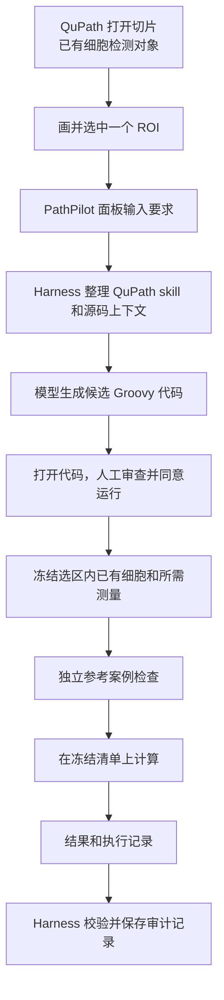

# PathPilot 代码阅读地图

> 核对范围：当前工作区中的 QuPath 0.8 源码版 PathPilot，以及与它相关的 Harness 和早期固定分析代码。核对日期：2026-10-27。

## 先用最简单的话说：圈一块地方，怎么算出细胞数量？

想象一张很大的病理切片是一张**大地图**，细胞是地图上很多很多**小圆点**。

1. **先找到小圆点。** 电脑先通过细胞检测，在切片上找到细胞并建立细胞对象。就像先把地图上的小圆点标出来。PathPilot 现在的计数入口不会替你自动做这一步。
2. **圈一块地方。** 你在 QuPath 里用鼠标画一个圈，并选中这个圈。这个圈叫做“选区”或 ROI。
3. **告诉 PathPilot 想做什么。** 比如输入“统计这个区域里有多少个细胞”。PathPilot 根据要求，请模型写一小段计算代码。
4. **先检查代码。** 代码会展示出来，操作者检查后明确同意运行。现在的代码审查并不等于系统级隔离。
5. **把圈里的小圆点拿出来。** 程序检查你选中的圈，找到属于这个圈的已有细胞，把需要的信息整理成一份临时清单。就像把圈里的小圆点一个个记在纸上。
6. **先做小考，再数清单。** 程序先用准备好的小例子检查生成代码；通过后，再把真实选区的清单交给代码计算。数完后得到细胞数量。
7. **记下发生过什么。** 结果和这次计算的相关记录会交给 Harness 保存和检查，方便以后追溯。

如果第 1 步没有找到任何细胞，当前真实选区流程会提示没有可用细胞，**不能把“还没检测”当成“这里有 0 个细胞”**。如果某个独立小考故意给空清单，它可以根据事先写好的期望检查返回 0 或检查指定异常；这和真实选区能否为空是两回事。

一次已经做过的真实验证中，细胞检测由另行审阅的上游流程完成；然后才进入 PathPilot 的选区统计。三张切片完成过工程流程验证，但这不代表临床准确性已经得到验证。

## 1. 先看整条路线

下面的箭头表示真实调用关系；模型不会直接看到整个切片或自动操作 QuPath。

把程序想成一个小组：Java 管 QuPath 界面和现场，Python 管模型请求及 Harness，Groovy 是在 QuPath 里执行的候选计算代码。JSON 是它们传递的结构化小纸条。模型生成只是写出候选代码；用户审查和实际执行发生在后面，是不同阶段。

### 推荐阅读顺序

| 顺序 | 问题 | 文件 |
| --- | --- | --- |
| 1 | 面板从哪里出现？ | [QuPathGUI.java](<../qupath-main 2/qupath-main/qupath-gui-fx/src/main/java/qupath/lib/gui/QuPathGUI.java>)、[ChatPanel.java](<../qupath-main 2/qupath-main/qupath-gui-fx/src/main/java/qupath/lib/gui/ai/ChatPanel.java>) |
| 2 | 用户输入如何变成两个操作：生成、审查运行？ | [AgentEngine.java](<../qupath-main 2/qupath-main/qupath-gui-fx/src/main/java/qupath/lib/gui/ai/AgentEngine.java>) |
| 3 | 任务怎么描述，模型怎么收到要求？ | [example.json](<../qupath-main 2/qupath-main/pathpilot-coder/example.json>)、[coder.py](<../qupath-main 2/qupath-main/pathpilot-coder/coder.py>) |
| 4 | QuPath skill 怎样进入 Harness？ | [source_skill.py](<../qupath-main 2/qupath-main/pathpilot-coder/source_skill.py>)、[harness_skills.py](<../qupath-main 2/qupath-main/pathpilot-coder/harness_skills.py>) |
| 5 | 生成的代码怎样做参考案例检查和真实计算？ | [review.groovy](<../qupath-main 2/qupath-main/pathpilot-coder/review.groovy>)，然后回到 `AgentEngine.captureSnapshot` |
| 6 | 执行完成后怎样检查和记录？ | [audit_execution.py](<../qupath-main 2/qupath-main/pathpilot-coder/audit_execution.py>)、[contracts.py](<../qupath-main 2/qupath-main/pathpilot-coder/support/harness_core/contracts.py>)、[runtime.py](<../qupath-main 2/qupath-main/pathpilot-coder/support/harness_core/runtime.py>) |
| 7 | 检测与固定报告原来怎样做？ | [capture_roi.groovy](<../code/qupath-agent/qupath_bridge/capture_roi.groovy>)、[roi.py](<../code/qupath-agent/qupath_bridge/roi.py>)；这是另一条早期固定流程 |
| 8 | 哪些事情真的测试过？ | [PathPilotCodeFlowSmoke.java](<../qupath-main 2/qupath-main/pathpilot-coder/tests/PathPilotCodeFlowSmoke.java>) 和 `pathpilot-coder` 中的 `test_*.py` |

第一次阅读先走完 1～6，不需要一开始读整个 QuPath 或所有 Harness 源码。下面的行号用于定位阅读起点，代码以后变动时以方法名为准。

## 2. 第一步：从 QuPath 找到 PathPilot 面板

### `QuPathGUI.java`：面板的门

从约第 332 行开始看：`new ChatPanel(this)` 创建面板；接着创建标题为 `PathPilot` 的标签页并加入界面。它回答的是“面板从哪来”，不负责细胞计数。

### `ChatPanel.java`：用户看到和操作的地方

文件：[ChatPanel.java](<../qupath-main 2/qupath-main/qupath-gui-fx/src/main/java/qupath/lib/gui/ai/ChatPanel.java>)。

| 位置 | 代码块作用 | 阅读时抓住什么 |
| --- | --- | --- |
| 约 73～310 行 | 样式及界面辅助代码 | 先略读，不是计算逻辑。 |
| 约 376、455 行 | 声明“审查并运行代码”按钮，构造 `AgentEngine` | 界面通过引擎处理任务。 |
| 约 632～637 行 | 绑定审查运行按钮 | 用户点击后进入执行入口。 |
| 约 814～831 行 | 绑定输入框、发送按钮等事件 | 一句话从界面进入工作流。 |
| 约 927～954 行 | 调用 `agent.bind(message)`，并使用后台线程执行返回的任务 | JavaFX 界面操作与耗时任务有分工，避免一直卡住界面。 |
| 约 1474 行 | 根据忙碌状态及是否有候选代码启用按钮 | 防止在不合适的状态点击。 |

`AISettings.java` 和 `AISettingsDialog.java` 管模型连接配置与设置界面；`AISettings.resolveApiKey`、`resolveBaseUrl`、`resolveModel` 是理解配置来源的入口。不要把密钥写进文档或提交到仓库。

## 3. 第二步：理解 `AgentEngine` 的两个阶段

文件：[AgentEngine.java](<../qupath-main 2/qupath-main/qupath-gui-fx/src/main/java/qupath/lib/gui/ai/AgentEngine.java>)。这是阅读当前 0.8 主线最重要的文件。

| 方法或位置 | 作用 | 输入与输出 |
| --- | --- | --- |
| 构造方法，约 34 行 | 找到工作区和 coder 所需路径。 | QuPath GUI → 引擎实例。 |
| `bind`，约 43 行 | 将操作分流：普通文字去生成，特定的“审查并运行代码”去执行。 | 消息 → 可在后台执行的任务。 |
| `bindGeneration`，约 49 行 | 检查模型配置，准备并展示任务参数及确认界面，然后启动 Python coder。 | 用户要求、任务规范 → 运行目录、候选脚本和日志。 |
| 约 72～84 行 | 用 `ProcessBuilder` 调 Python；成功后用 `Platform.runLater` 打开待审 Groovy 脚本。 | 这是跨语言启动，不是 Java 直接调用 Python 函数。 |
| `bindExecution`，约 90 行 | 先核对文件哈希和当前选区，展示完整脚本、要求操作者同意，再冻结输入和执行。 | 审查后的候选 + 当前图像与选区 → 结果和执行记录。 |
| `captureSnapshot`，约 166 行 | 从当前 ROI 的已有细胞整理快照，带细胞 ID 和任务要求的测量值；无有效细胞时拒绝继续。 | 图像、选区、规范 → JSON 快照。 |
| `python`，约 193 行 | 确定 Python 解释器路径，支持环境变量覆盖。 | 配置 → 可执行路径。 |
| `audit`，约 200 行 | 执行完成后启动 Python 审计脚本。 | 执行回执 → Harness 审计记录。 |
| `checkTarget`，约 210 行 | 检查图像、选区及当前平面没有在中途变化。 | 当前 QuPath 状态 → 通过或报错。 |
| `checkedFile`，约 229 行 | 按大小、文件位置和清单哈希核验待执行文件。 | 路径和清单 → 已核验内容或错误。 |

抓住两个时间点：**生成阶段**只产出候选文件并打开预览；**执行阶段**才冻结当前选区并运行。快照的意义是让计算和回执对应同一份输入；文件哈希用于发现内容变动。它们不是操作系统沙箱，不能因此认定任意模型代码都安全。

一次执行如果计算成功但后续审计失败，代码会分别报告，不能把“计算成功”误说成“完整审计也成功”。

## 4. 第三步：任务规范和模型生成

### `example.json`：给任务写一张要求单

[example.json](<../qupath-main 2/qupath-main/pathpilot-coder/example.json>) 是默认示例，主要字段：

- `goal`：想完成什么，例如统计已有细胞。
- `measurements`：每个细胞需要哪些测量；只计数时可以为空。
- `outputs`：希望返回哪些字段，例如 `total_cells`。
- `cases`：事先准备的小例子，含输入细胞和预期结果。当前默认示例包含空列表期望 0，以及三个对象期望 3。

这些案例是检查计算逻辑的例子，不是实际切片。案例也可以指定 `expected_error`；它和正常的 `expected` 二选一。例如，若任务明确规定空输入应抛出异常，案例也要写相应预期，否则会发生“代码认为该报错，案例却要求返回 0”的冲突。

### `coder.py`：把要求变成候选脚本

文件：[coder.py](<../qupath-main 2/qupath-main/pathpilot-coder/coder.py>)。

| 方法或代码块 | 做什么 | 为什么要读 |
| --- | --- | --- |
| `Case`，约 25 行 | 检查一个案例必须有预期结果或指定异常，不能同时有两者。 | 明白前面空细胞报错与案例预期为何必须一致。 |
| `Spec`，约 37 行 | 定义和核对目标、测量、输出、案例之间的一致性。 | 这是输入合同。 |
| `Reply`，约 54 行 | 检查模型响应的结构。 | 模型回复不能随便当作有效代码。 |
| `request_for`，约 81 行 | 根据目标、所需测量、输出和 skill 上下文构造请求。 | 独立案例答案、实际切片和选区细胞不作为模型任务内容发送。 |
| `complete`，约 96 行 | 调用配置的模型接口，处理超时、响应大小、重定向和返回格式。 | 这是网络边界。 |
| `issues_for`，约 124 行 | 对候选代码做初步检查。 | 这是预检查，不是安全沙箱。 |
| `review_script`，约 134 行 | 将候选代码、规范等组合进审核执行模板。 | 理解为什么预览文件不只是模型原文。 |
| `generate`，约 141 行 | 先准备 skill 上下文，再请求模型，保存候选、清单和状态。 | 串起完整生成过程；这里不执行候选代码。 |
| `main`，约 172 行 | 解析命令行参数，供 Java 启动。 | 理解 Python 的外部入口。 |

生成目录中值得认识的文件：`submitted-spec.json` 是界面提交的规范，`spec.json` 是实际生成使用的规范，`source-context.json` / `source-task.json` 是 skill 上下文及任务记录，`request.json` 是模型请求，`candidate.groovy` 是候选代码，`review_in_qupath.groovy` 是连同检查逻辑的待审执行脚本，`manifest.json` 保存状态与文件校验信息，`generation.log` 记录生成过程。实际运行目录可能含本地敏感信息，不应直接上传。

## 5. 第四步：Harness 如何管理 QuPath skill

这里的 skill 可以理解为“关于 QuPath 的一本使用手册和源码索引”，Harness 是负责登记、执行和留记录的工作台。两者不是病理检测算法。

1. [source_skill.py](<../qupath-main 2/qupath-main/pathpilot-coder/source_skill.py>)：确定 skill 的位置、版本和运行环境；将准备工作交给下面的 Harness 集成。
2. [harness_skills.py](<../qupath-main 2/qupath-main/pathpilot-coder/harness_skills.py>) 的 `load_qupath_skill`（约 21 行）：核对来源和文件摘要，查询源码索引，提取有限的相关上下文。
3. `foundation_prompt`（约 87 行）：整理可以给模型使用的基础上下文。
4. `prepare_qupath_skill`（约 100 行）：把 QuPath skill 加入 Harness 的注册表，通过受控工具运行并记录任务。

建议再读 [contracts.py](<../qupath-main 2/qupath-main/pathpilot-coder/support/harness_core/contracts.py>) 和 [runtime.py](<../qupath-main 2/qupath-main/pathpilot-coder/support/harness_core/runtime.py>)：

| 概念 | 位置 | 通俗理解 |
| --- | --- | --- |
| `Tool` / `PluginManifest` | `contracts.py` 约 17、33 行 | 一个工具是什么、属于哪个插件。 |
| `Agent` / `Profile` | 约 43、50 行 | 谁可以用什么能力，以及工作配置。 |
| `Task` / `TaskState` | 约 71、80 行 | 一次任务及其状态；失败和成功需要区分。 |
| `Artifact` / `AuditEvent` | 约 61、122 行 | 被保存的产物，以及发生过什么的记录。 |
| `Registry` | `runtime.py` 约 46 行 | 登记和查找插件工具。 |
| `Store` | 约 90 行 | 保存任务、产物和审计信息，并检查记录。 |
| `Runtime.run` | 约 248 行 | 按配置执行已注册工具，推进状态并处理失败。 |

这套 Harness 目前主要管理 skill 上下文与执行记录；不要把它理解为已经具备全自动病理诊断或操作系统级隔离的系统。

## 6. 第五步：真实细胞清单如何进入计算

### Java：先固定现场

回到 `AgentEngine.captureSnapshot`。它从 QuPath 当前图像的对象层级取得当前 ROI 内的已有细胞，为每个细胞整理标识和规范中要求的测量值；无效或缺失测量以 `null` 表示，不能擅自当成 0。快照还绑定选区、图像身份、平面和规范等信息。当前路径对真实输入的细胞数和快照大小设置了限制。

理解选区获取底层机制，可追到 [PathObjectHierarchy.java](<../qupath-main 2/qupath-main/qupath-core/src/main/java/qupath/lib/objects/hierarchy/PathObjectHierarchy.java>) 的 `getCellsForROI`（约 818 行）。具体边界和对象归属应以该实现及其测试为准，不要简单理解为“只要细胞挨到圈就算”。

### Groovy：先考试，再计算

文件：[review.groovy](<../qupath-main 2/qupath-main/pathpilot-coder/review.groovy>)。它是模板，生成时会与候选代码和规范组合。

| 位置 | 做什么 |
| --- | --- |
| 约 10～13 行 | 读取嵌入的任务规范；0.8 主线要求由 PathPilot 提供冻结快照。 |
| `checkResult`，约 14 行 | 核对候选代码的结果是否符合案例预期。 |
| `freezeCells`，约 25 行 | 将案例细胞清单包装为不可修改的集合，减少意外改动。 |
| 约 26～35 行 | 逐个运行独立参考案例；支持预期返回值或预期异常。 |
| 独立案例之后 | 读取 PathPilot 提供的冻结快照；缺少快照时拒绝运行。 |
| 约 68～末尾 | 调用候选 `analyze(cells)`，检查并组织结果与关联信息。 |

例如候选函数可以把清单长度作为 `total_cells`，但真正运行前必须通过对应规范的案例，并经操作者审查。`No existing cells found` 的含义是当前代码拒绝把未检测到的细胞当作零；如果案例输入为空还要求返回 0，而候选实现会抛异常，也会在案例阶段失败。解决时要先确认有没有完成细胞检测，再让需求、代码与案例的预期一致。

### `audit_execution.py`：结果完成后的核对

[audit_execution.py](<../qupath-main 2/qupath-main/pathpilot-coder/audit_execution.py>) 的 `load_execution`（约 66 行）校验回执、规范、脚本、快照和结果的关联；`build_runtime`（约 103 行）配置记录工具；`audit`（约 145 行）通过 Harness 保存审计结果并避免重复记录。它不是再跑一次细胞检测，也不能替代病理专家对结果准确性的确认。

## 7. 早期固定分析：理解项目从哪里发展过来

这一组是独立的固定规则分析路径，不应与上面的 0.8 模型生成主线混成同一个入口：

| 文件 | 代码块 | 作用 |
| --- | --- | --- |
| [qupath_bridge/__main__.py](<../code/qupath-agent/qupath_bridge/__main__.py>) | `prepare`、`run`、`write_report` | 准备固定流程脚本、调用分析并输出报告。 |
| [capture_roi.groovy](<../code/qupath-agent/qupath_bridge/capture_roi.groovy>) | 约 45～112 行 | 获取当前图像、选区、像素校准和通道信息，检查现场是否变化。 |
| 同上 | 约 113～133 行 | 按明确配置选择已有细胞或可选的 watershed 检测。 |
| 同上 | 约 134～178 行 | 选出区域内细胞，在副本上计算需要的强度测量，冻结快照并交给 Python。 |
| [roi.py](<../code/qupath-agent/qupath_bridge/roi.py>) | `Config`、`Snapshot` | 定义通道、规则、检测参数、输入快照等数据合同。 |
| 同上 | `bind_inputs`、`analyze`、`validate_report` | 绑定输入、执行固定规则、验证报告；未确认或不可判断的情况不能假装是阴性或零。 |
| [analysis.py](<../code/qupath-agent/agent_core/analysis.py>) | `execute_mps` 等 | 更早期的固定统计与结果检查，处理已有输入标签，本身不检测细胞。 |
| [preflight.py](<../code/qupath-agent/agent_lab/preflight.py>) | `preflight` 等 | 早期候选代码研究和静态预检；与当前 0.8 主线的真实执行不是一回事。 |

QuPath 原生的测量实现可从 [ObjectMeasurements.java](<../qupath-main 2/qupath-main/qupath-core-processing/src/main/java/qupath/lib/analysis/features/ObjectMeasurements.java>) 的 `addIntensityMeasurements` 开始读。固定流程和上游检测助手使用它；不要误以为当前 PathPilot 的每次计数都会自动调用它。

## 8. 代码同步与测试，从哪里确认事实

- [sync_workspace.py](<../qupath-main 2/qupath-main/pathpilot-coder/sync_workspace.py>)：当前 coder 和 skill 资源向兼容位置同步，并对来源文件生成校验。改共享代码后需要同步并运行 `--check`；阅读时不必运行。
- `pathpilot-coder/test_coder.py`：检查任务规范、模型响应和生成边界。
- `pathpilot-coder/test_audit_execution.py`：检查回执、快照、结果及审计关联。
- `pathpilot-coder/test_sync_workspace.py`：检查同步内容和来源。
- [PathPilotCodeFlowSmoke.java](<../qupath-main 2/qupath-main/pathpilot-coder/tests/PathPilotCodeFlowSmoke.java>)：用合成数据检查 QuPath 源码版界面的代码工作流。合成数据测试不能单独证明真实切片效果。
- 已有三张切片的工程验收记录说明真实流程已走通；这些记录不是临床效能评估。检测是独立的上游操作，当前主入口不自动检测。

目前仍有边界：没有证明候选代码具备操作系统级隔离；科学准确性与专家反馈尚待验证；Windows 过长路径问题有待合入的修复补丁，不能宣称当前主线已经修好。

## 9. 几个最容易混淆的词

| 词 | 这里的意思 |
| --- | --- |
| 切片 / 图像 | 打开的一张病理图，不等于细胞清单。 |
| Annotation / ROI | 用户画出并选中的区域及其几何形状。 |
| Detection / Cell object | QuPath 识别或建立的对象；有了细胞对象才可沿当前入口统计。 |
| Measurement | 某个对象的数值，例如强度；缺失值不等于 0。 |
| Spec / Case | 任务要求 / 预先准备的独立小例子。 |
| Candidate / review script | 模型生成的候选函数 / 合并检查逻辑后供审查执行的脚本。 |
| Snapshot / receipt | 执行时冻结的输入清单 / 关于执行和结果的回执。 |
| Skill / Harness | QuPath 知识与源码资源 / 管理工具、任务和记录的基础设施。 |

## 10. 以后想改功能，先看哪里

| 想改什么 | 首先看哪里 | 注意 |
| --- | --- | --- |
| 聊天框、按钮、提示 | `ChatPanel.java` | 不要把界面事件误认为计算本身。 |
| 生成与执行的衔接、选区快照 | `AgentEngine.java` | 保持人工确认、现场核对和输入一致性。 |
| 任务字段、模型请求或参考案例 | `coder.py`、`example.json` | 同时检查生成模板和案例预期。 |
| 模型可用的 QuPath 知识 | `source_skill.py`、`harness_skills.py` 及 skill 作者目录 | 检查来源、版本和同步规则。 |
| 结果记录与可追溯性 | `audit_execution.py`、`harness_core` | 执行成功和审计成功分别判断。 |
| 细胞检测或固定标记规则 | `qupath_bridge/capture_roi.groovy`、`roi.py` | 先确认这是旧固定路径还是要接入新的 0.8 入口；不能假装已经自动接入。 |

读完后可以不用运行模型，自问四个问题：① 选区画好了但没有细胞对象，为什么不能直接报 0？② 哪一步真的发起模型请求？③ 什么情况下候选脚本才会执行？④ 如果计算成功而审计失败，界面应如何说明？能沿上述文件回答这四题，就抓住了当前主线。
