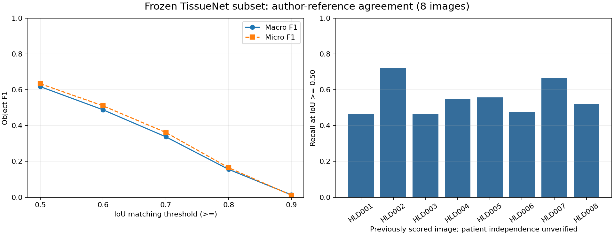
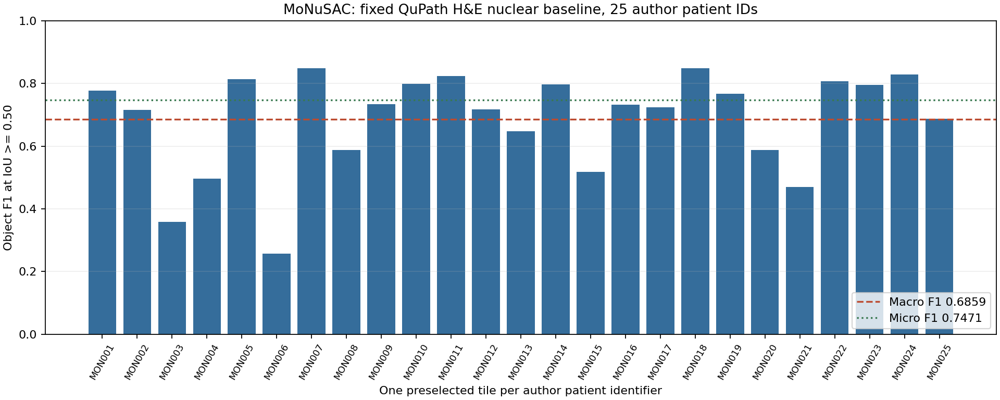

# 医学准确性验证：冻结复核与独立H&E基线

核对日期：2026-11-11。当前完成的是**与公开作者参考的一致性测试**。癌症诊断准确率、真实mIF表型准确率、TLS成熟度准确率和知识库增益均未建立；本轮没有新增专家批准。

## 本轮结论

- 原冻结TissueNet 8图完整复核：宏平均对象F1 **0.6177**，微平均F1 **0.6338**；未改参数、未重新推理、未把已评分图重新称为盲测。
- 新增独立来源MoNuSAC官方H&E测试数据，预声明25个作者患者标识各取排序首图，固定QuPath软件默认核检测。25/25原生推理完成，参考一致性宏平均F1 **0.6859**、微平均F1 **0.7471**。
- 两批图像模态、参考对象与软件参数不同，**不合并分数，不据此声称荧光模型泛化改善或RAG提高医学表现**。MoNuSAC是独立数据上的另一个固定软件基线。

## 一、TissueNet：已冻结8图的详细复核

全部参数、样本清单、原生输入、RGB输入、作者参考和预测摘要通过；IoU≥0.50的逐图所有历史指标在1e-12容差内重现。实际参考618对象、预测499对象，TP354、FP145、FN264；微平均精确率70.94%、召回率57.28%，计数MAE14.875个/图。

未匹配参考中88个与所有预测完全没有像素重叠，176个有重叠但不能达到有效一对一匹配；145个未匹配预测全部与参考有部分重叠。77个未匹配参考与多个预测重叠，63个未匹配预测与多个参考重叠。后一组只是几何现象，不能自动断定过分割/欠分割；核与整细胞参考生成版本尚未完全核准，也可能影响边界评价。

| IoU匹配阈值≥ | 逐图宏F1 | 合并微F1 | 有效匹配TP |
|---|---:|---:|---:|
| 0.50 | 0.6177 | 0.6338 | 354 |
| 0.60 | 0.4881 | 0.5103 | 285 |
| 0.70 | 0.3372 | 0.3617 | 202 |
| 0.80 | 0.1554 | 0.1647 | 92 |
| 0.90 | 0.0130 | 0.0107 | 6 |

高IoU下匹配快速下降，说明当前轮廓与作者参考差距明显。改变的是评分门槛，模型与预测不变，不能称为五个模型实验。8图患者独立性未确认，不输出患者级置信区间。



## 二、MoNuSAC：独立来源的核检测基线

数据取自[赛事官方Data页面](https://monusac-2020.grand-challenge.org/Data/)所列Testing Data链接，许可为CC BY-NC-SA 4.0。已下载202,746,703字节原始ZIP，全部313项CRC通过；本地SHA256为`bcbc38f6bf8b149230c90c29f3428cc7b2b76f8acd7766ce9fc908fc896c2674`。这是本地传输指纹，未取得官方发布的全包校验值。

归档有101组SVS与XML，25个不同作者患者标识。运行前固定每个标识按文件名排序首张SVS，覆盖全部25个标识；没有按细胞数量、图像观感或成绩筛选。输入改用匿名MON001–MON025，推理配置不含参考路径，脚本未读取XML，推理回执完整后才评分。这里的患者标识去重不等于验证临床患者诊断，也未证明与所有既有模型训练数据无重叠；没有操作系统级盲法隔离。

本轮复用QuPath 0.8原生WatershedCellDetection：H&E软件默认染色向量，检测Hematoxylin OD；检测分辨率0.5µm，背景半径8µm，sigma 1.5µm，核面积10–400µm²，强度0.1，核形状分裂开启，细胞扩张0µm。尺度逐图与作者XML的MicronsPerPixel核对。**这些是软件基线参数，不是经过医学确认的阳性阈值。** 零扩张后核对象独立导出，不把整个细胞ROI当核ROI。

参考光栅化沿用[组织者示例](https://github.com/ruchikaverma-iitg/MoNuSAC/blob/master/n-ary_mask_generation.ipynb)的`skimage.draw.polygon(y,x,shape)`规则。888个Ambiguous区域的758,930个像素从两张掩膜同时清零，保留剩余实例ID；1个参考对象、439个预测对象因此完全消失，不计入有效评价分母。该规则与[赛事示例的模糊区域处理](https://github.com/ruchikaverma-iitg/MoNuSAC/blob/master/PQ_metric.ipynb)思想一致，但本次是类别无关IoU≥0.50对象F1，**不是官方按类别、IoU>0.50的PQ挑战赛成绩**。官网用于展示的彩色GT图片未用于评分。

### 标注质量问题完整保留

两份XML共7个NegativeROA=1标记。组织者示例不解释该标记，逐Region填充；本轮按同一规则保留，并记录尚未裁定的语义。118个区域含图界外顶点，依官方shape裁剪，1个区域完全在图外；没有平移、缩放或按结果改参考。原作者核多边形相互覆盖共4,129像素，采用明确的后写入实例覆盖规则。以上限制意味着结果是对该公开参考处理口径的一致性，不能视为无误的专家真值。

### 完整25图结果

有效参考 **7099**，有效预测 **7785**，TP **5560**、FP **2225**、FN **1539**。合并精确率 **71.42%**、召回率 **78.32%**、微F1 **0.7471**；逐图宏F1 **0.6859**，逐图前景Dice均值 **0.7372**，计数MAE **56.4** 个/图。逐图F1范围0.2564–0.8496，平均值不能掩盖失败图。

| 图ID | 参考数 | 预测数 | TP | FP | FN | 对象F1 |
|---|---:|---:|---:|---:|---:|---:|
| MON001 | 7 | 11 | 7 | 4 | 0 | 0.7778 |
| MON002 | 256 | 205 | 165 | 40 | 91 | 0.7158 |
| MON003 | 26 | 52 | 14 | 38 | 12 | 0.3590 |
| MON004 | 314 | 527 | 209 | 318 | 105 | 0.4970 |
| MON005 | 308 | 326 | 258 | 68 | 50 | 0.8139 |
| MON006 | 12 | 27 | 5 | 22 | 7 | 0.2564 |
| MON007 | 303 | 326 | 267 | 59 | 36 | 0.8490 |
| MON008 | 14 | 20 | 10 | 10 | 4 | 0.5882 |
| MON009 | 639 | 731 | 503 | 228 | 136 | 0.7343 |
| MON010 | 324 | 347 | 268 | 79 | 56 | 0.7988 |
| MON011 | 207 | 213 | 173 | 40 | 34 | 0.8238 |
| MON012 | 625 | 467 | 392 | 75 | 233 | 0.7179 |
| MON013 | 277 | 186 | 150 | 36 | 127 | 0.6479 |
| MON014 | 458 | 496 | 380 | 116 | 78 | 0.7966 |
| MON015 | 49 | 86 | 35 | 51 | 14 | 0.5185 |
| MON016 | 861 | 1100 | 718 | 382 | 143 | 0.7323 |
| MON017 | 377 | 548 | 335 | 213 | 42 | 0.7243 |
| MON018 | 583 | 587 | 497 | 90 | 86 | 0.8496 |
| MON019 | 148 | 188 | 129 | 59 | 19 | 0.7679 |
| MON020 | 7 | 10 | 5 | 5 | 2 | 0.5882 |
| MON021 | 5 | 12 | 4 | 8 | 1 | 0.4706 |
| MON022 | 134 | 114 | 100 | 14 | 34 | 0.8065 |
| MON023 | 442 | 400 | 335 | 65 | 107 | 0.7957 |
| MON024 | 518 | 546 | 441 | 105 | 77 | 0.8289 |
| MON025 | 205 | 260 | 160 | 100 | 45 | 0.6882 |



原始多边形类别有5005个Lymphocyte、2046个Epithelial、22个Neutrophil、28个Macrophage（裁剪/排除前）。本次将四类合为核目标，没有产生细胞类别预测；类别高度不均衡，不能由总F1推断巨噬细胞、粒细胞或肿瘤细胞识别准确率。也不把作者标为Epithelial直接改成恶性细胞。

## 三、本地证据与复现

工作区相对位置如下，原始图像、参考和叠图均只保存在本地，不随网站分发。

- `output/medical-validation-20261111/MoNuSAC Testing Data and Annotations.zip`：官方原包；下载回执和3份组织者原代码的来源/摘要在同级目录。
- `output/medical-validation-20261111/tissuenet-audit/accuracy-audit.json`、`per-image-metrics.csv`、`matching-details/`、`local-error-overlays/`：8图摘要验证、逐阈值结果、逐对象对应及本地叠图。
- `output/medical-validation-20261111/monusac/protocol.json`、`manifest.json`、`input-config.json`、`native/receipt.json`、`results-frozen.json`：25图冻结协议、独立输入、实际推理与评分回执。
- 本地叠图共33张：绿色为有效匹配预测轮廓，红色为未匹配参考轮廓，蓝色为未匹配预测轮廓；颜色可覆盖，精确对应以JSON为准。PNG按原宽高比缩放，不重绘组织。

```powershell
$env:PYTHONUTF8='1'
& 'F:/Python/Python310/python.exe' -m unittest discover -s pathology-knowledge/scripts -p test_real_validation.py -v
& 'F:/Python/Python310/python.exe' pathology-knowledge/scripts/audit_accuracy.py
& 'F:/Python/Python310/python.exe' pathology-knowledge/scripts/validate_monusac.py score
```

11项工程检查通过，包括微/宏平均差异、摘要绑定篡改拒绝、原始标签ID、官方多边形边界、NegativeROA兼容、模糊区域排除及缺交不生成总分。`common.sha`修复为分块读取，兼容本机Python3.10；未安装新依赖，未改变生产环境。工程检查只保证计算实现，不增加医学可信度。

## 四、下一步与本轮未关闭的问题

1. 保留MON003/MON006等低分图作开发排错，不能继续把这25图当未接触最终测试。后续算法选择需独立开发集，最终测试另冻结。
2. 解决TissueNet核/整细胞生成版本和MoNuSAC标注歧义，必要时由独立病理审核给出裁定记录；不以模型表现修改标签。
3. 真正的mIF/IMC验证仍需可信panel、标记阳性参考和专家细胞/TLS标注。本轮未将未知50通道身份补猜为已确认，也未用H&E替代mIF成熟度测试。
4. 要评价知识库收益，需同图、同检测器、同预算的无RAG/有RAG配对协议及独立参考；当前没有此类增益结论。

网页仅发布数值图表和本报告；原片、作者XML、逐像素标签及本地专家参考未上传。
