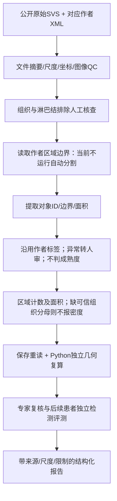

# 主案例推荐与内部筛选评分

核对日期：2026-11-10。推荐状态：**研究路线推荐，待专家确认**。这份报告完成当前资源条件下的候选排序，不表示医学准确性已获验证，也不把 FYP 永久限定为肺癌。完整任务仍为 PARTIALLY_COMPLETE。

## 评分口径

比较锚点为“肺组织中 TLS 的结构识别与可复现定量”，不是某位患者。癌种/组织学20、任务25、判据20、图像20、复现/验证10、FYP相关5，总计100。85–100为Primary，70–84为Secondary，50–69为Reference，低于50为Not Selected。评分是本项目的资源筛选判断，不能用作医学标准或模型性能。

图像评分以实际取得且来源可核验的输入为主；仅有仓库声明、论文图或摘要低分。来源未读、panel不明、判据冲突均扣分；不为满足数量强行纳入。推荐的任务边界与评分必须一起阅读。

| 候选 | 癌种/组织学20 | 任务25 | 判据20 | 图像20 | 复现10 | FYP5 | 总分/等级 |
|---|---:|---:|---:|---:|---:|---:|---|
| LUSC H&E TLS作者区域计量，HookNet配套原片 | 20 | 24 | 13 | 19 | 6 | 5 | **87 / Primary** |
| NSCLC TLS mIF成熟度与Ki-67，2026研究 | 17 | 24 | 17 | 5 | 7 | 5 | **75 / Secondary** |
| NSCLC TLS IHC成熟度与丰度，2022研究 | 16 | 24 | 16 | 5 | 7 | 5 | **73 / Secondary** |
| 肺癌H&E TLS检测，PLOS 2021 | 18 | 23 | 11 | 6 | 6 | 4 | 68 / Reference |
| HCC治疗后TLS/IMC候选 | 12 | 21 | 6 | 8 | 3 | 4 | 54 / Reference |
| 肺癌引流淋巴结/TLS研究，尚未阅读全文 | 16 | 21 | 5 | 2 | 3 | 4 | 51 / Reference |
| 乳腺sTIL共识候选，完整版本待核验 | 8 | 13 | 9 | 2 | 4 | 3 | 39 / Not Selected |
| CRC出芽ITBCC摘要参考 | 6 | 12 | 10 | 2 | 4 | 3 | 37 / Not Selected |
| CRC自动出芽2025研究，尚未阅读全文 | 6 | 12 | 4 | 2 | 3 | 3 | 30 / Not Selected |

## 每个分数的依据

每行六项理由按评分列顺序排列。来源未完整核验导致的低分表示当前证据不足，不是在评价论文的科学质量。

- **LUSC 87**：所选原片有作者癌种映射及GDC形态学记录支持；计数/面积与组织级TLS量化直接相关；主文已读但H&E参照不完美、密度分母缺失、无本地自动识别判据；取得1张完整SVS及8个精确对应作者区域；原生保存重读与独立面积复算通过，但只有1张演示片、无医学盲测；可复用现有QuPath、Harness和版本链。19分图像不代表图像质量已逐区获专家批准。
- **2026 NSCLC 75**：同器官但65 LUAD/23 LUSC混合且治疗背景受限；成熟度/增殖直接相关但必须拆任务；结构、分母明确，CD21条件内部冲突扣分；没有本地原始mIF，仅论文展示；有双病理复核及一致性，缺外部验证和本地真值；符合多通道FYP方向，原图门槛尚未满足。
- **2022 NSCLC 73**：同器官但混合亚型及三个治疗组；TLS成熟度/丰度相近；PFL+SFL的二分类清楚，最高丰度依赖定性形态，非通用数值规则；无本地原始配套切片；121例与两病理复核可追溯，缺本地医学验证；适合做来源规则差异与正确拒答实验。
- **PLOS 68**：肺切除背景相近但包含不同亚型且样本数字矛盾；H&E检测/区域计量相近；阈值来自两个数据集共同观察，不能视作独立验证的通用判据，不能区分成熟度；作者Zenodo入口存在但档案未在本地核验；作者报告5/13患者拆分及400细胞比较，同院数据与描述矛盾限制强度；可作方法对照，暂不启动另一套模型训练。
- **HCC 54**：不同器官、治疗后背景；TLS形态/空间问题相关；原文尚未完整取得，不能提炼正式规则；已取得有许可的RGB ROI和表格，但不是raw IMC；校验和与头信息可重复，尚无原始通道/医学复核；可补充空间方法，暂不足以投入核心实验。
- **引流淋巴结研究51**：肺癌背景相近但亚型/队列尚未全文提取；与TLS形成/成熟相关；全文文件取得但未读，规则不给高分；配套原片未取得；只有书目核验与文件回执；暂作机制背景，后续阅读后重新评分。
- **乳腺sTIL 39**：器官/组织学不同；评分对象为间质单核炎细胞面积比例，与TLS结构不同；正式共识候选有原始表格线索，但全文/版本未完成；没有适配原片；尚不能复现实验；保留规范检索线索，不与TLS分母合并。
- **ITBCC 37**：CRC而非肺；对象是1–4个肿瘤细胞的出芽，不是免疫结构；原始摘要支持0.785 mm²侵袭前沿热点和三级评分，完整分级细节尚缺；既有CODEX图块不是合格出芽WSI；摘要与DOI已核验但无本地评分真值；保留部分标准参考，当前不实现BD分级。
- **CRC算法30**：癌种不同；出芽可共享部分检测工程但医学对象不同；已取全文尚未读，规则不可补写；原始配套图像未取得；元数据/文件回执不足以证明复现；本阶段避免扩展独立任务。

## 选择结果及可执行边界

**Primary：肺鳞癌H&E TLS标注辅助定量。** 当前对应 `case-tls-lusc-author-count`。先复现作者标注的对象计数、单对象面积及总面积、坐标与尺度一致性、保存重读及独立结果核对。实际1张原片、8个作者TLS区域；这张已接触数据只能作开发演示。现有作者区域计量脚本可直接运行，但不检测TLS、不推断成熟度、不证明病理准确率。完整组织/肿瘤排除区和分母核验后才能增加密度与空间距离；不能用稀疏tumor标注代替完整肿瘤区。

选择这一研究路线的优势是癌种/具体原片组织学可追溯、输入和作者区域已实际取得、工作流已执行。主要风险是H&E参照本身存在漏标/误标、小GC漏判，原文1019张与188+69+767的拆分数字也不一致。既不复制该拆分作为本项目队列，也不把作者标注当无误差金标准。

**Secondary 1：NSCLC mIF TLS成熟度与TLS内Ki-67。** 对应2026研究任务，当前只能比较外部核验的结构特征。取得raw mIF、明确marker与强度对照、核分割真值和专家处理CD21冲突后再升级。成熟比例、单TLS增殖比例、患者等权均值分开保存，禁止以预后中位数替代细胞阳性阈值。

**Secondary 2：NSCLC IHC TLS成熟度/丰度。** 对应2022研究任务，保持治疗组和亚型分层。PFL+SFL高成熟度不能与Secondary 1的“SFL才成熟”互换；此项优先验证来源选择、缺数据拒答和定性分级转人审，不当作第二套已经有原片的实验。

旧三张QPTIFF、TissueNet、CODEX、MIHIC、NISD继续保留。它们分别服务未知临床输入的工程审计、细胞分割、空间方法或组织分类，不能因为文件存在就成为本次TLS核心病例。没有删除任何旧卡或数据。

## FYP十项可行性比较

| 维度 | Primary：LUSC H&E | Secondary 1：NSCLC mIF | Secondary 2：NSCLC IHC |
|---|---|---|---|
| Medical Relevance | TLS组织级免疫研究，有文献支持 | TLS成熟/增殖研究 | TLS成熟/丰度及治疗背景 |
| Criteria Clarity | 计量明确；生物学识别仍需专家 | 结构规则明确但CD21冲突 | 三阶段与二分明确；最高丰度定性 |
| Quantifiability | 已有计数/面积；密度缺分母 | 成熟比例、每TLSKi-67、患者均值 | 阶段、丰度、位置 |
| Image Availability | 1张完整SVS+8作者区域 | 无本地raw mIF | 无本地原始配套切片 |
| QuPath Compatibility | 0.8原生实际读写通过 | 条件可行，未验证raw输入 | 条件可行，未验证raw输入 |
| Agent Suitability | 任务规划、范围核对、审计 | 来源选择与冲突/缺panel拒答 | 规则版本与治疗背景选择 |
| Code Generation | 可生成可审核几何计量；未测该任务模型增益 | 仅特征规则比较，不是原图特征提取 | 仅特征规则比较 |
| Reproducibility | 输入摘要、尺度、保存重读与独立面积 | 文献特征用例可复跑，原图不能 | 文献特征用例可复跑，原图不能 |
| Validation | 作者参照+独立工程复算，非医学盲测 | 作者病理复核，本项目未医学验证 | 作者病理复核，本项目未医学验证 |
| FYP Feasibility | 最先做；固定范围，补患者独立队列 | 取到raw和专家后升级 | 先作规则差异与人审节点对照 |

## Primary独立流程

自动检测属于下一实验阶段：必须先冻结新的患者级输入清单、适用组织/排除区及评价协议，预测与参考分开；检测性能用真实对象匹配测量，不能以“读到了8个作者标签”计算检测准确率。没有专家条件时先报告作者参考下的误差和不确定性，不生成临床结论。

## 原始依据与本地证据

- [HookNet-TLS原文](https://doi.org/10.1038/s43856-023-00421-7)：Par13–16、22、24、28、35–36、46、48–49；主文、表格文本、图注及声明已读，独立补充附件尚未完整阅读。
- [肺癌H&E TLS原文](https://doi.org/10.1371/journal.pone.0256907)：sec007、sec011、sec012；原文已读，样本数字矛盾保留。
- [NSCLC成熟度研究](https://doi.org/10.1136/jitc-2022-005531)；[NSCLC Ki-67研究](https://doi.org/10.1186/s12885-026-16525-x)：见诊断标准比较报告的精确定位。
- 原片下载回执、QuPath执行、独立面积复算：`pathology-knowledge/case_resources/hooknet/slide-download-receipt.json`及`output/case-curation-20261110/hooknet-native/`。原图、标注与论文正文不随网站发布。
- 未读候选的DOI、元数据与访问状态见`literature_search_report.md`及本地来源登记，不以候选评分代替全文核验。

---

# 案例整理任务验收与12项答复

核对日期：2026-11-10。状态：**PARTIALLY_COMPLETE**。这是阶段验收，不是医学有效性证明。原文要求的9份研究报告现在全部存在，但文件存在不等于所有研究工作完成。

## 12项答复

1. **多少个案例？** 当前原Knowledge Engine有4个CaseCard：1个图像资源案例、2个NSCLC研究任务、1个CRC部分标准参考；不是4位患者。另有172个SlideCard，原始患者数仍UNKNOWN。旧62张知识卡不是62例临床病例。
2. **保留哪些？** 原62张卡的既有版本全部保留；三张用户QPTIFF保留作私有输入/工程检查，TissueNet、CODEX、MIHIC、NISD分别保留作分割、空间、组织分类或核检测参考，不删除旧数据。
3. **重新分类哪些？** 方法图块、核图和组织分类图从“癌症诊断案例”分离为工程/方法资源；未知panel的QPTIFF仍待核验。LUSC H&E区域计量、NSCLC IHC成熟度、NSCLC mIF成熟度/Ki-67、CRC出芽独立分组。NSCLC不自动改成LUAD或LUSC。
4. **哪些缺明确标准？** 三张旧QPTIFF缺病例级诊断与panel；CRC参考缺ITBCC完整原始分级规范；乳腺sTIL全文/适配版本待核；HCC和引流淋巴结研究尚未完成原文提取。TLS两篇成熟度规则不同，2026研究还含CD21内部矛盾；H&E作者计量协议不是生物学自动识别标准。
5. **新增多少论文？** 本轮核验9篇书目，其中7个DOI不在旧登记中。不能把活动库22个来源都称论文，来源中有说明、审计和运行证据。
6. **多少全文？** 本轮6份许可明确XML取得，4篇主文、表格文本、图注及声明实际已读，其中3篇为新DOI。尚未完整阅读独立补充附件或检查所有图像像素。其余2份XML尚未读，不能标VERIFIED_FULL_TEXT。全项目更早批次全文不混入本轮数字。
7. **真实WSI多少？** 本地已确认4张：3张原有QPTIFF，加1张新增公开GDC LUSC SVS。新增SVS通过官方MD5与QuPath原生读写；旧3张癌种和panel仍未知。作者仓库的1019份标注索引不代表本地已下载1019张WSI。
8. **ROI或代表图多少？** 明确来源的非WSI视野/图块为166份：24 TissueNet、4 CODEX、21 MIHIC、116 NISD主表示，加1份HCC RGB派生ROI；不是166位患者。另有1份有效但来源未核实TIFF及1份317字节失败记录。新增WSI有8个作者TLS多边形，它们是该片内区域，不另计8张图。未把论文图注或网页截图计为下载的原始病理图像。
9. **哪些可直接形成QuPath工作流？** LUSC作者区域计数/面积已有可执行Groovy、保存重读和独立几何复算。旧TissueNet工程分割工作流也已运行，属于历史方法验证。两个NSCLC病例仅支持已核验特征输入的规则比较，不具备原图到成熟度的完整工作流；CRC因标准/图像不足保持阻断。
10. **首个实验对象？** 推荐LUSC H&E TLS标注辅助定量，内部87分。首先复现实验输入、8区域计数/面积和审计链；它不等于自动TLS检测。随后取得患者独立新片、完整组织排除区与专家参考，再评估检测和密度。两个NSCLC成熟度研究为次路线，详见主案例推荐。
11. **专家还需确认什么？** TLS/淋巴结/非组织化炎症及T/B细胞团边界，GC形态，成熟度来源冲突，panel/阳性对照/区室，分割口径，肿瘤与组织分母，治疗/组织学适用性、丰度定性分级。专家批准数仍为0；旧Treg新版来源只能支持特定研究标注，不能证明功能抑制或泛癌适用。
12. **下一步最值得投入？** 完成选定主路线的病理专家复核、患者级独立队列与QC/组织分母，然后在冻结输入和评价协议下运行真实TLS检测。多通道路线先取得raw通道、panel与匹配参考；不要先扩大模型或癌种数量。当前还可继续合法来源核验与原文阅读，无需等待专家才能推进这些工作。

## 对照原任务的验收

| 原要求 | 当前证据 | 判定与剩余工作 |
|---|---|---|
| 先审计架构、网页、旧知识和图像 | 源码地图、盘点、浏览器记录、原库快照 | 已完成首轮审计；不是逐像素临床QC |
| 每资源15项状态、头信息及摘要 | 两份inventory报告、私有170条快照 | 已有状态；缺临床资料不猜测，新增两份另由SlideCard记录 |
| 去重与癌种/组织学/任务/流程分组 | 资源摘要无完全重复组、similarity报告 | 文件去重已做；患者去重与未知组织学仍待核验 |
| 当前学校浏览器与可追溯文献检索 | 实际Discover/EBSCO检索记录 | 已复用；逐篇订阅全文未全部验证，不能声称检索穷尽 |
| P1共识与原始标准，候选任务适用性 | 9篇核验、4篇阅读全文、2套成熟度比较 | 部分完成；ITBCC/sTIL完整标准、其他评分候选仍不足 |
| 每篇规定元数据与研究字段 | registry、receipts、4份review | 已读来源可提取；未读来源的完整研究字段不能视作已验证 |
| TLS各结构、不同panel/判据保留 | criteria比较、review、版本卡片 | 已保留差异；PNAd/HEV等不能由现有输入推断 |
| 固定100分、逐维理由、1主最多2次 | recommended_primary_cases.md | 当前条件下已完成推荐；缺原片的次路线不冒称可执行 |
| 真实WSI/ROI、来源许可与完整性 | 官方下载MD5、QuPath、独立面积、RGB头信息 | 有1新增匹配WSI；raw mIF/IMC仍缺，截图不替代 |
| Slide字段与未知值、旧卡不覆盖 | 172 SlideCard、版本日志、原库逐行比较 | 有实体和记录；病例归属/临床字段仍存在UNKNOWN |
| 四种病例实体与旧marker/metric/evidence关联 | 同一Engine4/172/4/4，旧62版本不变 | 首批已接入；新阅读的H&E来源仍需选择性接入，未自动导入全文 |
| 每案例可执行12步流程及步骤字段 | WorkflowCard、Groovy、流程报告/Mermaid | 1工程流程已执行；2特征比较、1阻断，不能判全部满足 |
| 规则、五态、人审、范围与缺值 | 同一Engine实现、35项工程测试与真实特征回执 | 工程机制已验证；原图特征提取/病理准确性未验证 |
| 6类过滤与带来源的RAG示例 | 原BM25/本地向量/RRF/重排/Harness四查询 | 首批实际查询0/2/1/1；扩展库检索质量仍需专家基准 |
| 9报告、独立Mermaid、12项答复 | 9份指定报告+本报告 | 文档交付存在；研究缺项继续保留 |
| 不改旧QuPath skill、不上传私图、版本记录 | 维护源/快照和公开文件白名单 | 本轮未改QuPath编码skill功能；原片/XML/SQLite不发布 |
| PROGRESS与公开网页同步、验收状态 | 根PROGRESS、公开摘要及发布回执 | 随本轮更新核验；完整任务保持PARTIALLY_COMPLETE |

## 权威证据入口

数据库规模及旧行不变：`output/case-curation-20261110/case-layer-import-summary.json`；实际查询与规则结果：`case-layer-real-validation.json`；新增原片几何验证：`hooknet-native/independent-validation.json`；来源阅读/哈希：`pathology-knowledge/sources/metadata/source_registry_case_curation.jsonl`与`case-curation-reviews/`；研究限制：`research_gaps.md`。

本报告不据已有测试宣告完整目标完成。当前还缺可用于成熟度验证的raw图像、完整共识标准、部分候选阅读、病例级医学归属和从原图提取特征的验证。能够继续的来源核验、数据获取和主流程完善仍应推进。
