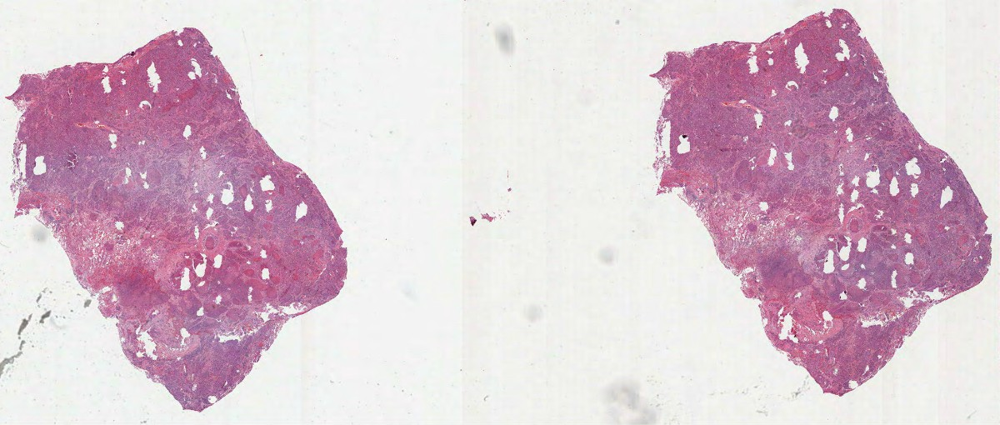

# 病例库整理与现有资源审计

核对日期：2026-11-10。新任务总体状态：**PARTIALLY_COMPLETE**。资源审计、首批原文标准与真实原片流程已核验；首批案例实体已接入原Knowledge Engine，当前研究路线评分推荐已形成，完整标准补齐、病例归属和原图医学验证仍未完成。

## 本日后续：首批病例层接入

| 当前活动实体 | 数量 | 范围 |
|---|---:|---|
| CaseCard | 4 | 1个实际图像资源案例、3个研究任务/参考案例；不是4位已验证患者 |
| SlideCard | 172 | 原170条文件资源加新增WSI/RGB，缺项与失败记录保留，不等于172份可用医学真值 |
| DiagnosticCriteriaCard | 4 | 研究特定规则、工程协议与尚待完整标准的参考项分开 |
| AnalysisWorkflowCard | 4 | 1个作者区域计量工程已验证，2个仅特征比较，1个因原标准/输入不足而阻断 |

仍使用原SQLite卡片/版本表、原BM25/本地向量/融合与重排、原Harness。新增内容后活动库为22个来源、2738个活跃块，来源包含论文、作者说明、审计和运行记录，不能称22篇论文。原62张卡和所有原来源/段落/卡片历史逐条未改写；扩展前15篇/1820块及其检索成绩仍是旧基线，不能把旧MRR当作新病例检索效果。

病例支持癌种、组织学、任务、marker、模态、证据、标准类型及工作流/图像可得性预过滤，查询结果附实际版本和来源。已用真实本地模型执行四条查询：

| 查询 | 实际结果 |
|---|---|
| 肺癌TLS成熟度且有本地可用mIF WSI | 0条；没有用论文代表图补成可用原片 |
| 有明确原文判据的肺癌研究候选 | 2条NSCLC研究任务，图像缺项明确 |
| CRC tumor budding标准研究 | 1条参考案例，仅摘要/部分标准，不能输出患者分级 |
| 有本地WSI的已验证LUSC作者区域工作流 | 1条，作者标注计量而非自动检测 |

五态规则比较可返回Positive、Negative、Indeterminate、Insufficient Data、Out of Scope；缺panel、队列/标本不适配、混合癌种、原文冲突均不强行给成熟度。病例规则证据与旧marker相关背景分别标注；不把相关概念自动变成适用标准。所有查询和比较都不授予执行权限，也未产生专家批准。

新实体关联已复用原marker/QC版本，并增加只限本轮来源解释的CD21概念、4个研究指标。原片计量的真实8个作者区域和mIF规则的合成特征工程检查分别记录，后者不是医学准确率。

## 本日后续：原文标准与原始切片

本轮9篇书目已通过配置范围内的DOI/题名/作者/年份核验，其中7个为原登记外的新DOI。6份许可明确的XML已取得，只有4篇解析主文、表格文本、图注及数据声明已读（其中3篇为新DOI；独立附件及所有图像像素尚未完整核验），没有把“取得”计作阅读全文。可选同名版本查找遭遇Semantic Scholar 429，已明确关闭该可选项后重跑，核验范围另记。

两篇NSCLC原文的成熟度二分类不同：一篇合并PFL与SFL作为高成熟度，另一篇仅把SFL列为成熟。后一篇对CD21/CD23还存在方法与结果描述差异，已保留待病理人审；Ki-67患者汇总遵循每TLS比例的均值，不替换为合并细胞比例。这些都是论文特定操作定义，没有升级为跨癌种共识。

新增一张公开TCGA-LUSC原始SVS，大小661049717字节，官方MD5通过；QuPath实际读取尺寸137172×58340、MPP 0.252µm，导入8个精确匹配的作者TLS区域。保存重读通过，Python独立多边形面积与QuPath一致。两套标注坐标比例2.0，对应派生MPP为0.504µm，没有按目录名猜成精确0.5。

上图是完整原片的缩略概览，不是用论文图替代WSI；原始SVS和作者XML仍只在本地。图像来自NCI GDC/TCGA，原生降采样后JPEG压缩，无生成式修改、无参考标注覆盖；[来源与使用说明](assets/cases/TCGA-HookNet-NOTICE.txt)。8个区域是作者提供的标注，不是本系统新检测出的结构。

当前只有标注计数和面积工作流获得工程验证：没有可信组织/肿瘤分母，未输出密度；没有mIF判定输入，未输出成熟度。另取得的HCC TIFF经实际检查为uint8三通道RGB派生图，不能当原始多通道IMC定量输入。

本地新增`reports/diagnostic_criteria_comparison.md`、`reports/slide_availability_report.md`和`reports/workflow_standardization_report.md`，包含证据定位、限制和独立任务Mermaid。首批卡片与过滤查询已接入；更多原始标准的核验、未知资源病例归属、后续标准与病例归属继续核验；当前评分推荐见[案例推荐与任务验收](案例推荐与任务验收.md)。

## 浏览器与项目现状

已实际连接用户日常Edge，确认XJTLU Library的Discover框、现有EBSCO结果页及候选详情页可读；未读取或保存登录凭据。实际访问项目网站，核对了11月2日的问题清单与第二轮板块。机构全文能否访问须逐篇验证。

本次暂不限定单一癌种，按癌种/组织学、任务及流程分别比较；此前NSCLC聚焦建议不作为本次已确定的研究边界。TLS是结构识别与定量任务，不是癌症诊断类别。

## 既有知识审计

| 项目 | 当前核对结果 |
|---|---:|
| 原知识卡文件 | 62 |
| runtime状态为REQUIRES_EXPERT_CONFIRMATION | 61 |
| runtime状态为DRAFT | 1 |
| 专家确认 | 0 |
| 扩展前种子库独立来源 | 15（旧基线） |
| 旧基线活跃证据块 | 1820 |
| 历史块行数 | 2441，不能全计作当前有效块 |
| 四类新案例实体 | 首次审计为0；接入后的数量见本页最新表 |

首次审计时只有六类旧卡；当前已扩展四类病例实体，总计十类契约。原有Marker、Phenotype、Method、Metric、QC与Evidence保持兼容，不另建检索平台，也不覆盖旧卡。

## 图像资源盘点

| 来源 | 资源记录 | 边界 |
|---|---:|---|
| 用户既有QPTIFF WSI | 3 | 7通道头信息可读；癌种、组织学、真实panel未由编号推断 |
| TissueNet处理图 | 24 | 旧8图、8校准、8已评分留出；不是24位独立患者 |
| CRC CODEX处理图 | 4 | 通道marker映射仍待核验，相邻图块不能当独立患者 |
| MIHIC组织图 | 21 | 分类参考不等于同细胞多marker共表达真值 |
| NISD 16bit主表示 | 116 | 四套辅助表示不重复计病例，真值语义待核实 |
| 来源未核实的本地TIFF | 2 | 其中1项317字节文件头解析失败；不计为已验证临床病例 |

本任务开始时的既有资源快照共170条，169项头信息可读、1项待核验，后增WSI/RGB另记。初版误计了一个以.tif结尾的目录，已排除并保留修订记录，不再当作文件权限故障。没有发现可读主表示之间的完全相同SHA256组；这不能证明患者独立性或无预训练重叠。

已读取原用户QuPath工程的3条清单和公开图块工程的33条清单；当前可获得的层级summary分别为1份和33份。本轮没有重新启动QuPath重载qpdata或逐块解码全部WSI，历史保存重读证据与当前头信息审计分别记录。

所有可读文件已流式计算SHA256。文件可读不等于独立验证下载真实性；未知物镜、扫描协议、组织学和诊断标准继续保留UNKNOWN/MISSING/NEEDS_VERIFICATION。患者文件名、原始私有路径、扫描仪文本和逐资源明细不随网站发布。

## 已交付与下一阶段

本地已生成`reports/existing_case_inventory.md`和`reports/existing_slide_inventory.md`，逐资源记录15项所需字段状态。私有证据位于`output/case-curation-20261110/`，根`PROGRESS.md`维护新任务的全部阶段。

已通过学校Discover实际提交TLS成熟度与肺癌的检索，并打开候选详情。首次检索时未把候选当全文；后续实际阅读和RAG状态见本页最新段落。旧库已有SCLC与肺腺癌等不同TLS研究，后续必须分别核验范围，不能统一套用成熟度定义。

当前推荐LUSC H&E作者区域计量（87分）为首个实验路线，NSCLC mIF/IHC研究（75/73分）为两条次路线。9份指定报告和12项阶段答复已形成，见[案例推荐与任务验收](案例推荐与任务验收.md)。下一阶段补完整标准、患者独立原片、组织分母、raw多通道与专家参考；完整原图特征提取及知识库增益仍未验证。
